# Spawned backend design study

Measured runtime, transport, scheduler and I/O experiments. Read the methodology and compatibility limits before choosing a backend. Public actor/protocol APIs and production defaults are unchanged.

## How to read this report

Each platform is analyzed separately. Linux is an OrbStack ARM64 VM/container, not bare metal. Lines and bars use medians; error bars show observed min/max across repeated processes, not confidence intervals. Failed starts and watchdogs are retained and excluded from performance medians. Prototype controls omit some actor lifecycle semantics, so raw speed alone is not a replacement criterion.

1,134 measured processes; 1,125 completed; 113,200,977 validated requests/echoes. [Raw datasets and hashes](../../results/designs-2026-11-05/manifest.json).

## Findings and decision

**Keep Tokio as the default. Continue sharded and adaptive runnable scheduling as opt-in
research candidates, and improve dedicated-runtime resource ownership separately.**
This campaign finds useful design tradeoffs, not a universal replacement. Native
scheduler controls do not yet implement Spawned's full lifecycle or async handlers.
Three short repetitions on an unpinned host are descriptive evidence, not a
statistical proof or a production capacity forecast.

### What we learned on macOS

| 1,024 actors / 256 producers | Median replies/s | Median completion p99 | Runtime/scheduler workers |
|---|---:|---:|---:|
| Spawned async | 459,298 | 0.850 ms | 2 |
| Native ready queue, adaptive batch | 545,723 | 0.560 ms | 2 |
| Native ready queue, fixed batch 16 | 462,953 | 0.645 ms | 2 |
| Spawned synchronous thread actors | 276,040 | 0.730 ms | 1 thread per actor |
| Spawned async | 545,484 | 1.444 ms | 16 |
| Native ready queue, adaptive batch | 515,021 | 0.472 ms | 16 |

The adaptive control's two-worker median is 18.8% above async, but their observed
throughput ranges overlap: async 458,895–561,504 and adaptive 493,039–571,128
replies/s. With sixteen workers async leads median throughput. Every row still
has producer/observer threads outside the scheduler worker count. Native controls
use bounded concrete messages; the framework uses boxed envelopes and has more
semantics. This does not isolate batching as the cause of the entire difference.

Other concrete findings:

- **Spinning buys latency with reserved CPU.** Four idle `native-spin` actors use
  about 3.94 process CPU seconds per wall second. Blocking and short-spin controls
  round to approximately zero at the process timer's resolution. This is not a
  wattage measurement. Continuous spinning belongs only in a deliberately
  provisioned low-latency mode, if later application tests justify it.
- **Per-actor reactors have a resource ceiling.** `dedicated-current` at 1,024
  actors failed all three starts with the host's 4,096-descriptor soft limit.
  Raising only the benchmark child's limit to 16,384 let all three runs complete
  (median 261,070 replies/s). Removing helper runtime threads does not eliminate
  per-actor reactor costs.
- **Persistent blocking-pool actors can exhaust their executor.** At 1,024 actors,
  all three `Backend::Blocking` samples hit the 15-second watchdog; at 512 actors
  all three completed. Linux reproduced the same three watchdogs at 1,024 actors
  and three completions at 512. The benchmark's Tokio builder leaves the blocking-pool
  maximum at its dependency's [default of 512](https://github.com/tokio-rs/tokio/blob/tokio-1.48.0/tokio/src/runtime/builder.rs#L282), and each actor retains a blocking
  worker for its loop. The stalled warmup is consistent with queued actor loops
  having no worker available. This is a capacity/liveness result, not zero
  measured throughput.
- **A shared helper runtime is a tradeoff, not a free win.** The process-managed
  two-worker variant reaches only about 60k replies/s at 1,024 actors on this host.
  The separate caller-owned shared variant additionally depends on caller runtime
  lifetime. Current-thread mode cannot progress a spawned helper while its owner
  thread blocks. All are characterized explicitly by compatibility tests.
- **Reply shape matters.** In matched async `Probe` tests, Tokio oneshots use about
  3 allocation/reallocation calls per request versus about 6 for either standard
  channel. The normal async request path already uses Tokio oneshots: this is
  evidence against replacing them casually, not a newly discovered optimization
  of that path. Counts include driver activity.
- **A bounded queue can make a burst latency chart misleading.** A 256-slot queue
  blocks producers, delaying subsequent request timestamps. When capacity is
  raised to 131,072 in the control, native burst completion p99s grow into roughly
  91–183 ms. Their earlier few-millisecond tails were partly admission behavior,
  not an equivalent offered workload being processed dramatically faster.
- **Static placement needs skew tests.** In the two-worker hotspot case,
  `sharded-16` cold-actor p99 is 2.912 ms, versus 0.726 ms for async and 0.216 ms
  for ready-adaptive. This includes placement imbalance; it does not establish a
  general scheduling or fairness ranking.
- **I/O architecture matters as much as the API.** In the supplemental 128-socket
  macOS test, one-reactor Monoio kqueue and Tokio reach similar median throughput
  (239k and 236k echoes/s), with different tails (0.724 and 2.974 ms). Four client
  reactors yield about 210k and 198k/s; Tokio's tail improves to 0.843 ms. More
  reactors do not automatically improve throughput. The common echo server still
  uses one thread per socket, and this is loopback I/O rather than a networked
  application benchmark.

### What we learned in the Linux VM

The container has four allowed CPUs, 8 GiB RAM and a 4,096-PID limit. Its main
scheduler matrix uses two workers, with a separate four-worker control. The main
subset covers ten implementations and seven message cases plus all ten I/O
controls; macOS covers the wider message matrix. Neither CPU affinity per worker
nor bare-metal Linux was tested. Compare rows within each environment.

| 1,024 actors / 256 producers | Median replies/s | Median completion p99 | Workers |
|---|---:|---:|---:|
| Spawned async | 942,293 | 0.696 ms | 2 |
| Global ready queue, adaptive | 748,750 | 0.464 ms | 2 |
| Local ready queues, batch 16 | 964,785 | 0.472 ms | 2 |
| Scanning shards, batch 16 | 1,212,820 | 0.413 ms | 2 |
| Spawned async | 1,081,213 | 2.150 ms | 4 |
| Global ready queue, adaptive | 883,769 | 0.424 ms | 4 |
| Local ready queues, batch 16 | 1,254,441 | 0.449 ms | 4 |
| Scanning shards, batch 16 | 1,266,961 | 0.514 ms | 4 |

The global adaptive scheduler's macOS advantage does not reproduce here. Sharding
is the more promising large-population Linux control. However, at 128 actors with
four workers, async reaches 2.55M replies/s versus 2.50M for scanning shards and
1.60M for local ready queues. There is no single scheduler winner across scale,
worker budget and platform. These remain concrete-message controls with fewer
semantics than Spawned.

For 128 persistent loopback sockets with four client reactors:

| Client mechanism | Median echoes/s | Median echo p99 |
|---|---:|---:|
| Tokio / epoll | 992,365 | 0.825 ms |
| Monoio / epoll | 1,285,613 | 0.700 ms |
| Monoio / io_uring | 862,842 | 0.307 ms |

Explicit io_uring worked without fallback. It improves the measured tail versus
both four-reactor readiness controls, but does not lead throughput. The Monoio
epoll throughput range is wide (1.15M–1.86M/s); three processes do not establish a
stable production advantage. With one reactor, Monoio epoll and io_uring reach
about 502k and 468k/s. Buffer ownership, executor behavior, syscall choices and
reactor parallelism all change between controls. This does not measure the
isolated effect of io_uring or justify replacing Tokio.

### What should become library work

1. Preserve the current actor/protocol APIs and Tokio default while improving
   measurements and runtime guidance. Document blocking-pool saturation and
   dedicated-runtime ownership explicitly.
2. Evaluate sharded ownership and bounded turns/adaptive batching in a backend that actually runs
   Spawned envelopes, async handlers, cancellation, monitors and panic cleanup.
   Compare it with the existing executor at the same worker budget; do not ship
   the benchmark loop as a finished backend.
3. Investigate an explicitly owned shared runtime for dedicated actors, with
   helper-task isolation, shutdown and lifetime contracts. The current managed
   prototype's poor large-population result rules out promoting it unchanged.
4. Treat thread/core affinity, short spinning and sharded placement as optional
   specialist policies. Add work-stealing/placement experiments before selecting
   a static layout for uneven traffic. No affinity or work-stealing backend was
   measured here.
5. Consider a Linux io_uring or portable non-Tokio backend only after bridging the
   current `Send` handler model, timers and application I/O compatibility. Kernel
   I/O controls alone cannot establish a drop-in backend.

### Trust and coverage

The old separate-atomic runnable gate had a possible lost wakeup and speculative
rescheduling. Those exploratory samples are excluded. The corrected code shares
its gate with a bounded Loom model (preemption bound 3, up to 10,000 permutations).
That model exercises publication/finish races; it does not model a complete actor
runtime or prove every possible execution. Independent agy review of the corrected gate and one-reactor I/O found no
remaining blockers for that benchmark scope after the correction, while retaining
all disclosed prototype limitations.

All measured campaigns retain source revisions, binary hashes, process outcomes,
resource limits and raw samples. Default FD failures and blocking watchdogs appear
in the report. Initial sandbox-denied socket/measurement runs and smoke-only runs
are excluded from measured datasets. Standard workspace tests, runtime-mode
contract tests, model checks and lint checks are reported separately from
throughput. Public API preservation does not imply every experimental runtime has
identical behavior.


## linux-blocking

Source `d4c7e1f171700ed6e16594aa0cddc02bb7203806`; Linux-7.2.12-orbstack-00394-gbecdd6130068-aarch64-with-glibc2.36; rustc 1.93.1 (01f6ddf75 2026-02-11). 9/12 samples completed, 1,277,952 measured requests/exchanges.

Descriptor limits: `[20480, 1048576]`; requested child limit `0`. Linux cgroup limits: `{'/sys/fs/cgroup/cpuset.cpus.effective': '0-3', '/sys/fs/cgroup/cpu.max': 'max 100000', '/sys/fs/cgroup/memory.max': '8589934592', '/sys/fs/cgroup/pids.max': '4096'}`.

### Failed combinations

| Variant | Case | Status | Samples |
|---|---|---|---:|
| blocking | active1024_p256 | timeout | 3 |

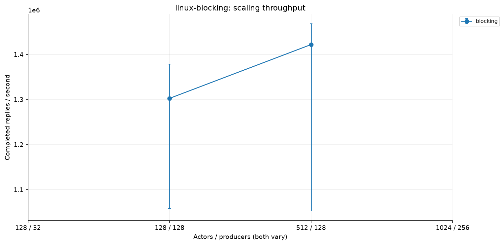

linux-blocking: scaling throughput — failed combinations are absent; see the failure table.

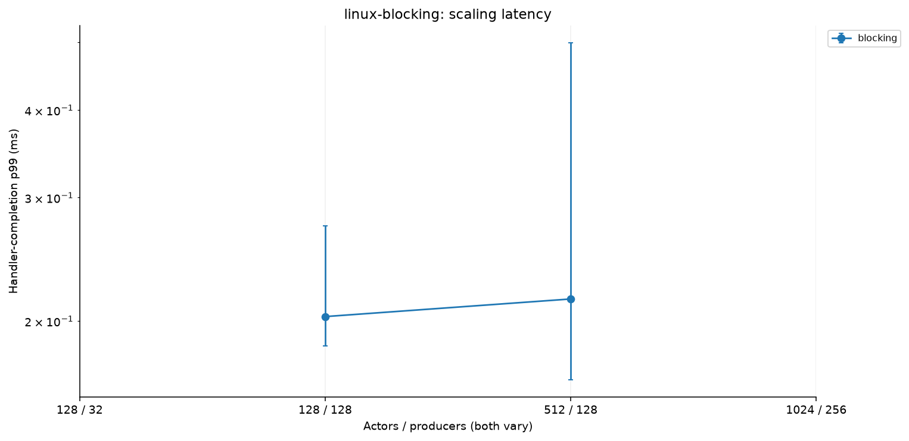

linux-blocking: scaling latency — failed combinations are absent; see the failure table.

### Median results

| Variant | Case | Successful samples | Replies/s | p99 (ms) | Peak RSS (MB) |
|---|---|---:|---:|---:|---:|
| blocking | active128_p128 | 3 | 1,302,322 | 0.2029 | 26.2 |
| blocking | active512_p128 | 3 | 1,421,711 | 0.2150 | 51.2 |
| blocking | rpc1 | 3 | 71,107 | 0.0140 | 5.7 |

## linux-main

Source `d4c7e1f171700ed6e16594aa0cddc02bb7203806`; Linux-7.2.12-orbstack-00394-gbecdd6130068-aarch64-with-glibc2.36; rustc 1.93.1 (01f6ddf75 2026-02-11). 300/300 samples completed, 29,909,070 measured requests/exchanges.

Descriptor limits: `[20480, 1048576]`; requested child limit `0`. Linux cgroup limits: `{'/sys/fs/cgroup/cpuset.cpus.effective': '0-3', '/sys/fs/cgroup/cpu.max': 'max 100000', '/sys/fs/cgroup/memory.max': '8589934592', '/sys/fs/cgroup/pids.max': '4096'}`.

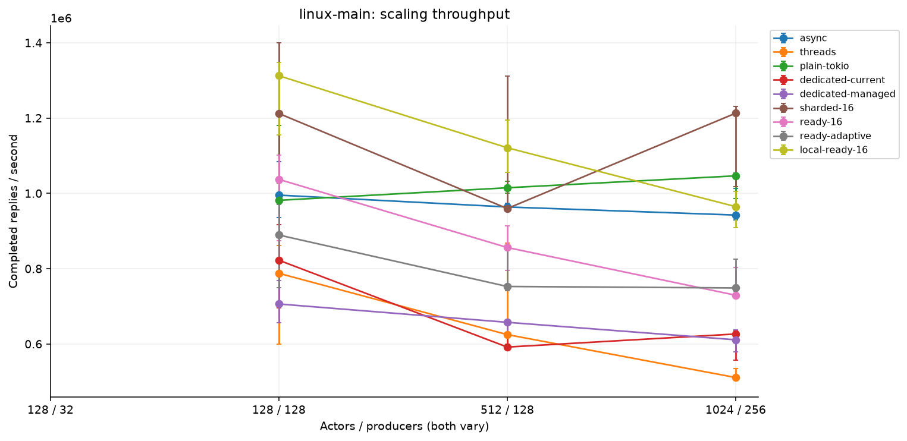

linux-main: scaling throughput — failed combinations are absent; see the failure table.

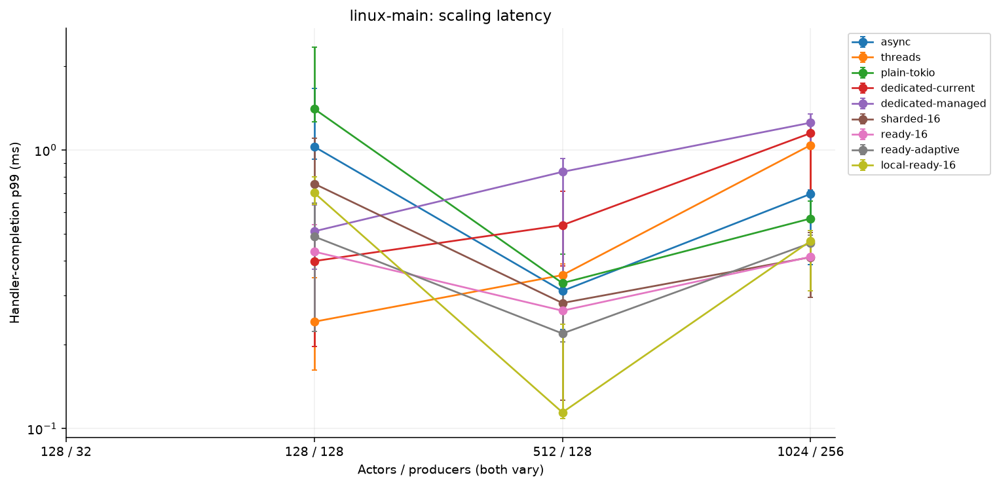

linux-main: scaling latency — failed combinations are absent; see the failure table.

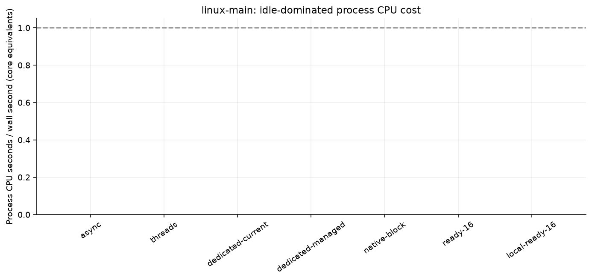

Idle cost includes warmup/startup and one measured request; it is not a power measurement.

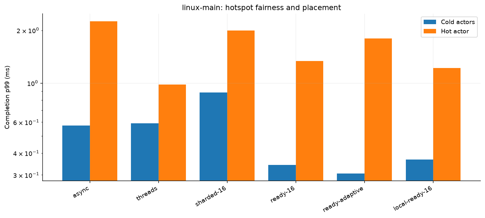

Static placement puts the hot actor on one shard; this tests imbalance as well as batch policy.

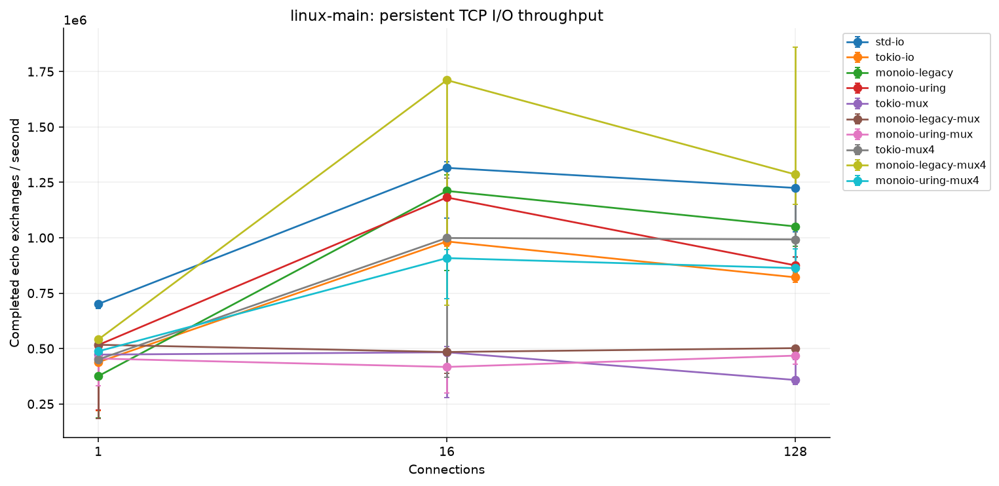

linux-main: persistent TCP I/O throughput — failed combinations are absent; see the failure table.

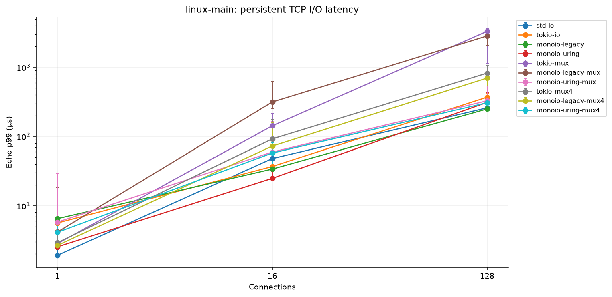

linux-main: persistent TCP I/O latency — failed combinations are absent; see the failure table.

### Median results

| Variant | Case | Successful samples | Replies/s | p99 (ms) | Peak RSS (MB) |
|---|---|---:|---:|---:|---:|
| async | active1024_p256 | 3 | 942,293 | 0.6962 | 45.5 |
| async | active128_p128 | 3 | 995,227 | 1.0291 | 24.2 |
| async | active512_p128 | 3 | 963,801 | 0.3118 | 44.0 |
| async | alloc1 | 3 | 75,312 | 0.0185 | 5.6 |
| async | hotspot128 | 3 | 343,898 | 2.1110 | 24.2 |
| async | idle4 | 3 | — (idle probe) | 0.0703 | 2.5 |
| async | rpc1 | 3 | 70,036 | 0.0211 | 5.5 |
| dedicated-current | active1024_p256 | 3 | 626,403 | 1.1512 | 81.6 |
| dedicated-current | active128_p128 | 3 | 822,366 | 0.3994 | 28.1 |
| dedicated-current | active512_p128 | 3 | 591,736 | 0.5377 | 63.2 |
| dedicated-current | alloc1 | 3 | 97,571 | 0.0112 | 5.7 |
| dedicated-current | hotspot128 | 3 | 506,525 | 0.5639 | 28.8 |
| dedicated-current | idle4 | 3 | — (idle probe) | 0.0822 | 2.6 |
| dedicated-current | rpc1 | 3 | 71,420 | 0.0128 | 5.7 |
| dedicated-managed | active1024_p256 | 3 | 611,083 | 1.2550 | 61.3 |
| dedicated-managed | active128_p128 | 3 | 706,157 | 0.5109 | 26.1 |
| dedicated-managed | active512_p128 | 3 | 657,473 | 0.8356 | 51.0 |
| dedicated-managed | alloc1 | 3 | 105,110 | 0.0143 | 5.7 |
| dedicated-managed | hotspot128 | 3 | 502,145 | 0.5166 | 26.1 |
| dedicated-managed | idle4 | 3 | — (idle probe) | 0.0804 | 2.5 |
| dedicated-managed | rpc1 | 3 | 86,252 | 0.0139 | 5.7 |
| local-ready-16 | active1024_p256 | 3 | 964,785 | 0.4717 | 72.9 |
| local-ready-16 | active128_p128 | 3 | 1,312,343 | 0.7026 | 35.1 |
| local-ready-16 | active512_p128 | 3 | 1,121,072 | 0.1142 | 56.4 |
| local-ready-16 | alloc1 | 3 | 71,732 | 0.0150 | 5.8 |
| local-ready-16 | hotspot128 | 3 | 345,194 | 1.1105 | 35.2 |
| local-ready-16 | idle4 | 3 | — (idle probe) | 0.0833 | 2.7 |
| local-ready-16 | rpc1 | 3 | 67,482 | 0.0181 | 6.0 |
| monoio-legacy | 1 | 3 | 375,562 | 0.0065 | 2.3 |
| monoio-legacy | 128 | 3 | 1,051,069 | 0.2500 | 14.1 |
| monoio-legacy | 16 | 3 | 1,211,244 | 0.0338 | 4.0 |
| monoio-legacy-mux | 1 | 3 | 516,882 | 0.0042 | 2.3 |
| monoio-legacy-mux | 128 | 3 | 501,682 | 2.8448 | 6.8 |
| monoio-legacy-mux | 16 | 3 | 484,239 | 0.3155 | 2.8 |
| monoio-legacy-mux4 | 1 | 3 | 540,631 | 0.0027 | 2.3 |
| monoio-legacy-mux4 | 128 | 3 | 1,285,613 | 0.6997 | 7.0 |
| monoio-legacy-mux4 | 16 | 3 | 1,711,372 | 0.0728 | 3.2 |
| monoio-uring | 1 | 3 | 515,869 | 0.0025 | 2.5 |
| monoio-uring | 128 | 3 | 875,246 | 0.3111 | 26.2 |
| monoio-uring | 16 | 3 | 1,181,800 | 0.0249 | 5.0 |
| monoio-uring-mux | 1 | 3 | 454,708 | 0.0058 | 2.4 |
| monoio-uring-mux | 128 | 3 | 467,831 | 0.3282 | 7.2 |
| monoio-uring-mux | 16 | 3 | 416,817 | 0.0596 | 2.9 |
| monoio-uring-mux4 | 1 | 3 | 487,389 | 0.0041 | 2.5 |
| monoio-uring-mux4 | 128 | 3 | 862,842 | 0.3072 | 7.2 |
| monoio-uring-mux4 | 16 | 3 | 908,049 | 0.0577 | 3.4 |
| native-block | active1024_p256 | 3 | 637,594 | 0.6220 | 81.9 |
| native-block | active128_p128 | 3 | 885,188 | 0.2490 | 34.7 |
| native-block | active512_p128 | 3 | 1,472,281 | 0.2440 | 63.6 |
| native-block | alloc1 | 3 | 77,046 | 0.0125 | 5.8 |
| native-block | hotspot128 | 3 | 430,120 | 1.0003 | 35.2 |
| native-block | idle4 | 3 | — (idle probe) | 0.0906 | 2.7 |
| native-block | rpc1 | 3 | 81,054 | 0.0115 | 5.8 |
| plain-tokio | active1024_p256 | 3 | 1,046,428 | 0.5680 | 48.4 |
| plain-tokio | active128_p128 | 3 | 981,436 | 1.4070 | 24.2 |
| plain-tokio | active512_p128 | 3 | 1,014,793 | 0.3328 | 44.5 |
| plain-tokio | alloc1 | 3 | 91,380 | 0.0167 | 5.6 |
| plain-tokio | hotspot128 | 3 | 343,397 | 2.1282 | 24.2 |
| plain-tokio | idle4 | 3 | — (idle probe) | 0.1160 | 2.5 |
| plain-tokio | rpc1 | 3 | 89,211 | 0.0173 | 5.6 |
| ready-16 | active1024_p256 | 3 | 729,437 | 0.4137 | 72.7 |
| ready-16 | active128_p128 | 3 | 1,037,096 | 0.4319 | 35.2 |
| ready-16 | active512_p128 | 3 | 856,171 | 0.2649 | 56.5 |
| ready-16 | alloc1 | 3 | 63,768 | 0.0248 | 6.0 |
| ready-16 | hotspot128 | 3 | 306,780 | 1.2698 | 35.2 |
| ready-16 | idle4 | 3 | — (idle probe) | 0.1174 | 2.7 |
| ready-16 | rpc1 | 3 | 68,721 | 0.0167 | 5.8 |
| ready-adaptive | active1024_p256 | 3 | 748,750 | 0.4637 | 73.0 |
| ready-adaptive | active128_p128 | 3 | 889,312 | 0.4893 | 35.1 |
| ready-adaptive | active512_p128 | 3 | 752,656 | 0.2194 | 56.4 |
| ready-adaptive | alloc1 | 3 | 69,809 | 0.0172 | 6.0 |
| ready-adaptive | hotspot128 | 3 | 294,399 | 1.5932 | 35.2 |
| ready-adaptive | idle4 | 3 | — (idle probe) | 0.0632 | 2.7 |
| ready-adaptive | rpc1 | 3 | 65,566 | 0.0183 | 5.8 |
| sharded-16 | active1024_p256 | 3 | 1,212,820 | 0.4126 | 71.4 |
| sharded-16 | active128_p128 | 3 | 1,212,093 | 0.7574 | 35.0 |
| sharded-16 | active512_p128 | 3 | 959,581 | 0.2823 | 56.3 |
| sharded-16 | alloc1 | 3 | 75,455 | 0.0114 | 5.7 |
| sharded-16 | hotspot128 | 3 | 321,000 | 1.7729 | 34.9 |
| sharded-16 | idle4 | 3 | — (idle probe) | 0.0744 | 2.7 |
| sharded-16 | rpc1 | 3 | 119,962 | 0.0116 | 6.0 |
| std-io | 1 | 3 | 700,957 | 0.0019 | 2.4 |
| std-io | 128 | 3 | 1,224,758 | 0.2596 | 7.9 |
| std-io | 16 | 3 | 1,315,403 | 0.0480 | 3.1 |
| threads | active1024_p256 | 3 | 510,856 | 1.0426 | 69.6 |
| threads | active128_p128 | 3 | 787,639 | 0.2418 | 30.8 |
| threads | active512_p128 | 3 | 624,858 | 0.3557 | 56.4 |
| threads | alloc1 | 3 | 68,831 | 0.0170 | 5.7 |
| threads | hotspot128 | 3 | 421,254 | 0.8520 | 32.5 |
| threads | idle4 | 3 | — (idle probe) | 0.0525 | 2.5 |
| threads | rpc1 | 3 | 73,428 | 0.0133 | 5.7 |
| tokio-io | 1 | 3 | 438,428 | 0.0056 | 2.5 |
| tokio-io | 128 | 3 | 821,348 | 0.3698 | 11.6 |
| tokio-io | 16 | 3 | 983,199 | 0.0369 | 3.6 |
| tokio-mux | 1 | 3 | 472,535 | 0.0028 | 2.4 |
| tokio-mux | 128 | 3 | 357,969 | 3.3222 | 7.0 |
| tokio-mux | 16 | 3 | 483,095 | 0.1428 | 3.0 |
| tokio-mux4 | 1 | 3 | 450,767 | 0.0029 | 2.3 |
| tokio-mux4 | 128 | 3 | 992,365 | 0.8249 | 7.0 |
| tokio-mux4 | 16 | 3 | 998,707 | 0.0925 | 3.1 |

## linux-pool4

Source `d4c7e1f171700ed6e16594aa0cddc02bb7203806`; Linux-7.2.12-orbstack-00394-gbecdd6130068-aarch64-with-glibc2.36; rustc 1.93.1 (01f6ddf75 2026-02-11). 54/54 samples completed, 9,437,184 measured requests/exchanges.

Descriptor limits: `[20480, 1048576]`; requested child limit `0`. Linux cgroup limits: `{'/sys/fs/cgroup/cpuset.cpus.effective': '0-3', '/sys/fs/cgroup/cpu.max': 'max 100000', '/sys/fs/cgroup/memory.max': '8589934592', '/sys/fs/cgroup/pids.max': '4096'}`.

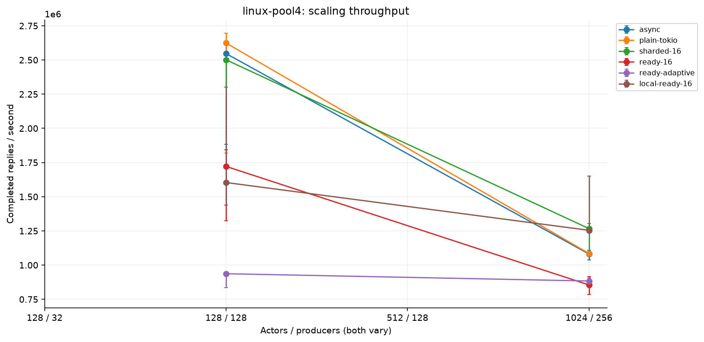

linux-pool4: scaling throughput — failed combinations are absent; see the failure table.

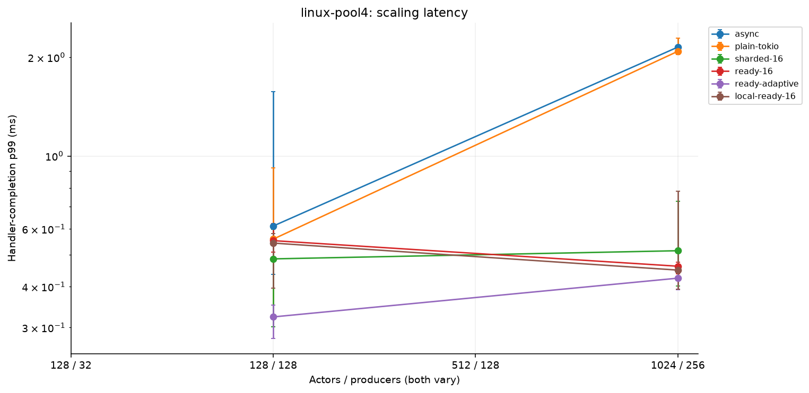

linux-pool4: scaling latency — failed combinations are absent; see the failure table.

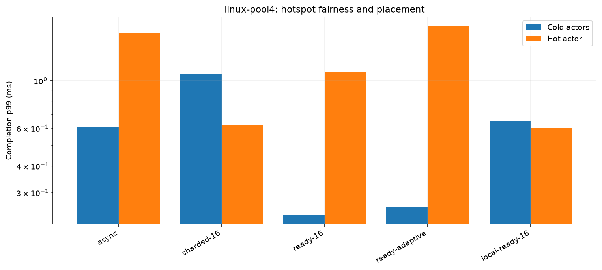

Static placement puts the hot actor on one shard; this tests imbalance as well as batch policy.

### Median results

| Variant | Case | Successful samples | Replies/s | p99 (ms) | Peak RSS (MB) |
|---|---|---:|---:|---:|---:|
| async | active1024_p256 | 3 | 1,081,213 | 2.1498 | 45.5 |
| async | active128_p128 | 3 | 2,546,672 | 0.6116 | 24.2 |
| async | hotspot128 | 3 | 387,319 | 1.4184 | 24.1 |
| local-ready-16 | active1024_p256 | 3 | 1,254,441 | 0.4487 | 72.4 |
| local-ready-16 | active128_p128 | 3 | 1,603,768 | 0.5425 | 35.4 |
| local-ready-16 | hotspot128 | 3 | 404,286 | 0.6340 | 35.6 |
| plain-tokio | active1024_p256 | 3 | 1,085,376 | 2.0870 | 48.4 |
| plain-tokio | active128_p128 | 3 | 2,623,838 | 0.5578 | 24.2 |
| plain-tokio | hotspot128 | 3 | 389,754 | 1.4575 | 24.3 |
| ready-16 | active1024_p256 | 3 | 855,141 | 0.4611 | 73.0 |
| ready-16 | active128_p128 | 3 | 1,721,615 | 0.5519 | 35.2 |
| ready-16 | hotspot128 | 3 | 358,306 | 0.9741 | 35.5 |
| ready-adaptive | active1024_p256 | 3 | 883,769 | 0.4240 | 73.0 |
| ready-adaptive | active128_p128 | 3 | 936,961 | 0.3229 | 35.1 |
| ready-adaptive | hotspot128 | 3 | 348,259 | 1.4122 | 35.5 |
| sharded-16 | active1024_p256 | 3 | 1,266,961 | 0.5141 | 71.1 |
| sharded-16 | active128_p128 | 3 | 2,501,273 | 0.4855 | 35.3 |
| sharded-16 | hotspot128 | 3 | 410,262 | 0.8578 | 35.2 |

## mac-blocking

Source `53eb0d01c30ba98d05f3158df42d04114ede985b`; macOS-26.6.2-arm64-arm-64bit-Mach-O; rustc 1.93.0 (254b59607 2026-01-19) (built from a source tarball). 9/12 samples completed, 1,277,952 measured requests/exchanges.

Descriptor limits: `[4096, 9223372036854775807]`; requested child limit `0`. Linux cgroup limits: `{}`.

### Failed combinations

| Variant | Case | Status | Samples |
|---|---|---|---:|
| blocking | active1024_p256 | timeout | 3 |

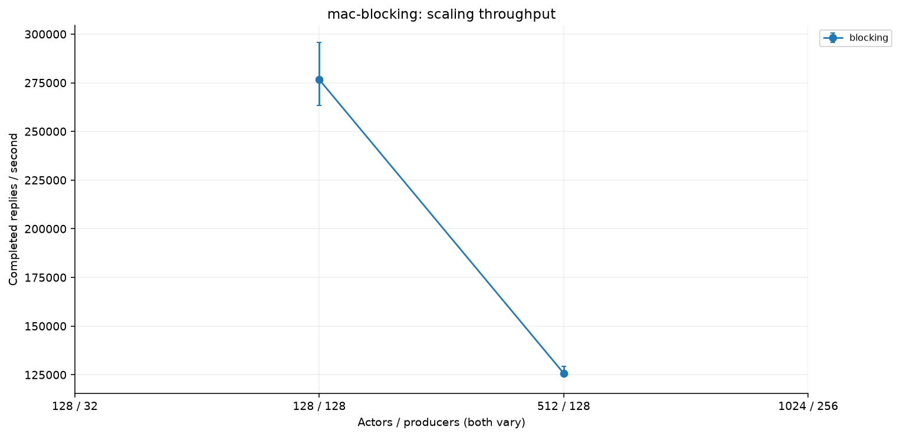

mac-blocking: scaling throughput — failed combinations are absent; see the failure table.

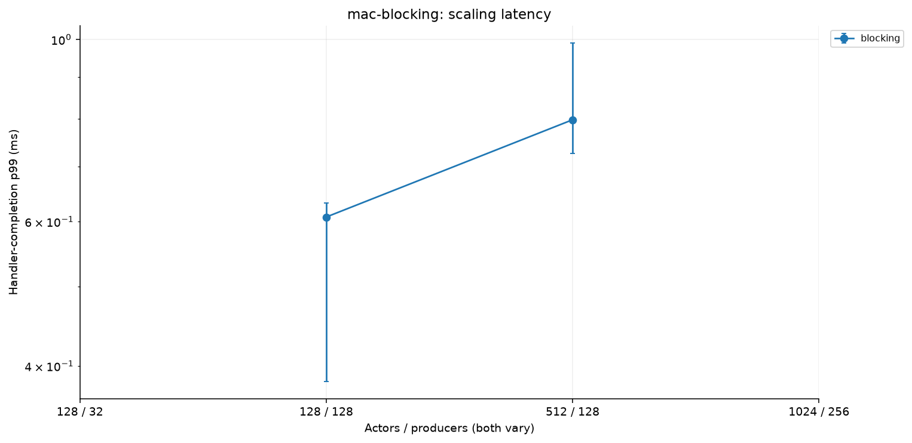

mac-blocking: scaling latency — failed combinations are absent; see the failure table.

### Median results

| Variant | Case | Successful samples | Replies/s | p99 (ms) | Peak RSS (MB) |
|---|---|---:|---:|---:|---:|
| blocking | active128_p128 | 3 | 276,617 | 0.6075 | 25.5 |
| blocking | active512_p128 | 3 | 125,745 | 0.7983 | 49.1 |
| blocking | rpc1 | 3 | 177,133 | 0.0079 | 11.4 |

## mac-capacity

Source `aae6312e1b5dd238101581079cf617006b47103b`; macOS-26.6.2-arm64-arm-64bit-Mach-O; rustc 1.93.0 (254b59607 2026-01-19) (built from a source tarball). 24/24 samples completed, 3,145,728 measured requests/exchanges.

Descriptor limits: `[4096, 9223372036854775807]`; requested child limit `0`. Linux cgroup limits: `{}`.

### Median results

| Variant | Case | Successful samples | Replies/s | p99 (ms) | Peak RSS (MB) |
|---|---|---:|---:|---:|---:|
| async-reply-bounded | burst32 | 3 | 590,797 | 193.4954 | 120.2 |
| local-ready-16 | burst32 | 3 | 777,989 | 135.1638 | 115.8 |
| native-block | burst32 | 3 | 990,683 | 100.9252 | 102.8 |
| native-hybrid | burst32 | 3 | 977,563 | 102.2245 | 91.9 |
| native-spin | burst32 | 3 | 946,967 | 106.9698 | 106.5 |
| ready-16 | burst32 | 3 | 584,478 | 183.1269 | 130.8 |
| ready-adaptive | burst32 | 3 | 721,273 | 145.4085 | 121.6 |
| sharded-16 | burst32 | 3 | 1,102,095 | 91.3494 | 103.5 |

## mac-fd

Source `aae6312e1b5dd238101581079cf617006b47103b`; macOS-26.6.2-arm64-arm-64bit-Mach-O; rustc 1.93.0 (254b59607 2026-01-19) (built from a source tarball). 3/3 samples completed, 786,432 measured requests/exchanges.

Descriptor limits: `[4096, 9223372036854775807]`; requested child limit `16384`. Linux cgroup limits: `{}`.

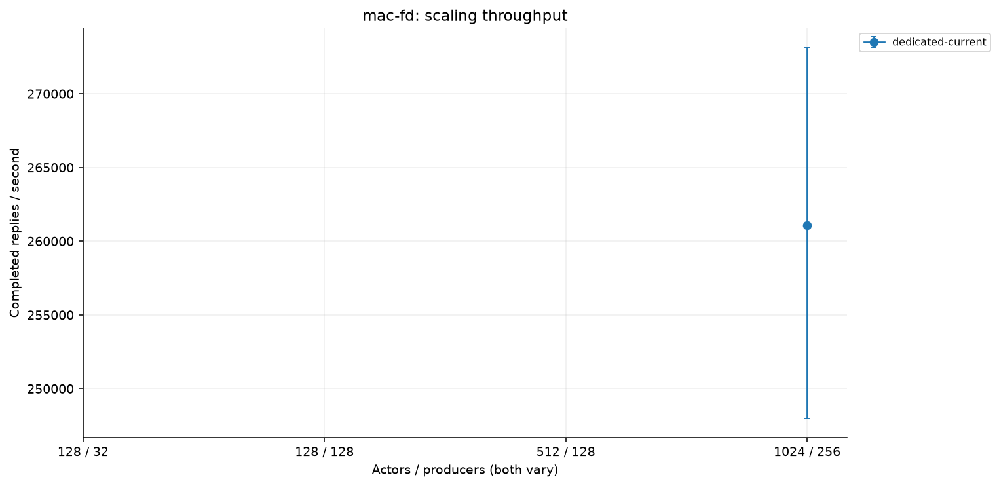

mac-fd: scaling throughput — failed combinations are absent; see the failure table.

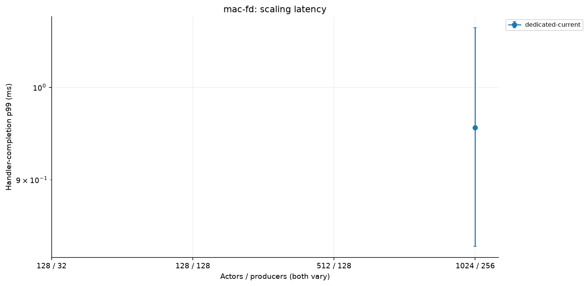

mac-fd: scaling latency — failed combinations are absent; see the failure table.

### Median results

| Variant | Case | Successful samples | Replies/s | p99 (ms) | Peak RSS (MB) |
|---|---|---:|---:|---:|---:|
| dedicated-current | active1024_p256 | 3 | 261,070 | 0.9550 | 87.6 |

## mac-io

Source `53eb0d01c30ba98d05f3158df42d04114ede985b`; macOS-26.6.2-arm64-arm-64bit-Mach-O; rustc 1.93.0 (254b59607 2026-01-19) (built from a source tarball). 63/63 samples completed, 3,045,000 measured requests/exchanges.

Descriptor limits: `[4096, 9223372036854775807]`; requested child limit `0`. Linux cgroup limits: `{}`.

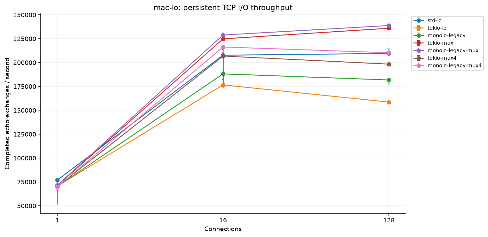

mac-io: persistent TCP I/O throughput — failed combinations are absent; see the failure table.

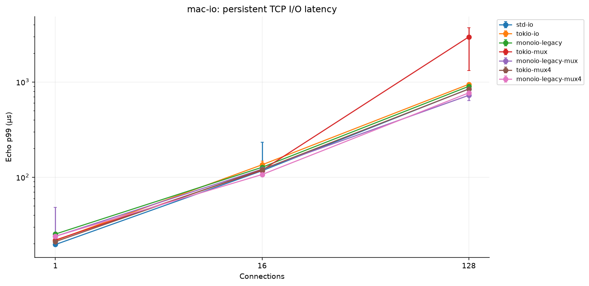

mac-io: persistent TCP I/O latency — failed combinations are absent; see the failure table.

### Median results

| Variant | Case | Successful samples | Replies/s | p99 (ms) | Peak RSS (MB) |
|---|---|---:|---:|---:|---:|
| monoio-legacy | 1 | 3 | 70,175 | 0.0253 | 2.3 |
| monoio-legacy | 128 | 3 | 181,782 | 0.8999 | 14.1 |
| monoio-legacy | 16 | 3 | 188,116 | 0.1270 | 3.9 |
| monoio-legacy-mux | 1 | 3 | 71,430 | 0.0239 | 2.4 |
| monoio-legacy-mux | 128 | 3 | 238,774 | 0.7242 | 6.2 |
| monoio-legacy-mux | 16 | 3 | 228,855 | 0.1215 | 2.9 |
| monoio-legacy-mux4 | 1 | 3 | 69,828 | 0.0240 | 2.4 |
| monoio-legacy-mux4 | 128 | 3 | 210,304 | 0.7683 | 6.5 |
| monoio-legacy-mux4 | 16 | 3 | 216,291 | 0.1067 | 3.1 |
| std-io | 1 | 3 | 76,810 | 0.0196 | 2.2 |
| std-io | 128 | 3 | 209,556 | 0.8452 | 9.0 |
| std-io | 16 | 3 | 207,708 | 0.1169 | 3.2 |
| tokio-io | 1 | 3 | 70,512 | 0.0217 | 2.5 |
| tokio-io | 128 | 3 | 158,603 | 0.9455 | 12.7 |
| tokio-io | 16 | 3 | 176,593 | 0.1350 | 3.8 |
| tokio-mux | 1 | 3 | 71,110 | 0.0219 | 2.5 |
| tokio-mux | 128 | 3 | 235,927 | 2.9737 | 6.3 |
| tokio-mux | 16 | 3 | 224,840 | 0.1183 | 3.0 |
| tokio-mux4 | 1 | 3 | 70,024 | 0.0210 | 2.5 |
| tokio-mux4 | 128 | 3 | 198,368 | 0.8429 | 6.5 |
| tokio-mux4 | 16 | 3 | 206,801 | 0.1205 | 3.1 |

## mac-main

Source `aae6312e1b5dd238101581079cf617006b47103b`; macOS-26.6.2-arm64-arm-64bit-Mach-O; rustc 1.93.0 (254b59607 2026-01-19) (built from a source tarball). 609/612 samples completed, 54,884,475 measured requests/exchanges.

Descriptor limits: `[4096, 9223372036854775807]`; requested child limit `0`. Linux cgroup limits: `{}`.

### Failed combinations

| Variant | Case | Status | Samples |
|---|---|---|---:|
| dedicated-current | active1024_p256 | exit_101 | 3 |

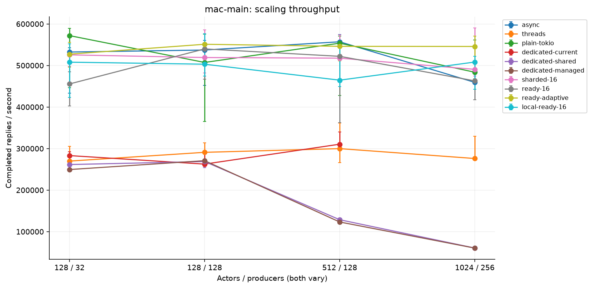

mac-main: scaling throughput — failed combinations are absent; see the failure table.

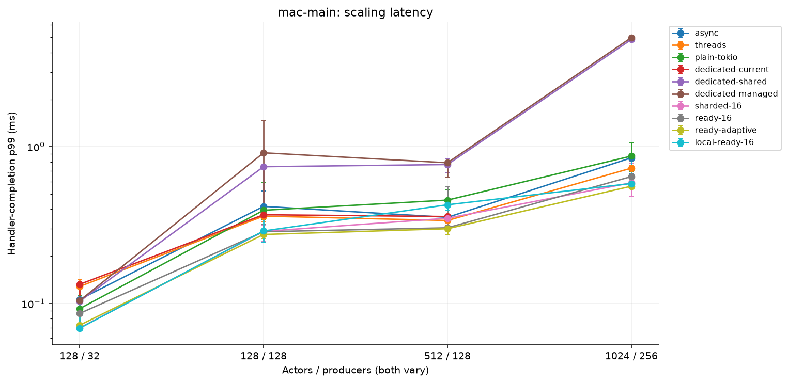

mac-main: scaling latency — failed combinations are absent; see the failure table.

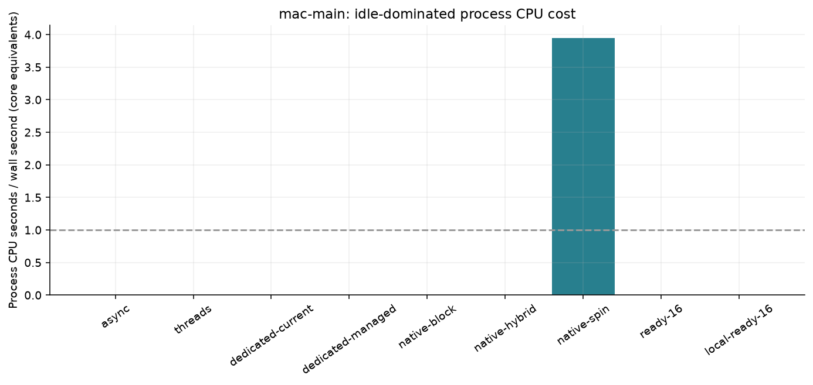

Idle cost includes warmup/startup and one measured request; it is not a power measurement.

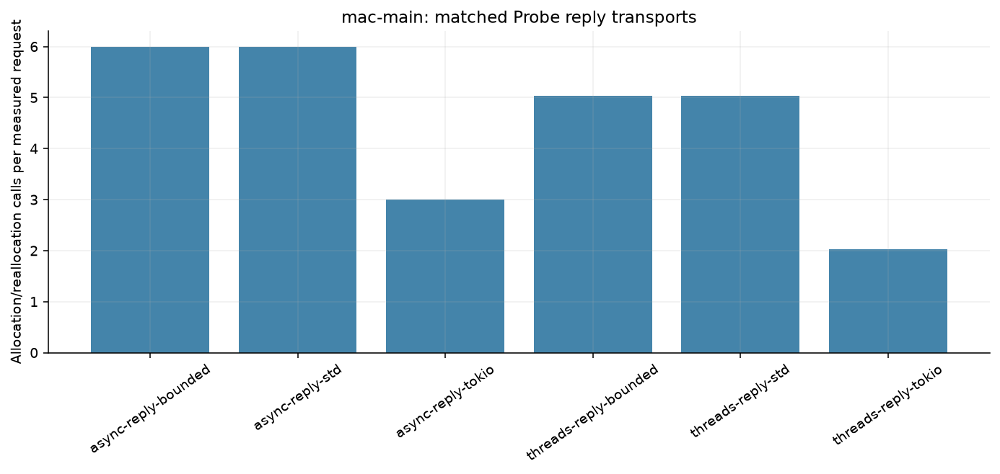

Counts include benchmark-driver work; compared message shapes are matched within the Probe group.

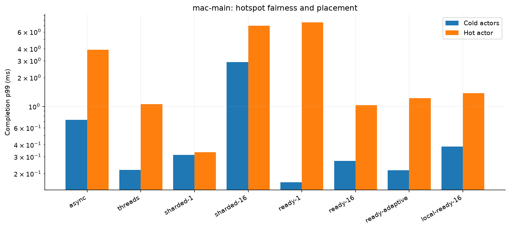

Static placement puts the hot actor on one shard; this tests imbalance as well as batch policy.

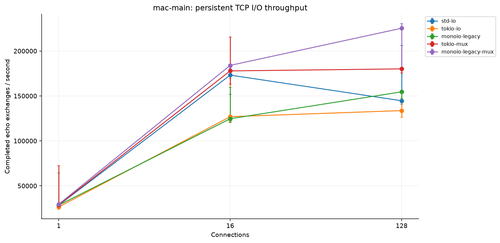

mac-main: persistent TCP I/O throughput — failed combinations are absent; see the failure table.

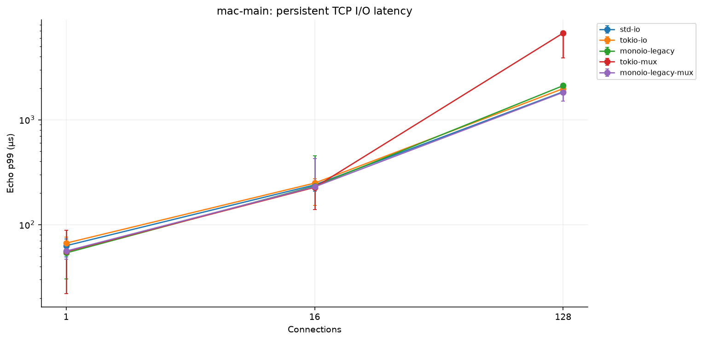

mac-main: persistent TCP I/O latency — failed combinations are absent; see the failure table.

### Median results

| Variant | Case | Successful samples | Replies/s | p99 (ms) | Peak RSS (MB) |
|---|---|---:|---:|---:|---:|
| async | active1024_p256 | 3 | 459,298 | 0.8500 | 41.1 |
| async | active128_p128 | 3 | 537,195 | 0.4162 | 22.9 |
| async | active128_p32 | 3 | 532,346 | 0.1060 | 23.0 |
| async | active512_p128 | 3 | 557,046 | 0.3542 | 38.9 |
| async | alloc1 | 3 | 109,226 | 0.0210 | 11.4 |
| async | burst32 | 3 | 532,875 | 221.1438 | 50.4 |
| async | hotspot128 | 3 | 332,611 | 2.9513 | 22.9 |
| async | idle4 | 3 | — (idle probe) | 0.0369 | 7.0 |
| async | lowload | 3 | 4,997 | 1.6249 | 10.7 |
| async | overload | 3 | 163,434 | 165.3509 | 21.0 |
| async | rpc1 | 3 | 109,095 | 0.0195 | 11.4 |
| async-reply-bounded | alloc1 | 3 | 118,790 | 0.0153 | 11.5 |
| async-reply-bounded | burst32 | 3 | 463,408 | 259.5476 | 125.3 |
| async-reply-bounded | rpc1 | 3 | 77,083 | 0.0268 | 11.5 |
| async-reply-std | alloc1 | 3 | 88,128 | 0.0295 | 11.5 |
| async-reply-std | burst32 | 3 | 557,946 | 205.4803 | 121.9 |
| async-reply-std | rpc1 | 3 | 121,514 | 0.0146 | 11.4 |
| async-reply-tokio | alloc1 | 3 | 118,320 | 0.0159 | 11.4 |
| async-reply-tokio | burst32 | 3 | 571,823 | 212.3992 | 59.2 |
| async-reply-tokio | rpc1 | 3 | 111,399 | 0.0154 | 11.4 |
| dedicated-current | active128_p128 | 3 | 262,580 | 0.3680 | 28.9 |
| dedicated-current | active128_p32 | 3 | 283,073 | 0.1323 | 29.1 |
| dedicated-current | active512_p128 | 3 | 310,491 | 0.3585 | 62.2 |
| dedicated-current | alloc1 | 3 | 130,983 | 0.0147 | 11.4 |
| dedicated-current | burst32 | 3 | 819,359 | 119.6092 | 48.4 |
| dedicated-current | hotspot128 | 3 | 322,615 | 0.7028 | 29.0 |
| dedicated-current | idle4 | 3 | — (idle probe) | 0.0307 | 7.2 |
| dedicated-current | lowload | 3 | 4,997 | 1.6126 | 10.9 |
| dedicated-current | overload | 3 | 304,499 | 73.5567 | 20.2 |
| dedicated-current | rpc1 | 3 | 188,799 | 0.0077 | 11.4 |
| dedicated-default | alloc1 | 3 | 105,962 | 0.0200 | 12.0 |
| dedicated-default | burst32 | 3 | 842,845 | 108.3425 | 45.9 |
| dedicated-default | idle4 | 3 | — (idle probe) | 0.0177 | 9.0 |
| dedicated-default | lowload | 3 | 4,997 | 1.6112 | 12.7 |
| dedicated-default | overload | 3 | 305,426 | 72.0152 | 21.2 |
| dedicated-default | rpc1 | 3 | 179,020 | 0.0075 | 12.0 |
| dedicated-managed | active1024_p256 | 3 | 60,381 | 4.9820 | 60.9 |
| dedicated-managed | active128_p128 | 3 | 270,841 | 0.9147 | 25.7 |
| dedicated-managed | active128_p32 | 3 | 249,474 | 0.1040 | 25.3 |
| dedicated-managed | active512_p128 | 3 | 123,230 | 0.7900 | 49.1 |
| dedicated-managed | alloc1 | 3 | 161,514 | 0.0075 | 11.4 |
| dedicated-managed | burst32 | 3 | 549,586 | 215.9487 | 53.5 |
| dedicated-managed | hotspot128 | 3 | 325,649 | 0.7921 | 25.8 |
| dedicated-managed | idle4 | 3 | — (idle probe) | 0.0300 | 7.2 |
| dedicated-managed | lowload | 3 | 4,997 | 1.6068 | 10.9 |
| dedicated-managed | overload | 3 | 306,866 | 72.1178 | 19.4 |
| dedicated-managed | rpc1 | 3 | 190,320 | 0.0077 | 11.5 |
| dedicated-one | active128_p128 | 3 | 291,519 | 0.5367 | 31.8 |
| dedicated-one | active128_p32 | 3 | 241,011 | 0.1064 | 31.4 |
| dedicated-one | active512_p128 | 3 | 125,047 | 0.6992 | 73.5 |
| dedicated-one | alloc1 | 3 | 117,808 | 0.0099 | 11.4 |
| dedicated-one | burst32 | 3 | 705,933 | 160.8278 | 46.2 |
| dedicated-one | hotspot128 | 3 | 325,577 | 0.6225 | 31.7 |
| dedicated-one | idle4 | 3 | — (idle probe) | 0.0264 | 7.3 |
| dedicated-one | lowload | 3 | 4,996 | 1.6101 | 11.0 |
| dedicated-one | overload | 3 | 302,433 | 73.7215 | 20.1 |
| dedicated-one | rpc1 | 3 | 190,810 | 0.0062 | 11.4 |
| dedicated-shared | active1024_p256 | 3 | 60,492 | 4.8431 | 61.0 |
| dedicated-shared | active128_p128 | 3 | 268,757 | 0.7456 | 25.4 |
| dedicated-shared | active128_p32 | 3 | 261,528 | 0.1031 | 25.5 |
| dedicated-shared | active512_p128 | 3 | 128,670 | 0.7697 | 49.1 |
| dedicated-shared | alloc1 | 3 | 120,602 | 0.0181 | 11.4 |
| dedicated-shared | burst32 | 3 | 564,539 | 218.7599 | 57.2 |
| dedicated-shared | hotspot128 | 3 | 329,075 | 0.5015 | 25.6 |
| dedicated-shared | idle4 | 3 | — (idle probe) | 0.0301 | 7.1 |
| dedicated-shared | lowload | 3 | 4,998 | 1.6212 | 10.8 |
| dedicated-shared | overload | 3 | 285,994 | 79.8103 | 20.0 |
| dedicated-shared | rpc1 | 3 | 183,807 | 0.0066 | 11.3 |
| local-ready-16 | active1024_p256 | 3 | 508,250 | 0.5824 | 61.3 |
| local-ready-16 | active128_p128 | 3 | 503,080 | 0.2899 | 25.5 |
| local-ready-16 | active128_p32 | 3 | 507,968 | 0.0693 | 25.7 |
| local-ready-16 | active512_p128 | 3 | 464,641 | 0.4261 | 49.0 |
| local-ready-16 | alloc1 | 3 | 204,097 | 0.0057 | 11.5 |
| local-ready-16 | burst32 | 3 | 209,491 | 2.1185 | 27.5 |
| local-ready-16 | hotspot128 | 3 | 420,753 | 1.2297 | 25.5 |
| local-ready-16 | idle4 | 3 | — (idle probe) | 0.0251 | 7.2 |
| local-ready-16 | lowload | 3 | 4,997 | 1.6152 | 10.8 |
| local-ready-16 | overload | 3 | 173,923 | 153.7802 | 14.2 |
| local-ready-16 | rpc1 | 3 | 203,531 | 0.0061 | 11.5 |
| monoio-legacy | 1 | 3 | 28,488 | 0.0539 | 2.3 |
| monoio-legacy | 128 | 3 | 154,555 | 2.1109 | 13.9 |
| monoio-legacy | 16 | 3 | 124,629 | 0.2333 | 3.9 |
| monoio-legacy-mux | 1 | 3 | 29,527 | 0.0561 | 2.4 |
| monoio-legacy-mux | 128 | 3 | 225,299 | 1.8238 | 6.2 |
| monoio-legacy-mux | 16 | 3 | 183,986 | 0.2298 | 2.8 |
| native-block | active1024_p256 | 3 | 301,489 | 0.7227 | 81.8 |
| native-block | active128_p128 | 3 | 314,843 | 0.3550 | 28.5 |
| native-block | active128_p32 | 3 | 305,132 | 0.0968 | 28.1 |
| native-block | active512_p128 | 3 | 287,722 | 0.3320 | 59.5 |
| native-block | alloc1 | 3 | 203,635 | 0.0053 | 11.5 |
| native-block | burst32 | 3 | 206,650 | 2.0633 | 25.7 |
| native-block | hotspot128 | 3 | 290,126 | 0.6445 | 28.5 |
| native-block | idle4 | 3 | — (idle probe) | 0.1025 | 7.2 |
| native-block | lowload | 3 | 4,997 | 1.6148 | 10.8 |
| native-block | overload | 3 | 242,154 | 102.1975 | 14.0 |
| native-block | rpc1 | 3 | 149,986 | 0.0123 | 11.5 |
| native-hybrid | alloc1 | 3 | 328,083 | 0.0057 | 11.5 |
| native-hybrid | burst32 | 3 | 199,877 | 2.1760 | 26.1 |
| native-hybrid | idle4 | 3 | — (idle probe) | 0.0271 | 7.2 |
| native-hybrid | lowload | 3 | 4,997 | 1.6118 | 10.8 |
| native-hybrid | overload | 3 | 239,050 | 103.2799 | 14.5 |
| native-hybrid | rpc1 | 3 | 266,177 | 0.0070 | 11.5 |
| native-spin | alloc1 | 3 | 353,589 | 0.0029 | 11.4 |
| native-spin | burst32 | 3 | 211,016 | 2.1383 | 25.3 |
| native-spin | idle4 | 3 | — (idle probe) | 0.0049 | 7.2 |
| native-spin | lowload | 3 | 4,998 | 1.6078 | 10.9 |
| native-spin | overload | 3 | 243,490 | 101.0765 | 14.8 |
| native-spin | rpc1 | 3 | 350,727 | 0.0008 | 11.4 |
| plain-tokio | active1024_p256 | 3 | 483,729 | 0.8720 | 42.2 |
| plain-tokio | active128_p128 | 3 | 507,289 | 0.3931 | 23.3 |
| plain-tokio | active128_p32 | 3 | 571,885 | 0.0925 | 23.2 |
| plain-tokio | active512_p128 | 3 | 553,698 | 0.4564 | 40.4 |
| plain-tokio | alloc1 | 3 | 116,688 | 0.0179 | 11.3 |
| plain-tokio | burst32 | 3 | 649,572 | 156.5742 | 48.0 |
| plain-tokio | hotspot128 | 3 | 437,890 | 2.5061 | 23.1 |
| plain-tokio | idle4 | 3 | — (idle probe) | 0.0398 | 7.0 |
| plain-tokio | lowload | 3 | 4,999 | 1.6203 | 10.7 |
| plain-tokio | overload | 3 | 185,815 | 141.8770 | 20.9 |
| plain-tokio | rpc1 | 3 | 129,447 | 0.0140 | 11.3 |
| ready-1 | active1024_p256 | 3 | 555,402 | 0.5393 | 61.3 |
| ready-1 | active128_p128 | 3 | 464,537 | 0.3505 | 26.1 |
| ready-1 | active128_p32 | 3 | 512,023 | 0.1134 | 25.7 |
| ready-1 | active512_p128 | 3 | 425,186 | 0.4397 | 47.6 |
| ready-1 | alloc1 | 3 | 93,923 | 0.0217 | 11.6 |
| ready-1 | burst32 | 3 | 142,659 | 2.7554 | 26.0 |
| ready-1 | hotspot128 | 3 | 227,219 | 0.5800 | 25.5 |
| ready-1 | idle4 | 3 | — (idle probe) | 0.0165 | 7.2 |
| ready-1 | lowload | 3 | 4,997 | 1.6183 | 10.8 |
| ready-1 | overload | 3 | 145,241 | 191.9173 | 14.1 |
| ready-1 | rpc1 | 3 | 114,698 | 0.0117 | 11.5 |
| ready-16 | active1024_p256 | 3 | 462,953 | 0.6451 | 61.4 |
| ready-16 | active128_p128 | 3 | 539,871 | 0.2867 | 25.6 |
| ready-16 | active128_p32 | 3 | 455,518 | 0.0862 | 25.7 |
| ready-16 | active512_p128 | 3 | 522,034 | 0.3037 | 49.0 |
| ready-16 | alloc1 | 3 | 121,513 | 0.0147 | 11.5 |
| ready-16 | burst32 | 3 | 145,644 | 3.7597 | 25.2 |
| ready-16 | hotspot128 | 3 | 323,163 | 1.0068 | 26.2 |
| ready-16 | idle4 | 3 | — (idle probe) | 0.0257 | 7.2 |
| ready-16 | lowload | 3 | 4,997 | 1.6149 | 10.8 |
| ready-16 | overload | 3 | 142,852 | 195.4335 | 14.2 |
| ready-16 | rpc1 | 3 | 90,695 | 0.0174 | 11.5 |
| ready-adaptive | active1024_p256 | 3 | 545,723 | 0.5601 | 61.3 |
| ready-adaptive | active128_p128 | 3 | 551,057 | 0.2753 | 25.6 |
| ready-adaptive | active128_p32 | 3 | 527,227 | 0.0725 | 25.8 |
| ready-adaptive | active512_p128 | 3 | 546,127 | 0.2995 | 49.0 |
| ready-adaptive | alloc1 | 3 | 86,078 | 0.0245 | 11.6 |
| ready-adaptive | burst32 | 3 | 134,033 | 3.4828 | 25.3 |
| ready-adaptive | hotspot128 | 3 | 382,296 | 1.0708 | 25.5 |
| ready-adaptive | idle4 | 3 | — (idle probe) | 0.0138 | 7.2 |
| ready-adaptive | lowload | 3 | 4,997 | 1.6164 | 10.8 |
| ready-adaptive | overload | 3 | 168,179 | 160.8217 | 14.1 |
| ready-adaptive | rpc1 | 3 | 134,073 | 0.0080 | 11.5 |
| sharded-1 | active1024_p256 | 3 | 461,088 | 0.6653 | 61.1 |
| sharded-1 | active128_p128 | 3 | 574,399 | 0.2652 | 25.4 |
| sharded-1 | active128_p32 | 3 | 520,393 | 0.0807 | 25.8 |
| sharded-1 | active512_p128 | 3 | 580,335 | 0.2782 | 48.9 |
| sharded-1 | alloc1 | 3 | 173,704 | 0.0093 | 11.5 |
| sharded-1 | burst32 | 3 | 156,161 | 3.4675 | 25.2 |
| sharded-1 | hotspot128 | 3 | 357,901 | 0.3112 | 25.4 |
| sharded-1 | idle4 | 3 | — (idle probe) | 0.0325 | 7.1 |
| sharded-1 | lowload | 3 | 4,998 | 1.6179 | 10.8 |
| sharded-1 | overload | 3 | 174,097 | 153.1407 | 14.1 |
| sharded-1 | rpc1 | 3 | 137,513 | 0.0155 | 11.5 |
| sharded-16 | active1024_p256 | 3 | 490,677 | 0.5890 | 61.1 |
| sharded-16 | active128_p128 | 3 | 519,161 | 0.2881 | 25.4 |
| sharded-16 | active128_p32 | 3 | 525,531 | 0.0697 | 25.8 |
| sharded-16 | active512_p128 | 3 | 517,600 | 0.3495 | 48.8 |
| sharded-16 | alloc1 | 3 | 209,778 | 0.0068 | 11.5 |
| sharded-16 | burst32 | 3 | 183,337 | 2.3165 | 25.2 |
| sharded-16 | hotspot128 | 3 | 355,901 | 4.4974 | 25.4 |
| sharded-16 | idle4 | 3 | — (idle probe) | 0.0301 | 7.1 |
| sharded-16 | lowload | 3 | 4,997 | 1.6125 | 10.8 |
| sharded-16 | overload | 3 | 132,072 | 212.8420 | 14.2 |
| sharded-16 | rpc1 | 3 | 200,793 | 0.0057 | 11.4 |
| std-io | 1 | 3 | 28,447 | 0.0631 | 2.2 |
| std-io | 128 | 3 | 144,658 | 1.8445 | 8.9 |
| std-io | 16 | 3 | 173,161 | 0.2393 | 3.1 |
| threads | active1024_p256 | 3 | 276,040 | 0.7301 | 61.4 |
| threads | active128_p128 | 3 | 290,930 | 0.3606 | 25.5 |
| threads | active128_p32 | 3 | 269,847 | 0.1282 | 25.5 |
| threads | active512_p128 | 3 | 299,832 | 0.3382 | 53.8 |
| threads | alloc1 | 3 | 176,078 | 0.0056 | 11.4 |
| threads | burst32 | 3 | 449,649 | 268.4233 | 105.6 |
| threads | hotspot128 | 3 | 321,675 | 0.8532 | 25.7 |
| threads | idle4 | 3 | — (idle probe) | 0.0296 | 7.1 |
| threads | lowload | 3 | 4,997 | 1.6157 | 10.8 |
| threads | overload | 3 | 298,968 | 75.2807 | 31.6 |
| threads | rpc1 | 3 | 111,432 | 0.0103 | 11.4 |
| threads-reply-bounded | alloc1 | 3 | 183,706 | 0.0075 | 11.5 |
| threads-reply-bounded | burst32 | 3 | 706,310 | 161.7785 | 116.7 |
| threads-reply-bounded | rpc1 | 3 | 180,681 | 0.0070 | 11.5 |
| threads-reply-std | alloc1 | 3 | 178,296 | 0.0058 | 11.5 |
| threads-reply-std | burst32 | 3 | 499,274 | 240.8727 | 113.4 |
| threads-reply-std | rpc1 | 3 | 143,554 | 0.0084 | 11.5 |
| threads-reply-tokio | alloc1 | 3 | 130,485 | 0.0138 | 11.4 |
| threads-reply-tokio | burst32 | 3 | 805,270 | 138.7936 | 51.2 |
| threads-reply-tokio | rpc1 | 3 | 129,720 | 0.0120 | 11.4 |
| tokio-io | 1 | 3 | 26,508 | 0.0668 | 2.5 |
| tokio-io | 128 | 3 | 133,686 | 1.9773 | 12.5 |
| tokio-io | 16 | 3 | 126,930 | 0.2492 | 3.9 |
| tokio-mux | 1 | 3 | 28,789 | 0.0555 | 2.5 |
| tokio-mux | 128 | 3 | 180,087 | 6.6923 | 6.3 |
| tokio-mux | 16 | 3 | 177,854 | 0.2269 | 2.9 |

## mac-pool16

Source `aae6312e1b5dd238101581079cf617006b47103b`; macOS-26.6.2-arm64-arm-64bit-Mach-O; rustc 1.93.0 (254b59607 2026-01-19) (built from a source tarball). 54/54 samples completed, 9,437,184 measured requests/exchanges.

Descriptor limits: `[4096, 9223372036854775807]`; requested child limit `0`. Linux cgroup limits: `{}`.

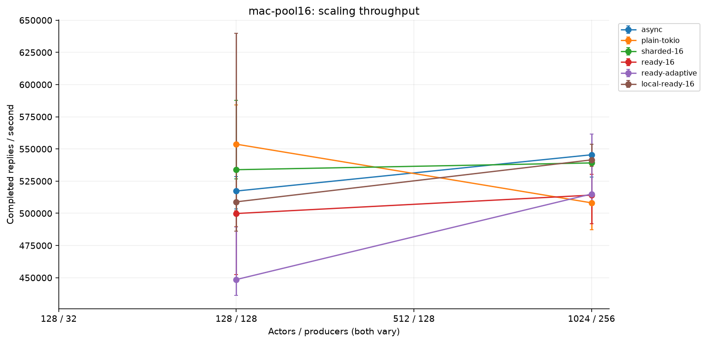

mac-pool16: scaling throughput — failed combinations are absent; see the failure table.

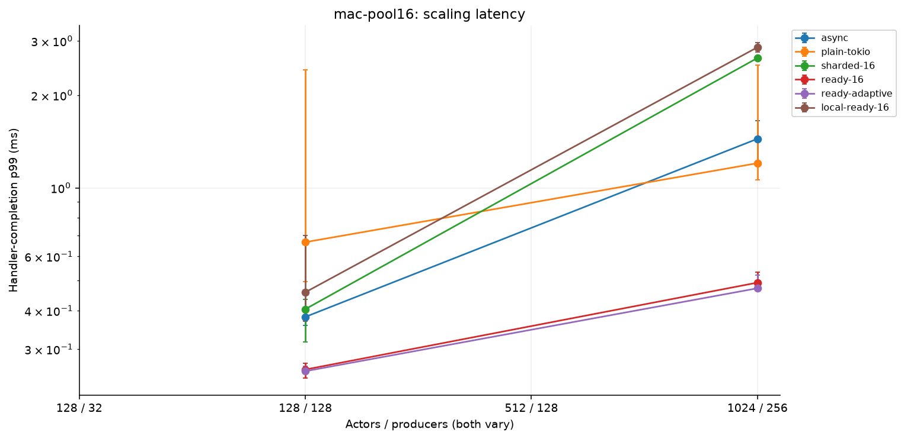

mac-pool16: scaling latency — failed combinations are absent; see the failure table.

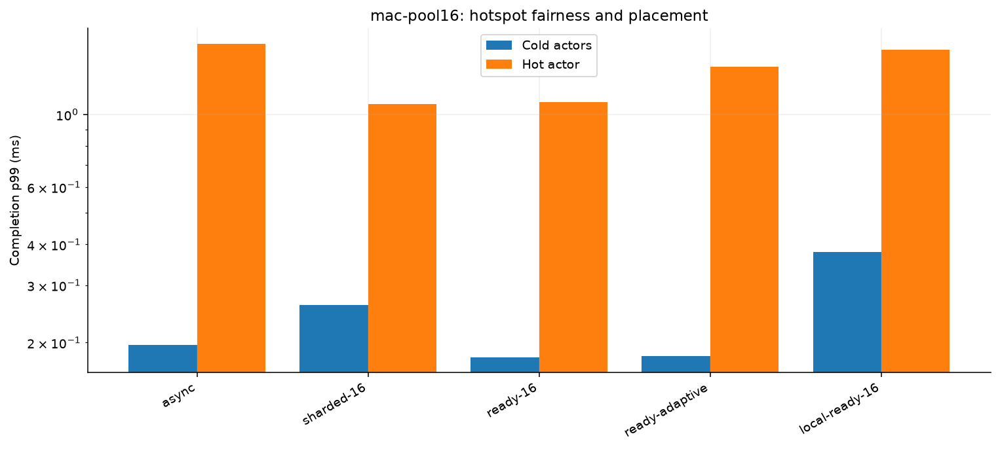

Static placement puts the hot actor on one shard; this tests imbalance as well as batch policy.

### Median results

| Variant | Case | Successful samples | Replies/s | p99 (ms) | Peak RSS (MB) |
|---|---|---:|---:|---:|---:|
| async | active1024_p256 | 3 | 545,484 | 1.4439 | 41.7 |
| async | active128_p128 | 3 | 517,313 | 0.3813 | 23.3 |
| async | hotspot128 | 3 | 438,898 | 1.1638 | 23.3 |
| local-ready-16 | active1024_p256 | 3 | 541,514 | 2.8626 | 72.1 |
| local-ready-16 | active128_p128 | 3 | 508,925 | 0.4585 | 26.3 |
| local-ready-16 | hotspot128 | 3 | 371,099 | 1.2575 | 26.3 |
| plain-tokio | active1024_p256 | 3 | 508,158 | 1.2033 | 42.8 |
| plain-tokio | active128_p128 | 3 | 553,709 | 0.6667 | 23.7 |
| plain-tokio | hotspot128 | 3 | 370,583 | 1.1424 | 23.6 |
| ready-16 | active1024_p256 | 3 | 514,147 | 0.4928 | 62.1 |
| ready-16 | active128_p128 | 3 | 499,861 | 0.2572 | 26.3 |
| ready-16 | hotspot128 | 3 | 305,234 | 1.0385 | 26.2 |
| ready-adaptive | active1024_p256 | 3 | 515,021 | 0.4723 | 62.1 |
| ready-adaptive | active128_p128 | 3 | 448,569 | 0.2541 | 26.6 |
| ready-adaptive | hotspot128 | 3 | 326,924 | 1.3130 | 26.3 |
| sharded-16 | active1024_p256 | 3 | 539,149 | 2.6421 | 71.5 |
| sharded-16 | active128_p128 | 3 | 533,884 | 0.4041 | 27.2 |
| sharded-16 | hotspot128 | 3 | 403,262 | 0.9895 | 26.6 |

## Incorporation criteria

A backend is eligible for incorporation only after both performance and compatibility evidence support it. Keep async Tokio as the general-purpose reference. Treat native runnable queues as scheduler prototypes requiring full lifecycle integration. Per-core placement can help locality while worsening skewed-load tails. Spinning consumes CPU even without useful work. The reply experiment is a transport control: the normal async path already uses Tokio oneshots. io_uring results are Linux VM evidence and cannot rank macOS kqueue against Linux kernels directly.

## All implementations and tests

The following guide defines every backend/control and test, including semantic differences and future integration work.

### Study guide

This study compares runtime ownership, transport costs, scheduling, waiting and
I/O. It does not select a production replacement from a single microbenchmark.
The public `Actor`, `Handler<M>`, protocol, `ActorRef`, message and reply APIs
remain unchanged. Existing defaults remain unchanged. Runtime experiments are
compiled only with `backend-experiments`, selected by a private test environment
variable. Native scheduler/transport and I/O controls exist only in bench code.

## What each implementation means

| Variant | Execution resources | Purpose and limitations |
|---|---|---|
| blocking | Persistent actor loops occupy the caller Tokio blocking pool | Current `Backend::Blocking`; the finite pool can be exhausted by a large population of persistent actors. |
| async | Actor futures on the driver's two-worker Tokio runtime | Current general-purpose baseline; full Spawned lifecycle and messages. |
| threads | One native OS thread per synchronous actor | Current actor implementation; no executor needed by handlers; still uses some Tokio synchronization types. |
| plain-tokio | One task per worker-loop instance on two runtime workers | Simpler channel/oneshot control; omits actor cancellation/unwind/type-erasure machinery. |
| dedicated-default | One owner thread plus a default multi-worker Tokio runtime per actor | Current `Backend::Thread`. Resource-heavy at large actor counts. Restricted to small cases in this matrix. |
| dedicated-one | One owner thread plus one runtime worker per actor | Reduces runtime worker count, but still has multiple threads per actor. |
| dedicated-current | One owner thread with a current-thread Tokio runtime | Removes helper runtime workers. A blocking handler stalls nested helper tasks. Each actor still owns a reactor and descriptors. |
| dedicated-managed | One owner thread per actor, with a process-owned two-worker shared runtime | Avoids per-actor reactors and caller-lifetime dependence; helper-resource isolation differs and the pool lives until process exit. |
| dedicated-shared | One owner thread per actor, sharing the caller's two-worker Tokio runtime | Avoids per-actor reactors and allows helper progress elsewhere. Caller runtime must outlive actors. |
| native-block | One native thread per prototype actor; bounded addressed mailbox; blocking receive | Tokio-free actor/reply data path when bounded replies and direct observation are selected. Does not implement all Spawned lifecycle features. |
| native-hybrid | Native-block plus up to 256 empty polls before blocking | Measures the CPU/latency tradeoff of short spinning. It is a fixed policy, not auto-tuned. |
| native-spin | Native-block with continuous empty polling | Latency-oriented control; consumes CPU while idle. Limited to four actors to avoid uncontrolled oversubscription. |
| sharded-1 / sharded-16 | Two native workers; actor queues partitioned by actor ID; bounded batches of 1 / 16 | Round-robin scans include idle queues. Actor placement is static within each benchmark process. |
| ready-1 / ready-16 | Two native workers share a runnable-actor queue; batches of 1 / 16 | Avoids scanning idle actors; shared ready-queue lock can contend. A mutex-protected scheduling gate prevents simultaneous ownership and lost wakeups. |
| ready-adaptive | Shared runnable queue; full/empty-turn-adaptive batch size 1–64, with a 50 µs turn budget | Experimental adaptive batching. The time budget is checked between handlers and cannot preempt a handler. |
| local-ready-16 | One runnable queue per worker; fixed actor-to-worker placement; batch 16 | Combines active-only scheduling and per-shard placement. Can suffer load imbalance; no work stealing. |

Native prototypes use ordinary owned Rust messages and bounded `std::sync::mpsc`
mailboxes (256 slots by default), not Copy-only broadcast rings. A successful
send never silently overwrites an unread request. Blocking enqueue can stall a
producer when full. They are design controls: dynamic registration, async handler
polling, timers, monitors, panic recovery, cancellation and cyclic actor sends
still need implementation and tests before such a scheduler can become a backend.
They do not establish that a drop-in implementation will have identical speed.

## Reply transport experiment

The `async-reply-*` and `threads-reply-*` variants deliver the same benchmark-local
`Probe` message through Spawned, carrying an explicitly selected reply transport:

- `std`: a general unbounded `std::mpsc` channel per request.
- `bounded`: a one-slot `std::mpsc::sync_channel` per request.
- `tokio`: Tokio's dedicated oneshot primitive per request.

These bypass the normal framework reply envelope to isolate reply choices using
a matched message shape. They do not alter public request/reply behavior. Compare
within this matched group; comparison with the framework path includes envelope
layout and dispatch differences. Allocation counters include driver activity and
report successful allocation/reallocation calls and full requested sizes.

All new message experiments use direct reply observation with a process-level
watchdog. This avoids a Tokio timeout future per observed reply; thread and
future wake mechanisms still differ. The original baseline and its timer-based
observer remain available in `baseline.rs`; historical results are not rewritten.

## Scale and workload matrix

| Case | Actors | Producers | Measured requests per run | Routing / question |
|---|---:|---:|---:|---|
| rpc1 | 1 | 1 | 32,768 | Closed-loop single-request latency. |
| burst32 | 1 | 32 | 131,072 | Finite burst into a busy mailbox; separate collectors. |
| active128_p32 | 128 | 32 | 131,072 | Round-robin traffic reaches every actor. |
| active128_p128 | 128 | 128 | 131,072 | One closed-loop producer per actor. |
| active512_p128 | 512 | 128 | 262,144 | Every actor receives traffic; at most 128 requests in flight. |
| active1024_p256 | 1,024 | 256 | 262,144 | Large population and producer count; resource limits are results. |
| hotspot128 | 128 | 128 | 131,072 | Half of requests go to actor 0; remaining traffic spreads over others. Compare hot and cold p99. |
| lowload | 4 | 32 | 10,000 | Scheduled 5k requests/s, 5,000 CPU iterations per handler. |
| overload | 4 | 32 | 32,768 | Scheduled 1M requests/s with the same CPU work. |
| idle4 | 4 | 1 | 1 | One-second idle interval after warmup; reveals spinning CPU cost. |
| alloc1 | 1 | 1 | 32,768 | Allocation counting enabled; not a timing-overhead-free result. |

Closed-loop producers wait for replies; increasing the actor population beyond
the producer count does not make all actors simultaneously busy. Paced and burst
cases can accumulate more outstanding requests. Actor mailboxes may be bounded
in prototypes, but collector channels/sample storage remain finite-run driver
allocations; no experiment proves safety under indefinite overload.

The original 128-actor baseline had only four active actors. These new scaling
cases deliberately send to every actor. Default per-actor multi-worker runtimes
are not launched at 512/1024 actors to avoid thousands of runtime threads.
One-worker-per-actor is capped at 512. Spin/hybrid controls are capped at four.
Skipped combinations are design/resource constraints, not successful measurements.

## Runtime compatibility characterization

`concurrency/tests/backend_experiments.rs` runs each runtime mode in a separate
process. It checks:

1. Nested async spawning and timer completion.
2. A real TCP request/reply using the runtime's reactor.
3. Whether a detached helper progresses while the actor blocks.
4. Actor shutdown and completion.
5. Actor behavior after its caller runtime is dropped.

Tests intentionally characterize differences: current-thread mode cannot run
helpers while a handler blocks, and shared-runtime mode cannot provide independent
runtime lifetime. Passing this suite does not mean those variants are drop-in
replacements. The standard workspace suite covers ordinary lifecycle behavior;
no new default should be chosen without wider client compatibility tests.

## Real I/O mechanisms

`io_designs.rs` reuses persistent loopback TCP connections with TCP_NODELAY.
Each connection sends and validates 64-byte request/reply frames. Cases use
1, 16 and 128 connections, 1,000 measured exchanges per connection after warmup.
A common native echo server uses one OS thread per connection. The per-connection controls also use one client OS thread per connection. The
`*-mux` controls distribute all connections across one client reactor, and
`*-mux4` across up to four reactors. The server remains identical across these
cases. None is a complete actor backend.

| I/O variant | Mechanism | What it tests |
|---|---|---|
| std-io | Blocking standard-library TCP | Synchronous syscall/socket control. |
| tokio-io | Current-thread Tokio and Mio | kqueue on macOS; epoll on Linux. |
| monoio-legacy | Monoio's non-Tokio legacy driver | kqueue on macOS; epoll on Linux, with owned-buffer APIs. |
| monoio-uring | Explicit Monoio io_uring driver | Linux only; preflight fails explicitly if unavailable or denied. No silent fallback. |

Monoio and Tokio differ in buffer ownership, scheduling and code, not just kernel
syscalls. Monoio's thread-local futures are not automatically compatible with
Spawned's `Send` handler futures. These tests do not prove that arbitrary existing
Tokio-based application handlers can run unchanged on Monoio.

## Measurement and reporting

Each sample is a fresh release-mode process, with warmup and randomized ordering.
Request IDs and completed counts are checked. Runs retain raw values, failures,
compiler/source revisions, environment, descriptor limits and Linux cgroup limits.
The watchdog kills the process group, preventing a timed-out child from silently
contaminating later samples. Failed samples never receive fabricated throughput.

Handler-completion latency, caller-observed reply latency, queue wait, handler
elapsed time and enqueue lag are distinct. CPU and peak RSS are process-wide,
including initialization, idle delay, driver/sample storage and teardown.
Reported medians of run-level p99s are not pooled p99s. Error bars show run-to-run
ranges, not confidence intervals. No cross-OS absolute speed comparison is valid
without accounting for the VM and budget differences.

Linux runs in OrbStack's ARM64 VM, with the container restricted to CPUs 0–3,
8 GiB RAM and 4,096 PIDs. Its source is mounted read-only. `seccomp=unconfined`
is used inside this unprivileged VM container to allow io_uring syscalls; this is
an experiment setting, not a production security recommendation. Descriptor limits
are recorded; a separately raised limit is a distinct experiment. macOS runs use
the native host's scheduling and cannot claim equal CPU placement.

## Reproduction

```sh
python3 benchmarks/design_experiments.py --output /tmp/design-smoke --repetitions 1 --smoke
python3 benchmarks/design_experiments.py --output /tmp/design-mac --repetitions 3
python3 benchmarks/design_experiments.py --output /tmp/design-fd-control --repetitions 3 --group messages --variants dedicated-current --cases active1024_p256 --fd-limit 16384
```

Use `--group`, `--cases` and `--variants` to limit a campaign. The experimental
feature must never be enabled implicitly for production. Public API preservation
is a requirement for any eventual backend implementation, not a conclusion from
these prototype controls.

## Research informing the candidates

- [Seastar's shared-nothing architecture](https://seastar.io/shared-nothing/): per-core ownership and explicit cross-core messaging. Our prototype does not reproduce its allocator/network stack.
- [Glommio](https://github.com/DataDog/glommio): cooperative thread-per-core async I/O on Linux io_uring; requires a Linux-specific integration study.
- [Akka dispatcher throughput](https://doc.akka.io/japi/akka-core/current/akka/dispatch/Dispatcher.html): bounded mailbox batches trade throughput against fairness.
- [Monoio legacy driver](https://github.com/monoio-rs/monoio/blob/master/docs/en/use-legacy-driver.md): kqueue/epoll counterpart to its io_uring driver.
- [Mio](https://github.com/tokio-rs/mio): OS readiness mechanisms underlying Tokio networking.
- [Compio](https://github.com/compio-rs/compio): portable thread-per-core I/O candidate for later integration; researched, not measured in this campaign.
- [Silver/flux research](../../../docs/research/silver-flux.md): transport and observability ideas, with explicit differences from actors.

## Scheduler review correction

The first exploratory runnable-queue prototype used separate atomics for a pending
count and scheduling flag. Review identified a possible lost notification and
spurious rescheduling while a sender had reserved but not published work. Those
samples are invalid for selecting a design and are excluded from final graphs.

The measured revision uses `support/ready_gate.rs`: a mutex serializes producer
notification with the worker's lookahead-and-release decision. The worker retains
one lookahead message rather than maintaining a speculative pending count.
`ready_gate_loom.rs` models that same gate implementation under publication/finish
interleavings. Adaptive batching grows after full turns and resets on empty turns;
its clock reads are part of the measured policy cost, not free instrumentation.

Bounded and unbounded burst tails are different admission experiments: blocking
a producer delays creation of its next burst timestamp. Burst p99 is therefore
not a matched offered-load comparison. Use the absolute-arrival paced cases and
a separately pre-sized capacity control before attributing differences to queue
implementation. Hotspot placement deliberately creates a hot shard; it measures
load imbalance as well as batching. Worker counts and total process CPU budgets
are distinct controls.

Multiplexed I/O variants (`tokio-mux`, `monoio-legacy-mux`, `monoio-uring-mux`)
drive all connections on one client runtime/thread. The per-connection-runtime
variants remain as resource controls. They use the same native echo server;
server thread costs remain common confounders. Linux io_uring is explicitly
selected and preflighted, with no silent fallback.

Additional controls include the existing `Backend::Blocking` pool, and I/O
multiplexing on four client reactors (`*-mux4`) as well as one (`*-mux`).
Per-reactor connections are partitioned round-robin; both configurations use the
same echo server. This separates reactor amortization from a one-client-core
bottleneck. Blocking-pool exhaustion is captured by a shorter process watchdog
in its separate capacity study, rather than fabricated as zero throughput.
