# Spawned: profiling, actor graphs and overload fairness on native Linux

Source `454d25a8baed62ee0a7b005e919d3d9e32f86893`; dirty `False`. 1,002 fresh processes; 1,002 successful. Phase counts: `{'calibration': 6, 'graph': 280, 'graph-long': 140, 'offered': 504, 'pilot': 6, 'profile': 66}`.

Linux-6.8.0-147-generic-x86_64-with-glibc2.39; rustc 1.93.0 (254b59607 2026-01-19) (built from a source tarball); nice=10. Actors inherit CPUs `2,3,4,5`; new graph/load producers use `6,7,14,15` and collectors/samplers use `8,9,16,17`. Both budgets use the same four-core actor affinity mask; workers are not individually pinned. Other users and frequency scaling remain uncontrolled.

[Protocol and limitations](../../RESEARCH-FEDE-PROTOCOL.md) · [Raw inputs and exact schedule](../../results/fede-research-2026-11-06/metadata.json)

The earlier 9b22346 study is separate: these workloads use corrected source, different graphs/load and explicit driver CPU separation. Compare policies inside each case. Bars/lines are medians; whiskers/ranges show fresh-process min/max, not confidence intervals.

## Findings and next experiments

Keep Tokio as the default. The longer actor-to-actor experiment confirms that a policy which helped independent requests in the earlier study can lose when actor replies cross fixed worker boundaries. Placement, communication pattern and overload behavior matter more than a single peak-throughput number.

Four worker threads, 1,024 actors, 256 closed-loop native producers, 1,048,576 logical root requests, eight handlers/root. Each cell is **k root replies/s / caller-observed p99 ms**, median of five fresh processes; figures show full min/max ranges. Same/cross is an enforced placement for shards and only a spawn-order control for Tokio.

| Policy | Chain same | Chain cross | Fan-out same | Fan-out cross |
|---|---:|---:|---:|---:|
| async | 955.2 / 0.410 | 948.3 / 0.337 | 950.5 / 0.348 | 957.8 / 0.331 |
| tokio-1 | 815.9 / 0.472 | 821.0 / 0.470 | 846.3 / 0.423 | 883.8 / 0.418 |
| tokio-16 | 847.3 / 0.585 | 839.6 / 0.586 | 853.0 / 0.430 | 874.8 / 0.415 |
| tokio-adaptive | 840.2 / 0.581 | 863.2 / 0.573 | 875.9 / 0.414 | 871.1 / 0.453 |
| sharded-1 | 850.0 / 0.325 | 506.0 / 0.583 | 934.7 / 0.303 | 612.2 / 0.473 |
| sharded-16 | 857.9 / 0.316 | 508.4 / 0.573 | 947.3 / 0.295 | 610.1 / 0.493 |
| sharded-adaptive | 845.1 / 0.332 | 513.3 / 0.572 | 933.1 / 0.301 | 610.4 / 0.485 |

Sharded turn-16 falls from 857.9k to 508.4k root replies/s between same/cross chain placement (40.7% lower), while ordinary Tokio stays near 950k in both controls. The corresponding sharded actor-worker CPU cost rises from about 4,636 to 7,831 ns/root. This is evidence of a cross-worker coordination cost in this workload; it does not identify cache misses, kernel wakeups or any single cause. Same-placement fan-out reaches 947.3k with shards versus 950.5k with Tokio; this near parity is workload-specific, not proof of equivalence.

The additional explicit turn checks did not improve long-graph throughput over ordinary Tokio here. The default may benefit from continuation locality, but confirming that explanation needs targeted scheduler/driver controls. The shared ~950k plateau could also contain load-generator or instrumentation costs; do not call it the framework’s maximum capacity.

**Overload evidence is incomplete.** All 1,002 processes returned valid outcomes and completed their admitted work, but only **260/504 offered-load runs** met the predefined admission schedule. All 244 invalid runs remain visible, and every affected aggregate is marked. Do not rank those cells as equivalent offered traffic or interpret their tail differences as isolated backend effects. A better-controlled producer/observer experiment comes before stronger fairness claims.

A valid diagnostic at 950,237 requests/s concentrates four hot actors on one shard: sharded turn-16 has 66.3% hot caller timeouts (median, three valid schedules), despite a 0.014 ms other-cohort cold observed p99. The worst cold actor p99 is 0.216 ms, showing why other-shard and worst-actor tails must accompany each other. Good cold isolation does not cure a hot shard’s growing backlog. These are two-second injection windows with a two-second caller deadline, followed by full drain; they are not a steady-state capacity or SLO result.

CPU profiles are available for all 66 profile processes. Inclusive scheduler ancestry is nearly universal and cannot be interpreted as scheduler overhead. Mailbox/reply frames and per-worker CPU counters motivate experiments, not causal conclusions about the kernel or allocator. No hardware counters or off-CPU profiles were available.

The next tests are (1) a process-owned Tokio pool control, (2) native actor dispatch with shared I/O, using global FIFO and bounded local continuation/stealing queues, (3) equal total runtime-thread controls, (4) asynchronous versus blocking callers and instrumentation controls, and (5) longer bounded soaks with actor churn. Native schedulers must first pass wakeup models and real actor lifecycle/I/O tests. These remain opt-in research; no public API, default scheduler, delivery semantics or lifecycle contract is promoted or replaced.

## Actor-to-actor graphs

Each logical request traverses eight actual handlers (chain or seven-way fan-out). Short graph cells use 65,536 requests; graph-long confirmations use 1,048,576 and are kept separate. The logical graph, count and work are identical across placement controls. Same/cross placement is enforced only for sharded actors; under Tokio it is a spawn-order control. Producers await each root reply.

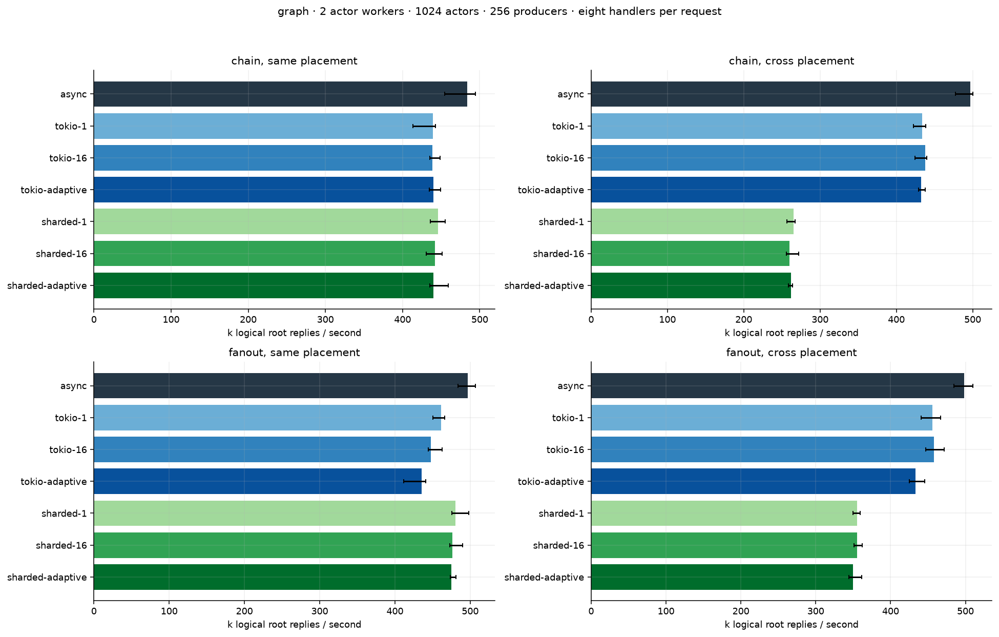

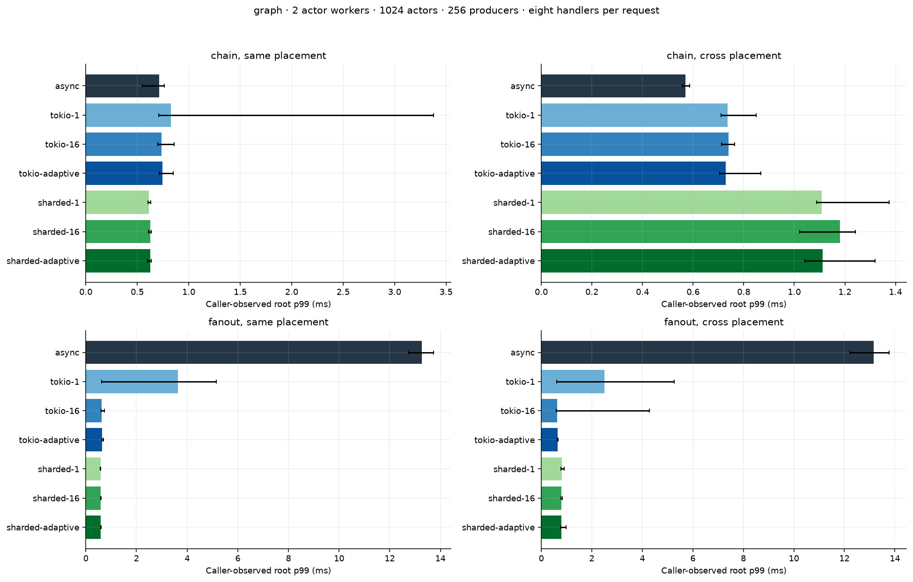

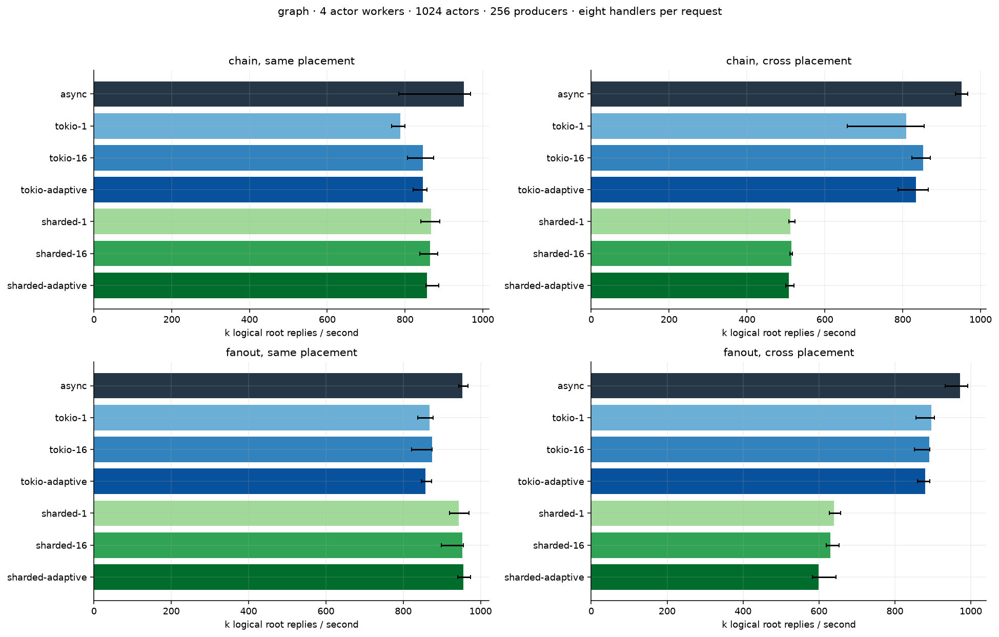

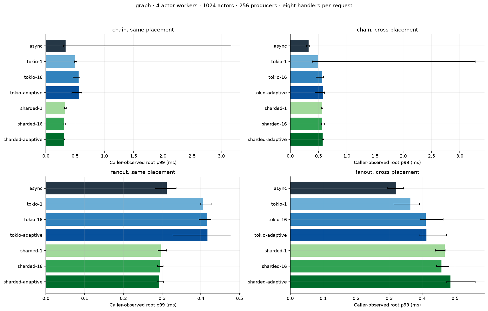

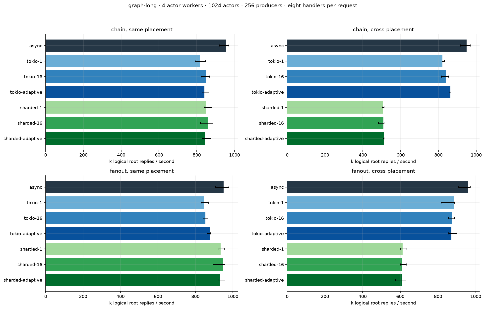

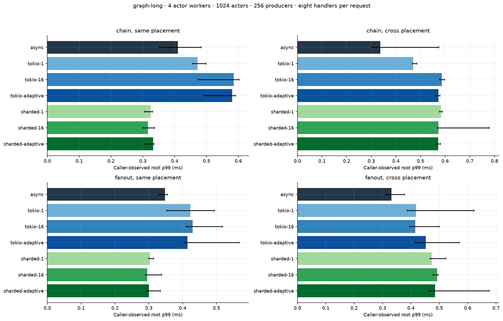

## Graph worker CPU counters

These counters include the timed actor work and drain, not producer CPU. CPU ns/root sums worker CPU across threads, so it can exceed elapsed ns/root. Run-queue counters depend on kernel availability; no migration/cache-event attribution is made.

| Long graph | Policy | Actor CPU ns/root | CPU ns/handler | Voluntary switches/root |
|---|---|---:|---:|---:|
| chain / cross | async | 4,215 | 527 | 0.000 |
| chain / same | async | 4,175 | 522 | 0.000 |
| fanout / cross | async | 4,138 | 517 | 0.000 |
| fanout / same | async | 4,205 | 526 | 0.000 |
| chain / cross | sharded-1 | 7,830 | 979 | 0.038 |
| chain / same | sharded-1 | 4,666 | 583 | 0.000 |
| fanout / cross | sharded-1 | 6,494 | 812 | 0.013 |
| fanout / same | sharded-1 | 4,227 | 528 | 0.000 |
| chain / cross | sharded-16 | 7,831 | 979 | 0.022 |
| chain / same | sharded-16 | 4,636 | 579 | 0.000 |
| fanout / cross | sharded-16 | 6,501 | 813 | 0.018 |
| fanout / same | sharded-16 | 4,182 | 523 | 0.000 |
| chain / cross | sharded-adaptive | 7,758 | 970 | 0.022 |
| chain / same | sharded-adaptive | 4,715 | 589 | 0.000 |
| fanout / cross | sharded-adaptive | 6,511 | 814 | 0.018 |
| fanout / same | sharded-adaptive | 4,226 | 528 | 0.000 |
| chain / cross | tokio-1 | 4,854 | 607 | 0.007 |
| chain / same | tokio-1 | 4,873 | 609 | 0.006 |
| fanout / cross | tokio-1 | 4,521 | 565 | 0.001 |
| fanout / same | tokio-1 | 4,662 | 583 | 0.000 |
| chain / cross | tokio-16 | 4,754 | 594 | 0.001 |
| chain / same | tokio-16 | 4,715 | 589 | 0.001 |
| fanout / cross | tokio-16 | 4,569 | 571 | 0.000 |
| fanout / same | tokio-16 | 4,686 | 586 | 0.000 |
| chain / cross | tokio-adaptive | 4,623 | 578 | 0.001 |
| chain / same | tokio-adaptive | 4,680 | 585 | 0.001 |
| fanout / cross | tokio-adaptive | 4,588 | 574 | 0.001 |
| fanout / same | tokio-adaptive | 4,558 | 570 | 0.000 |

## Offered-load fairness

Fixed hot/cold traffic, steady and burst schedules. Quantiles of successful completions omit timed-out requests; observation tails include timeout events with censored completion. Timeout/deadline fractions must accompany latency. A point is marked × if any of its three repetitions has an invalid generator schedule (>1% requests >1 ms late). Do not rank such points as equivalent offered traffic. These two-second finite windows are not a soak or SLO test.

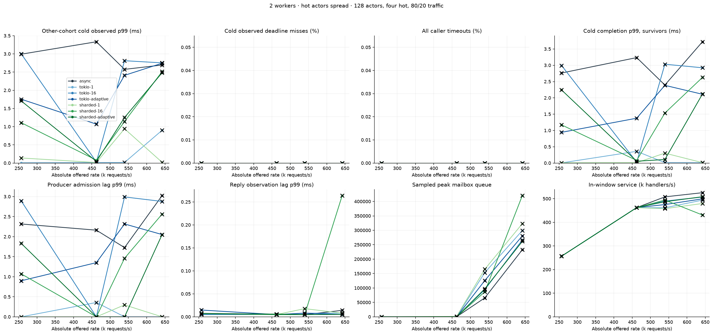

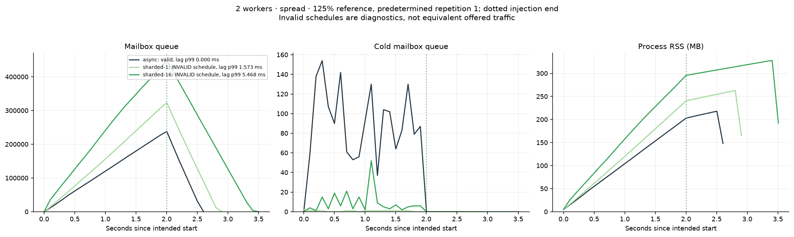

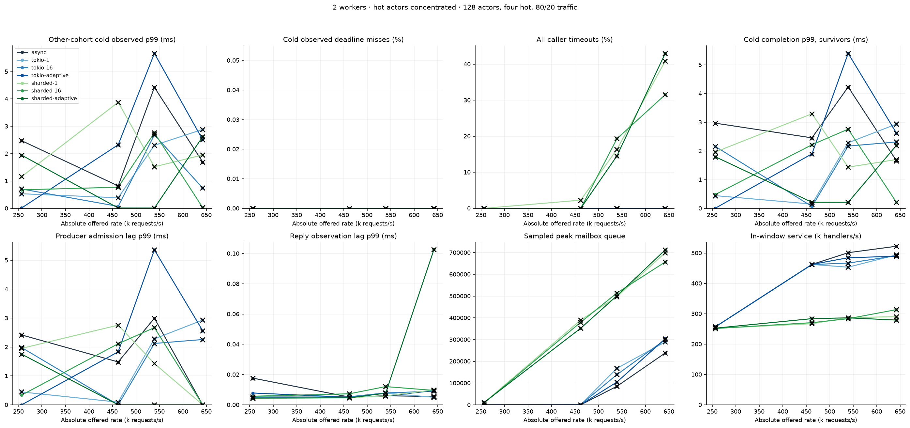

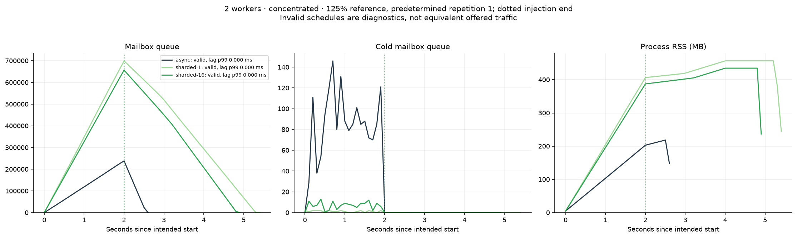

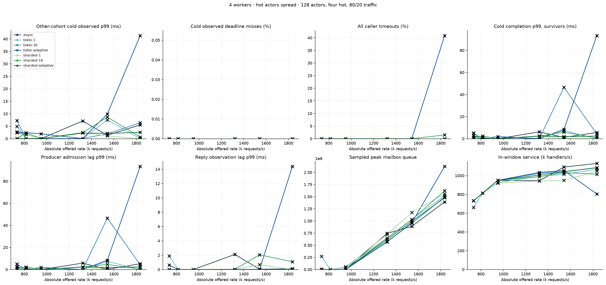

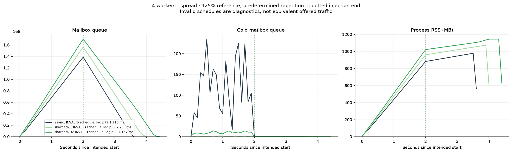

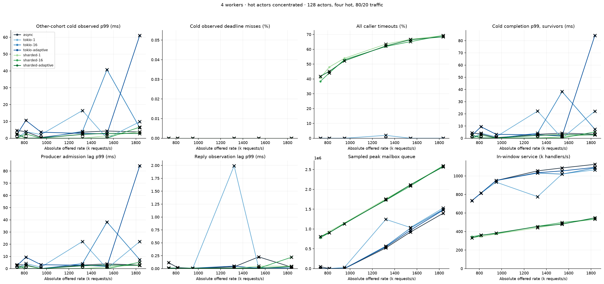

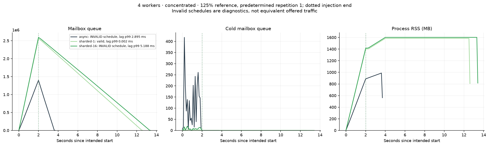

## Per-cell offered outcomes

Survivor-only completion p99 is shown beside timeout counts. Caller-observed deadline misses also include late ready replies; an elapsed timeout does not cancel actor work. All admitted work drains before process exit. `valid/n` describes generator schedules, not successful replies.

| Workers | Layout | Burst | Policy | Rate/s | valid/n | Other-cohort cold observed p99 ms | Worst cold actor p99 ms | Cold deadline misses % | Hot timeouts % | Peak queued |
|---:|---|---:|---|---:|---:|---:|---:|---:|---:|---:|
| 2 | concentrated | 1 | async | 256,869 | 1/3 | 2.473 | 3.359 | 0.00 | 0.00 | 54 |
| 2 | concentrated | 1 | async | 462,364 | 1/3 | 0.819 | 3.936 | 0.00 | 0.00 | 42 |
| 2 | concentrated | 1 | async | 539,424 | 0/3 | 4.425 | 4.790 | 0.00 | 0.00 | 85,057 |
| 2 | concentrated | 1000 | async | 539,424 | 3/3 | 1.923 | 2.037 | 0.00 | 0.00 | 67,497 |
| 2 | concentrated | 1 | async | 642,172 | 2/3 | 1.694 | 1.781 | 0.00 | 0.00 | 238,095 |
| 2 | spread | 1 | async | 256,869 | 1/3 | 2.993 | 3.867 | 0.00 | 0.00 | 29 |
| 2 | spread | 1 | async | 462,364 | 1/3 | 3.334 | 3.885 | 0.00 | 0.00 | 241 |
| 2 | spread | 1 | async | 539,424 | 1/3 | 2.575 | 3.439 | 0.00 | 0.00 | 65,666 |
| 2 | spread | 1000 | async | 539,424 | 2/3 | 1.954 | 2.021 | 0.00 | 0.00 | 62,265 |
| 2 | spread | 1 | async | 642,172 | 1/3 | 2.695 | 4.779 | 0.00 | 0.00 | 232,730 |
| 2 | concentrated | 1 | sharded-1 | 256,869 | 1/3 | 1.161 | 2.964 | 0.00 | 0.00 | 9,955 |
| 2 | concentrated | 1 | sharded-1 | 462,364 | 0/3 | 3.879 | 4.175 | 0.00 | 2.83 | 389,952 |
| 2 | concentrated | 1 | sharded-1 | 539,424 | 1/3 | 1.520 | 2.150 | 0.00 | 20.41 | 496,866 |
| 2 | concentrated | 1000 | sharded-1 | 539,424 | 2/3 | 1.425 | 1.714 | 0.00 | 27.08 | 503,640 |
| 2 | concentrated | 1 | sharded-1 | 642,172 | 2/3 | 1.953 | 2.514 | 0.00 | 51.06 | 699,277 |
| 2 | spread | 1 | sharded-1 | 256,869 | 2/3 | 0.139 | 1.508 | 0.00 | 0.00 | 4 |
| 2 | spread | 1 | sharded-1 | 462,364 | 2/3 | 0.015 | 0.034 | 0.00 | 0.00 | 1,625 |
| 2 | spread | 1 | sharded-1 | 539,424 | 2/3 | 0.942 | 1.920 | 0.00 | 0.00 | 165,035 |
| 2 | spread | 1000 | sharded-1 | 539,424 | 3/3 | 0.295 | 0.303 | 0.00 | 0.00 | 117,663 |
| 2 | spread | 1 | sharded-1 | 642,172 | 2/3 | 0.020 | 0.654 | 0.00 | 0.00 | 323,036 |
| 2 | concentrated | 1 | sharded-16 | 256,869 | 3/3 | 0.676 | 1.585 | 0.00 | 0.00 | 8,487 |
| 2 | concentrated | 1 | sharded-16 | 462,364 | 1/3 | 0.772 | 2.788 | 0.00 | 0.00 | 379,679 |
| 2 | concentrated | 1 | sharded-16 | 539,424 | 1/3 | 2.761 | 3.003 | 0.00 | 24.12 | 514,203 |
| 2 | concentrated | 1000 | sharded-16 | 539,424 | 3/3 | 0.533 | 0.657 | 0.00 | 17.64 | 479,842 |
| 2 | concentrated | 1 | sharded-16 | 642,172 | 2/3 | 0.027 | 0.458 | 0.00 | 39.39 | 656,551 |
| 2 | spread | 1 | sharded-16 | 256,869 | 1/3 | 1.108 | 1.940 | 0.00 | 0.00 | 3 |
| 2 | spread | 1 | sharded-16 | 462,364 | 3/3 | 0.081 | 0.112 | 0.00 | 0.00 | 44 |
| 2 | spread | 1 | sharded-16 | 539,424 | 1/3 | 1.142 | 2.693 | 0.00 | 0.00 | 86,692 |
| 2 | spread | 1000 | sharded-16 | 539,424 | 3/3 | 0.446 | 0.455 | 0.00 | 0.00 | 111,394 |
| 2 | spread | 1 | sharded-16 | 642,172 | 0/3 | 2.514 | 2.875 | 0.00 | 0.00 | 420,410 |
| 2 | concentrated | 1 | sharded-adaptive | 256,869 | 1/3 | 1.944 | 3.047 | 0.00 | 0.00 | 10,887 |
| 2 | concentrated | 1 | sharded-adaptive | 462,364 | 2/3 | 0.011 | 0.690 | 0.00 | 0.00 | 352,181 |
| 2 | concentrated | 1 | sharded-adaptive | 539,424 | 2/3 | 0.010 | 0.216 | 0.00 | 18.16 | 501,405 |
| 2 | concentrated | 1000 | sharded-adaptive | 539,424 | 2/3 | 0.581 | 0.812 | 0.00 | 40.46 | 558,686 |
| 2 | concentrated | 1 | sharded-adaptive | 642,172 | 2/3 | 2.619 | 2.702 | 0.00 | 53.73 | 712,395 |
| 2 | spread | 1 | sharded-adaptive | 256,869 | 1/3 | 1.706 | 2.775 | 0.00 | 0.00 | 67 |
| 2 | spread | 1 | sharded-adaptive | 462,364 | 2/3 | 0.046 | 0.088 | 0.00 | 0.00 | 24 |
| 2 | spread | 1 | sharded-adaptive | 539,424 | 2/3 | 1.251 | 1.614 | 0.00 | 0.00 | 97,044 |
| 2 | spread | 1000 | sharded-adaptive | 539,424 | 2/3 | 0.456 | 0.477 | 0.00 | 0.00 | 165,658 |
| 2 | spread | 1 | sharded-adaptive | 642,172 | 1/3 | 2.483 | 2.765 | 0.00 | 0.00 | 261,774 |
| 2 | concentrated | 1 | tokio-1 | 256,869 | 2/3 | 0.533 | 2.461 | 0.00 | 0.00 | 2 |
| 2 | concentrated | 1 | tokio-1 | 462,364 | 2/3 | 0.387 | 2.256 | 0.00 | 0.00 | 426 |
| 2 | concentrated | 1 | tokio-1 | 539,424 | 1/3 | 2.306 | 2.767 | 0.00 | 0.00 | 167,864 |
| 2 | concentrated | 1000 | tokio-1 | 539,424 | 3/3 | 0.383 | 0.405 | 0.00 | 0.00 | 150,567 |
| 2 | concentrated | 1 | tokio-1 | 642,172 | 1/3 | 2.887 | 3.340 | 0.00 | 0.00 | 288,826 |
| 2 | spread | 1 | tokio-1 | 256,869 | 3/3 | 0.007 | 0.009 | 0.00 | 0.00 | 3 |
| 2 | spread | 1 | tokio-1 | 462,364 | 2/3 | 0.013 | 2.247 | 0.00 | 0.00 | 234 |
| 2 | spread | 1 | tokio-1 | 539,424 | 2/3 | 0.016 | 2.887 | 0.00 | 0.00 | 153,347 |
| 2 | spread | 1000 | tokio-1 | 539,424 | 3/3 | 0.298 | 0.323 | 0.00 | 0.00 | 143,410 |
| 2 | spread | 1 | tokio-1 | 642,172 | 2/3 | 0.901 | 1.448 | 0.00 | 0.00 | 299,136 |
| 2 | concentrated | 1 | tokio-16 | 256,869 | 1/3 | 0.707 | 3.036 | 0.00 | 0.00 | 4 |
| 2 | concentrated | 1 | tokio-16 | 462,364 | 3/3 | 0.070 | 0.085 | 0.00 | 0.00 | 1,157 |
| 2 | concentrated | 1 | tokio-16 | 539,424 | 1/3 | 2.689 | 2.804 | 0.00 | 0.00 | 138,721 |
| 2 | concentrated | 1000 | tokio-16 | 539,424 | 3/3 | 0.380 | 0.411 | 0.00 | 0.00 | 77,360 |
| 2 | concentrated | 1 | tokio-16 | 642,172 | 1/3 | 0.742 | 2.836 | 0.00 | 0.00 | 299,709 |
| 2 | spread | 1 | tokio-16 | 256,869 | 1/3 | 3.001 | 3.657 | 0.00 | 0.00 | 103 |
| 2 | spread | 1 | tokio-16 | 462,364 | 2/3 | 0.030 | 0.038 | 0.00 | 0.00 | 44 |
| 2 | spread | 1 | tokio-16 | 539,424 | 0/3 | 2.813 | 4.124 | 0.00 | 0.00 | 94,145 |
| 2 | spread | 1000 | tokio-16 | 539,424 | 3/3 | 0.387 | 0.408 | 0.00 | 0.00 | 148,363 |
| 2 | spread | 1 | tokio-16 | 642,172 | 0/3 | 2.754 | 4.230 | 0.00 | 0.00 | 266,803 |
| 2 | concentrated | 1 | tokio-adaptive | 256,869 | 3/3 | 0.013 | 0.112 | 0.00 | 0.00 | 3 |
| 2 | concentrated | 1 | tokio-adaptive | 462,364 | 1/3 | 2.324 | 2.984 | 0.00 | 0.00 | 276 |
| 2 | concentrated | 1 | tokio-adaptive | 539,424 | 0/3 | 5.667 | 5.979 | 0.00 | 0.00 | 104,675 |
| 2 | concentrated | 1000 | tokio-adaptive | 539,424 | 2/3 | 0.877 | 1.260 | 0.00 | 0.00 | 208,724 |
| 2 | concentrated | 1 | tokio-adaptive | 642,172 | 0/3 | 2.508 | 3.776 | 0.00 | 0.00 | 303,699 |
| 2 | spread | 1 | tokio-adaptive | 256,869 | 2/3 | 1.755 | 2.887 | 0.00 | 0.00 | 98 |
| 2 | spread | 1 | tokio-adaptive | 462,364 | 1/3 | 1.070 | 2.417 | 0.00 | 0.00 | 53 |
| 2 | spread | 1 | tokio-adaptive | 539,424 | 0/3 | 2.411 | 2.877 | 0.00 | 0.00 | 125,716 |
| 2 | spread | 1000 | tokio-adaptive | 539,424 | 2/3 | 0.740 | 1.182 | 0.00 | 0.00 | 107,492 |
| 2 | spread | 1 | tokio-adaptive | 642,172 | 0/3 | 2.744 | 3.160 | 0.00 | 0.00 | 280,684 |
| 4 | concentrated | 1 | async | 733,946 | 0/3 | 4.635 | 5.756 | 0.00 | 0.00 | 50,109 |
| 4 | concentrated | 1 | async | 814,489 | 0/3 | 3.887 | 4.826 | 0.00 | 0.00 | 751 |
| 4 | concentrated | 1 | async | 950,237 | 2/3 | 0.455 | 0.603 | 0.00 | 0.00 | 10 |
| 4 | concentrated | 1 | async | 1,321,103 | 1/3 | 3.610 | 4.095 | 0.00 | 0.00 | 522,082 |
| 4 | concentrated | 1 | async | 1,541,287 | 0/3 | 4.290 | 5.403 | 0.00 | 0.00 | 922,292 |
| 4 | concentrated | 1000 | async | 1,541,287 | 3/3 | 1.246 | 1.286 | 0.00 | 0.00 | 872,144 |
| 4 | concentrated | 1 | async | 1,834,866 | 1/3 | 3.714 | 4.389 | 0.00 | 0.00 | 1,397,181 |
| 4 | spread | 1 | async | 733,946 | 0/3 | 2.439 | 3.302 | 0.00 | 0.00 | 536 |
| 4 | spread | 1 | async | 814,489 | 2/3 | 1.726 | 2.637 | 0.00 | 0.00 | 1,022 |
| 4 | spread | 1 | async | 950,237 | 3/3 | 0.025 | 0.030 | 0.00 | 0.00 | 9 |
| 4 | spread | 1 | async | 1,321,103 | 0/3 | 7.127 | 11.358 | 0.00 | 0.00 | 745,615 |
| 4 | spread | 1 | async | 1,541,287 | 2/3 | 1.357 | 2.607 | 0.00 | 0.00 | 888,698 |
| 4 | spread | 1000 | async | 1,541,287 | 3/3 | 1.301 | 1.343 | 0.00 | 0.00 | 865,611 |
| 4 | spread | 1 | async | 1,834,866 | 0/3 | 5.570 | 7.903 | 0.00 | 0.00 | 1,392,083 |
| 4 | concentrated | 1 | sharded-1 | 733,946 | 3/3 | 0.158 | 0.498 | 0.00 | 50.81 | 795,218 |
| 4 | concentrated | 1 | sharded-1 | 814,489 | 3/3 | 0.015 | 0.792 | 0.00 | 60.06 | 936,984 |
| 4 | concentrated | 1 | sharded-1 | 950,237 | 3/3 | 0.014 | 0.073 | 0.00 | 67.42 | 1,152,108 |
| 4 | concentrated | 1 | sharded-1 | 1,321,103 | 2/3 | 0.011 | 0.252 | 0.00 | 79.35 | 1,759,740 |
| 4 | concentrated | 1 | sharded-1 | 1,541,287 | 1/3 | 1.490 | 1.992 | 0.00 | 83.43 | 2,114,553 |
| 4 | concentrated | 1000 | sharded-1 | 1,541,287 | 3/3 | 0.359 | 0.385 | 0.00 | 83.16 | 2,117,970 |
| 4 | concentrated | 1 | sharded-1 | 1,834,866 | 1/3 | 3.781 | 4.260 | 0.00 | 86.54 | 2,593,988 |
| 4 | spread | 1 | sharded-1 | 733,946 | 2/3 | 0.010 | 0.013 | 0.00 | 0.00 | 56 |
| 4 | spread | 1 | sharded-1 | 814,489 | 1/3 | 1.762 | 2.290 | 0.00 | 0.00 | 143 |
| 4 | spread | 1 | sharded-1 | 950,237 | 2/3 | 0.014 | 0.017 | 0.00 | 0.00 | 55,914 |
| 4 | spread | 1 | sharded-1 | 1,321,103 | 0/3 | 2.519 | 2.757 | 0.00 | 0.00 | 725,014 |
| 4 | spread | 1 | sharded-1 | 1,541,287 | 2/3 | 1.164 | 1.424 | 0.00 | 0.00 | 1,174,091 |
| 4 | spread | 1000 | sharded-1 | 1,541,287 | 2/3 | 0.509 | 0.604 | 0.00 | 0.00 | 1,024,464 |
| 4 | spread | 1 | sharded-1 | 1,834,866 | 2/3 | 0.026 | 2.152 | 0.00 | 0.00 | 1,562,689 |
| 4 | concentrated | 1 | sharded-16 | 733,946 | 3/3 | 0.010 | 0.217 | 0.00 | 47.93 | 776,715 |
| 4 | concentrated | 1 | sharded-16 | 814,489 | 1/3 | 2.565 | 2.740 | 0.00 | 55.07 | 906,303 |
| 4 | concentrated | 1 | sharded-16 | 950,237 | 3/3 | 0.014 | 0.216 | 0.00 | 66.26 | 1,141,969 |
| 4 | concentrated | 1 | sharded-16 | 1,321,103 | 3/3 | 0.010 | 0.215 | 0.00 | 77.38 | 1,726,055 |
| 4 | concentrated | 1 | sharded-16 | 1,541,287 | 2/3 | 0.038 | 0.895 | 0.00 | 81.44 | 2,084,391 |
| 4 | concentrated | 1000 | sharded-16 | 1,541,287 | 3/3 | 0.406 | 0.534 | 0.00 | 82.57 | 2,101,453 |
| 4 | concentrated | 1 | sharded-16 | 1,834,866 | 1/3 | 6.592 | 9.339 | 0.00 | 86.70 | 2,594,741 |
| 4 | spread | 1 | sharded-16 | 733,946 | 2/3 | 0.058 | 2.235 | 0.00 | 0.00 | 223 |
| 4 | spread | 1 | sharded-16 | 814,489 | 1/3 | 2.384 | 2.581 | 0.00 | 0.00 | 832 |
| 4 | spread | 1 | sharded-16 | 950,237 | 3/3 | 0.058 | 0.060 | 0.00 | 0.00 | 401 |
| 4 | spread | 1 | sharded-16 | 1,321,103 | 0/3 | 2.431 | 2.597 | 0.00 | 0.00 | 647,291 |
| 4 | spread | 1 | sharded-16 | 1,541,287 | 1/3 | 8.671 | 9.003 | 0.00 | 0.00 | 1,027,319 |
| 4 | spread | 1000 | sharded-16 | 1,541,287 | 3/3 | 0.424 | 0.440 | 0.00 | 0.00 | 920,758 |
| 4 | spread | 1 | sharded-16 | 1,834,866 | 2/3 | 0.668 | 2.266 | 0.00 | 1.87 | 1,621,258 |
| 4 | concentrated | 1 | sharded-adaptive | 733,946 | 0/3 | 2.637 | 2.971 | 0.00 | 52.22 | 806,267 |
| 4 | concentrated | 1 | sharded-adaptive | 814,489 | 2/3 | 0.014 | 0.218 | 0.00 | 56.37 | 908,949 |
| 4 | concentrated | 1 | sharded-adaptive | 950,237 | 2/3 | 0.107 | 1.250 | 0.00 | 65.30 | 1,132,312 |
| 4 | concentrated | 1 | sharded-adaptive | 1,321,103 | 0/3 | 2.308 | 2.950 | 0.00 | 77.80 | 1,735,484 |
| 4 | concentrated | 1 | sharded-adaptive | 1,541,287 | 1/3 | 2.890 | 3.165 | 0.00 | 83.11 | 2,115,243 |
| 4 | concentrated | 1000 | sharded-adaptive | 1,541,287 | 3/3 | 0.629 | 0.967 | 0.00 | 81.78 | 2,091,670 |
| 4 | concentrated | 1 | sharded-adaptive | 1,834,866 | 0/3 | 2.802 | 3.414 | 0.00 | 85.54 | 2,569,819 |
| 4 | spread | 1 | sharded-adaptive | 733,946 | 3/3 | 0.030 | 1.298 | 0.00 | 0.00 | 10 |
| 4 | spread | 1 | sharded-adaptive | 814,489 | 2/3 | 0.041 | 1.210 | 0.00 | 0.00 | 9 |
| 4 | spread | 1 | sharded-adaptive | 950,237 | 3/3 | 0.057 | 0.061 | 0.00 | 0.00 | 313 |
| 4 | spread | 1 | sharded-adaptive | 1,321,103 | 0/3 | 2.278 | 2.758 | 0.00 | 0.00 | 616,165 |
| 4 | spread | 1 | sharded-adaptive | 1,541,287 | 1/3 | 2.131 | 2.624 | 0.00 | 0.00 | 990,301 |
| 4 | spread | 1000 | sharded-adaptive | 1,541,287 | 1/3 | 2.642 | 3.634 | 0.00 | 0.00 | 1,016,333 |
| 4 | spread | 1 | sharded-adaptive | 1,834,866 | 1/3 | 2.554 | 2.754 | 0.00 | 0.00 | 1,479,658 |
| 4 | concentrated | 1 | tokio-1 | 733,946 | 2/3 | 0.037 | 0.696 | 0.00 | 0.00 | 4,857 |
| 4 | concentrated | 1 | tokio-1 | 814,489 | 1/3 | 3.907 | 5.156 | 0.00 | 0.00 | 1,077 |
| 4 | concentrated | 1 | tokio-1 | 950,237 | 1/3 | 2.159 | 4.113 | 0.00 | 0.00 | 29,946 |
| 4 | concentrated | 1 | tokio-1 | 1,321,103 | 1/3 | 16.462 | 26.831 | 0.00 | 2.43 | 1,243,310 |
| 4 | concentrated | 1 | tokio-1 | 1,541,287 | 2/3 | 0.017 | 0.192 | 0.00 | 0.00 | 1,037,324 |
| 4 | concentrated | 1000 | tokio-1 | 1,541,287 | 2/3 | 0.345 | 0.416 | 0.00 | 0.00 | 1,060,635 |
| 4 | concentrated | 1 | tokio-1 | 1,834,866 | 0/3 | 9.787 | 36.963 | 0.00 | 0.00 | 1,530,141 |
| 4 | spread | 1 | tokio-1 | 733,946 | 0/3 | 4.952 | 7.296 | 0.00 | 0.00 | 273,061 |
| 4 | spread | 1 | tokio-1 | 814,489 | 3/3 | 0.008 | 0.009 | 0.00 | 0.00 | 22 |
| 4 | spread | 1 | tokio-1 | 950,237 | 2/3 | 0.009 | 0.195 | 0.00 | 0.00 | 41,970 |
| 4 | spread | 1 | tokio-1 | 1,321,103 | 3/3 | 0.009 | 0.010 | 0.00 | 0.00 | 649,617 |
| 4 | spread | 1 | tokio-1 | 1,541,287 | 0/3 | 7.555 | 10.481 | 0.00 | 0.00 | 1,034,162 |
| 4 | spread | 1000 | tokio-1 | 1,541,287 | 3/3 | 0.368 | 0.411 | 0.00 | 0.00 | 1,016,602 |
| 4 | spread | 1 | tokio-1 | 1,834,866 | 2/3 | 0.017 | 2.579 | 0.00 | 0.00 | 1,518,957 |
| 4 | concentrated | 1 | tokio-16 | 733,946 | 2/3 | 0.042 | 1.102 | 0.00 | 0.00 | 173 |
| 4 | concentrated | 1 | tokio-16 | 814,489 | 2/3 | 0.032 | 0.052 | 0.00 | 0.00 | 9 |
| 4 | concentrated | 1 | tokio-16 | 950,237 | 3/3 | 0.058 | 0.059 | 0.00 | 0.00 | 206 |
| 4 | concentrated | 1 | tokio-16 | 1,321,103 | 1/3 | 4.072 | 4.700 | 0.00 | 0.00 | 567,207 |
| 4 | concentrated | 1 | tokio-16 | 1,541,287 | 0/3 | 40.711 | 43.327 | 0.00 | 0.00 | 1,020,711 |
| 4 | concentrated | 1000 | tokio-16 | 1,541,287 | 2/3 | 0.484 | 0.508 | 0.00 | 0.00 | 957,339 |
| 4 | concentrated | 1 | tokio-16 | 1,834,866 | 1/3 | 6.189 | 20.804 | 0.00 | 0.00 | 1,492,298 |
| 4 | spread | 1 | tokio-16 | 733,946 | 0/3 | 7.267 | 12.116 | 0.00 | 0.00 | 534 |
| 4 | spread | 1 | tokio-16 | 814,489 | 3/3 | 0.015 | 0.017 | 0.00 | 0.00 | 25 |
| 4 | spread | 1 | tokio-16 | 950,237 | 2/3 | 0.060 | 0.599 | 0.00 | 0.00 | 682 |
| 4 | spread | 1 | tokio-16 | 1,321,103 | 2/3 | 0.092 | 3.141 | 0.00 | 0.00 | 576,530 |
| 4 | spread | 1 | tokio-16 | 1,541,287 | 0/3 | 1.966 | 64.089 | 0.00 | 0.00 | 950,674 |
| 4 | spread | 1000 | tokio-16 | 1,541,287 | 3/3 | 0.382 | 0.416 | 0.00 | 0.00 | 917,374 |
| 4 | spread | 1 | tokio-16 | 1,834,866 | 1/3 | 6.393 | 10.468 | 0.00 | 0.00 | 1,494,048 |
| 4 | concentrated | 1 | tokio-adaptive | 733,946 | 0/3 | 2.154 | 2.891 | 0.00 | 0.00 | 16 |
| 4 | concentrated | 1 | tokio-adaptive | 814,489 | 1/3 | 10.578 | 14.077 | 0.00 | 0.00 | 2,721 |
| 4 | concentrated | 1 | tokio-adaptive | 950,237 | 0/3 | 3.614 | 8.078 | 0.00 | 0.00 | 4,163 |
| 4 | concentrated | 1 | tokio-adaptive | 1,321,103 | 1/3 | 2.837 | 3.020 | 0.00 | 0.00 | 550,391 |
| 4 | concentrated | 1 | tokio-adaptive | 1,541,287 | 1/3 | 2.605 | 4.877 | 0.00 | 0.00 | 968,672 |
| 4 | concentrated | 1000 | tokio-adaptive | 1,541,287 | 1/3 | 2.962 | 3.531 | 0.00 | 51.23 | 1,870,141 |
| 4 | concentrated | 1 | tokio-adaptive | 1,834,866 | 0/3 | 61.074 | 93.344 | 0.00 | 0.00 | 1,477,652 |
| 4 | spread | 1 | tokio-adaptive | 733,946 | 0/3 | 2.736 | 3.508 | 0.00 | 0.00 | 6,645 |
| 4 | spread | 1 | tokio-adaptive | 814,489 | 2/3 | 2.412 | 3.001 | 0.00 | 0.00 | 13 |
| 4 | spread | 1 | tokio-adaptive | 950,237 | 1/3 | 1.961 | 2.747 | 0.00 | 0.00 | 1,184 |
| 4 | spread | 1 | tokio-adaptive | 1,321,103 | 2/3 | 0.057 | 0.060 | 0.00 | 0.00 | 568,750 |
| 4 | spread | 1 | tokio-adaptive | 1,541,287 | 1/3 | 9.869 | 14.090 | 0.00 | 0.00 | 961,376 |
| 4 | spread | 1000 | tokio-adaptive | 1,541,287 | 3/3 | 0.389 | 0.402 | 0.00 | 0.00 | 943,065 |
| 4 | spread | 1 | tokio-adaptive | 1,834,866 | 0/3 | 41.376 | 109.465 | 0.00 | 51.14 | 2,124,551 |

## Qualitative CPU profiles

SIGPROF sampling was used because perf is restricted. Counts represent user-space samples; they do not measure hardware events or off-CPU causality. The profiler blocklists libc/libgcc/pthread/vdso, so missing samples cannot establish absence of those costs. Legacy CPU/hotspot/TCP profiles retain all threads in CPUs 2–5; graph profiles separate driver CPUs. Profiled rows are excluded from performance medians.

Shares below are inclusive: a stack may contain several categories. The denominator is captured actor-worker samples, not elapsed wall time or all process CPU. Separate flamegraphs retain driver/main stacks. Scheduler ancestry appears in essentially every actor stack, including time executing user code: a 100% inclusive scheduler share does not mean 100% scheduling overhead.

| Case / workers / policy / repetition | Actor samples | Other samples | Scheduler % | Mailbox % | Reply % | Network % | Flamegraph |
|---|---:|---:|---:|---:|---:|---:|---|
| cpu / 2 / async / 0 | 70 | 47 | 100.0 | 17.1 | 12.9 | 0.0 | [SVG](../../results/fede-research-2026-11-06/profiles/main/0712-profile-async-w2-0.svg) |
| cpu / 2 / async / 1 | 65 | 41 | 100.0 | 12.3 | 12.3 | 0.0 | [SVG](../../results/fede-research-2026-11-06/profiles/main/0713-profile-async-w2-1.svg) |
| cpu / 2 / async / 2 | 71 | 39 | 100.0 | 21.1 | 15.5 | 0.0 | [SVG](../../results/fede-research-2026-11-06/profiles/main/0714-profile-async-w2-2.svg) |
| hotspot / 2 / async / 0 | 242 | 32 | 100.0 | 0.8 | 5.4 | 0.0 | [SVG](../../results/fede-research-2026-11-06/profiles/main/0715-profile-async-w2-0.svg) |
| hotspot / 2 / async / 1 | 232 | 29 | 100.0 | 1.3 | 4.3 | 0.0 | [SVG](../../results/fede-research-2026-11-06/profiles/main/0716-profile-async-w2-1.svg) |
| hotspot / 2 / async / 2 | 241 | 31 | 100.0 | 0.4 | 5.4 | 0.0 | [SVG](../../results/fede-research-2026-11-06/profiles/main/0717-profile-async-w2-2.svg) |
| tcp / 2 / async / 0 | 204 | 76 | 100.0 | 11.8 | 8.3 | 19.6 | [SVG](../../results/fede-research-2026-11-06/profiles/main/0718-profile-async-w2-0.svg) |
| tcp / 2 / async / 1 | 170 | 81 | 100.0 | 12.9 | 10.0 | 11.2 | [SVG](../../results/fede-research-2026-11-06/profiles/main/0719-profile-async-w2-1.svg) |
| tcp / 2 / async / 2 | 179 | 75 | 100.0 | 9.5 | 5.0 | 19.6 | [SVG](../../results/fede-research-2026-11-06/profiles/main/0720-profile-async-w2-2.svg) |
| graph-same / 2 / async / 0 | 384 | 24 | 100.0 | 13.5 | 25.5 | 0.0 | [SVG](../../results/fede-research-2026-11-06/profiles/main/0721-profile-async-w2-0.svg) |
| graph-cross / 2 / async / 0 | 370 | 46 | 100.0 | 15.4 | 21.6 | 0.0 | [SVG](../../results/fede-research-2026-11-06/profiles/main/0722-profile-async-w2-0.svg) |
| cpu / 2 / sharded-1 / 0 | 71 | 34 | 100.0 | 19.7 | 11.3 | 0.0 | [SVG](../../results/fede-research-2026-11-06/profiles/main/0723-profile-sharded-1-w2-0.svg) |
| cpu / 2 / sharded-1 / 1 | 63 | 42 | 100.0 | 17.5 | 11.1 | 0.0 | [SVG](../../results/fede-research-2026-11-06/profiles/main/0724-profile-sharded-1-w2-1.svg) |
| cpu / 2 / sharded-1 / 2 | 73 | 27 | 100.0 | 13.7 | 6.8 | 0.0 | [SVG](../../results/fede-research-2026-11-06/profiles/main/0725-profile-sharded-1-w2-2.svg) |
| hotspot / 2 / sharded-1 / 0 | 238 | 26 | 100.0 | 3.4 | 3.8 | 0.0 | [SVG](../../results/fede-research-2026-11-06/profiles/main/0726-profile-sharded-1-w2-0.svg) |
| hotspot / 2 / sharded-1 / 1 | 240 | 44 | 100.0 | 2.5 | 4.2 | 0.0 | [SVG](../../results/fede-research-2026-11-06/profiles/main/0727-profile-sharded-1-w2-1.svg) |
| hotspot / 2 / sharded-1 / 2 | 245 | 35 | 100.0 | 4.5 | 4.5 | 0.0 | [SVG](../../results/fede-research-2026-11-06/profiles/main/0728-profile-sharded-1-w2-2.svg) |
| tcp / 2 / sharded-1 / 0 | 148 | 69 | 100.0 | 13.5 | 3.4 | 12.2 | [SVG](../../results/fede-research-2026-11-06/profiles/main/0729-profile-sharded-1-w2-0.svg) |
| tcp / 2 / sharded-1 / 1 | 128 | 67 | 100.0 | 7.8 | 9.4 | 15.6 | [SVG](../../results/fede-research-2026-11-06/profiles/main/0730-profile-sharded-1-w2-1.svg) |
| tcp / 2 / sharded-1 / 2 | 134 | 81 | 100.0 | 11.9 | 3.7 | 25.4 | [SVG](../../results/fede-research-2026-11-06/profiles/main/0731-profile-sharded-1-w2-2.svg) |
| graph-same / 2 / sharded-1 / 0 | 349 | 51 | 100.0 | 16.3 | 22.6 | 0.0 | [SVG](../../results/fede-research-2026-11-06/profiles/main/0732-profile-sharded-1-w2-0.svg) |
| graph-cross / 2 / sharded-1 / 0 | 484 | 56 | 100.0 | 19.0 | 26.0 | 1.0 | [SVG](../../results/fede-research-2026-11-06/profiles/main/0733-profile-sharded-1-w2-0.svg) |
| cpu / 2 / sharded-16 / 0 | 83 | 35 | 100.0 | 26.5 | 9.6 | 0.0 | [SVG](../../results/fede-research-2026-11-06/profiles/main/0734-profile-sharded-16-w2-0.svg) |
| cpu / 2 / sharded-16 / 1 | 59 | 43 | 100.0 | 15.3 | 20.3 | 0.0 | [SVG](../../results/fede-research-2026-11-06/profiles/main/0735-profile-sharded-16-w2-1.svg) |
| cpu / 2 / sharded-16 / 2 | 57 | 38 | 100.0 | 17.5 | 12.3 | 0.0 | [SVG](../../results/fede-research-2026-11-06/profiles/main/0736-profile-sharded-16-w2-2.svg) |
| hotspot / 2 / sharded-16 / 0 | 212 | 44 | 100.0 | 2.4 | 5.2 | 0.0 | [SVG](../../results/fede-research-2026-11-06/profiles/main/0737-profile-sharded-16-w2-0.svg) |
| hotspot / 2 / sharded-16 / 1 | 229 | 28 | 100.0 | 4.4 | 5.7 | 0.0 | [SVG](../../results/fede-research-2026-11-06/profiles/main/0738-profile-sharded-16-w2-1.svg) |
| hotspot / 2 / sharded-16 / 2 | 223 | 41 | 100.0 | 2.2 | 2.7 | 0.0 | [SVG](../../results/fede-research-2026-11-06/profiles/main/0739-profile-sharded-16-w2-2.svg) |
| tcp / 2 / sharded-16 / 0 | 170 | 68 | 100.0 | 20.0 | 5.3 | 9.4 | [SVG](../../results/fede-research-2026-11-06/profiles/main/0740-profile-sharded-16-w2-0.svg) |
| tcp / 2 / sharded-16 / 1 | 149 | 78 | 100.0 | 13.4 | 12.1 | 26.2 | [SVG](../../results/fede-research-2026-11-06/profiles/main/0741-profile-sharded-16-w2-1.svg) |
| tcp / 2 / sharded-16 / 2 | 147 | 66 | 100.0 | 5.4 | 8.2 | 19.0 | [SVG](../../results/fede-research-2026-11-06/profiles/main/0742-profile-sharded-16-w2-2.svg) |
| graph-same / 2 / sharded-16 / 0 | 364 | 36 | 100.0 | 14.6 | 18.7 | 0.0 | [SVG](../../results/fede-research-2026-11-06/profiles/main/0743-profile-sharded-16-w2-0.svg) |
| graph-cross / 2 / sharded-16 / 0 | 501 | 56 | 100.0 | 19.8 | 22.6 | 0.4 | [SVG](../../results/fede-research-2026-11-06/profiles/main/0744-profile-sharded-16-w2-0.svg) |
| cpu / 4 / async / 0 | 56 | 50 | 100.0 | 21.4 | 7.1 | 0.0 | [SVG](../../results/fede-research-2026-11-06/profiles/main/0745-profile-async-w4-0.svg) |
| cpu / 4 / async / 1 | 63 | 47 | 100.0 | 22.2 | 11.1 | 0.0 | [SVG](../../results/fede-research-2026-11-06/profiles/main/0746-profile-async-w4-1.svg) |
| cpu / 4 / async / 2 | 68 | 57 | 100.0 | 14.7 | 11.8 | 0.0 | [SVG](../../results/fede-research-2026-11-06/profiles/main/0747-profile-async-w4-2.svg) |
| hotspot / 4 / async / 0 | 238 | 27 | 100.0 | 1.7 | 5.0 | 0.0 | [SVG](../../results/fede-research-2026-11-06/profiles/main/0748-profile-async-w4-0.svg) |
| hotspot / 4 / async / 1 | 248 | 32 | 100.0 | 1.2 | 6.9 | 0.0 | [SVG](../../results/fede-research-2026-11-06/profiles/main/0749-profile-async-w4-1.svg) |
| hotspot / 4 / async / 2 | 218 | 31 | 100.0 | 0.9 | 5.0 | 0.0 | [SVG](../../results/fede-research-2026-11-06/profiles/main/0750-profile-async-w4-2.svg) |
| tcp / 4 / async / 0 | 143 | 72 | 100.0 | 8.4 | 9.8 | 16.8 | [SVG](../../results/fede-research-2026-11-06/profiles/main/0751-profile-async-w4-0.svg) |
| tcp / 4 / async / 1 | 132 | 76 | 100.0 | 9.1 | 14.4 | 18.9 | [SVG](../../results/fede-research-2026-11-06/profiles/main/0752-profile-async-w4-1.svg) |
| tcp / 4 / async / 2 | 128 | 95 | 100.0 | 9.4 | 14.1 | 14.8 | [SVG](../../results/fede-research-2026-11-06/profiles/main/0753-profile-async-w4-2.svg) |
| graph-same / 4 / async / 0 | 341 | 31 | 100.0 | 15.5 | 19.6 | 0.0 | [SVG](../../results/fede-research-2026-11-06/profiles/main/0754-profile-async-w4-0.svg) |
| graph-cross / 4 / async / 0 | 340 | 36 | 100.0 | 16.8 | 19.4 | 0.0 | [SVG](../../results/fede-research-2026-11-06/profiles/main/0755-profile-async-w4-0.svg) |
| cpu / 4 / sharded-1 / 0 | 70 | 41 | 100.0 | 21.4 | 11.4 | 1.4 | [SVG](../../results/fede-research-2026-11-06/profiles/main/0756-profile-sharded-1-w4-0.svg) |
| cpu / 4 / sharded-1 / 1 | 65 | 45 | 100.0 | 16.9 | 10.8 | 0.0 | [SVG](../../results/fede-research-2026-11-06/profiles/main/0757-profile-sharded-1-w4-1.svg) |
| cpu / 4 / sharded-1 / 2 | 65 | 54 | 100.0 | 16.9 | 16.9 | 0.0 | [SVG](../../results/fede-research-2026-11-06/profiles/main/0758-profile-sharded-1-w4-2.svg) |
| hotspot / 4 / sharded-1 / 0 | 245 | 32 | 100.0 | 0.8 | 3.7 | 0.8 | [SVG](../../results/fede-research-2026-11-06/profiles/main/0759-profile-sharded-1-w4-0.svg) |
| hotspot / 4 / sharded-1 / 1 | 262 | 34 | 100.0 | 2.3 | 6.5 | 0.0 | [SVG](../../results/fede-research-2026-11-06/profiles/main/0760-profile-sharded-1-w4-1.svg) |
| hotspot / 4 / sharded-1 / 2 | 237 | 41 | 100.0 | 2.1 | 4.6 | 0.0 | [SVG](../../results/fede-research-2026-11-06/profiles/main/0761-profile-sharded-1-w4-2.svg) |
| tcp / 4 / sharded-1 / 0 | 142 | 74 | 100.0 | 4.2 | 12.7 | 21.8 | [SVG](../../results/fede-research-2026-11-06/profiles/main/0762-profile-sharded-1-w4-0.svg) |
| tcp / 4 / sharded-1 / 1 | 145 | 88 | 100.0 | 9.7 | 15.2 | 13.8 | [SVG](../../results/fede-research-2026-11-06/profiles/main/0763-profile-sharded-1-w4-1.svg) |
| tcp / 4 / sharded-1 / 2 | 154 | 84 | 100.0 | 5.2 | 7.8 | 22.1 | [SVG](../../results/fede-research-2026-11-06/profiles/main/0764-profile-sharded-1-w4-2.svg) |
| graph-same / 4 / sharded-1 / 0 | 358 | 29 | 100.0 | 15.6 | 17.3 | 0.0 | [SVG](../../results/fede-research-2026-11-06/profiles/main/0765-profile-sharded-1-w4-0.svg) |
| graph-cross / 4 / sharded-1 / 0 | 559 | 37 | 100.0 | 19.1 | 26.5 | 0.5 | [SVG](../../results/fede-research-2026-11-06/profiles/main/0766-profile-sharded-1-w4-0.svg) |
| cpu / 4 / sharded-16 / 0 | 61 | 51 | 100.0 | 14.8 | 16.4 | 0.0 | [SVG](../../results/fede-research-2026-11-06/profiles/main/0767-profile-sharded-16-w4-0.svg) |
| cpu / 4 / sharded-16 / 1 | 84 | 47 | 100.0 | 13.1 | 14.3 | 0.0 | [SVG](../../results/fede-research-2026-11-06/profiles/main/0768-profile-sharded-16-w4-1.svg) |
| cpu / 4 / sharded-16 / 2 | 81 | 38 | 100.0 | 17.3 | 14.8 | 0.0 | [SVG](../../results/fede-research-2026-11-06/profiles/main/0769-profile-sharded-16-w4-2.svg) |
| hotspot / 4 / sharded-16 / 0 | 231 | 36 | 100.0 | 3.0 | 4.8 | 0.0 | [SVG](../../results/fede-research-2026-11-06/profiles/main/0770-profile-sharded-16-w4-0.svg) |
| hotspot / 4 / sharded-16 / 1 | 232 | 33 | 100.0 | 2.2 | 5.6 | 0.0 | [SVG](../../results/fede-research-2026-11-06/profiles/main/0771-profile-sharded-16-w4-1.svg) |
| hotspot / 4 / sharded-16 / 2 | 232 | 35 | 100.0 | 3.4 | 4.3 | 0.0 | [SVG](../../results/fede-research-2026-11-06/profiles/main/0772-profile-sharded-16-w4-2.svg) |
| tcp / 4 / sharded-16 / 0 | 140 | 66 | 100.0 | 11.4 | 10.0 | 19.3 | [SVG](../../results/fede-research-2026-11-06/profiles/main/0773-profile-sharded-16-w4-0.svg) |
| tcp / 4 / sharded-16 / 1 | 139 | 79 | 100.0 | 15.1 | 10.8 | 15.1 | [SVG](../../results/fede-research-2026-11-06/profiles/main/0774-profile-sharded-16-w4-1.svg) |
| tcp / 4 / sharded-16 / 2 | 141 | 74 | 100.0 | 6.4 | 14.2 | 29.1 | [SVG](../../results/fede-research-2026-11-06/profiles/main/0775-profile-sharded-16-w4-2.svg) |
| graph-same / 4 / sharded-16 / 0 | 498 | 99 | 100.0 | 19.5 | 17.1 | 0.0 | [SVG](../../results/fede-research-2026-11-06/profiles/main/0776-profile-sharded-16-w4-0.svg) |
| graph-cross / 4 / sharded-16 / 0 | 574 | 39 | 100.0 | 22.8 | 20.2 | 0.2 | [SVG](../../results/fede-research-2026-11-06/profiles/main/0777-profile-sharded-16-w4-0.svg) |

## Interpretation limits

The workload includes instrumentation and synthetic CPU work, and records finite unbounded mailboxes. Process RSS contains driver sample storage and pending replies; it is not isolated actor memory. Measured queue snapshots can miss short peaks. Shared-host results and short runs support specific follow-up experiments, not a default-backend promotion. Keep Tokio default until compatibility, long-run fairness and workload-specific evidence justify a supported alternative.

