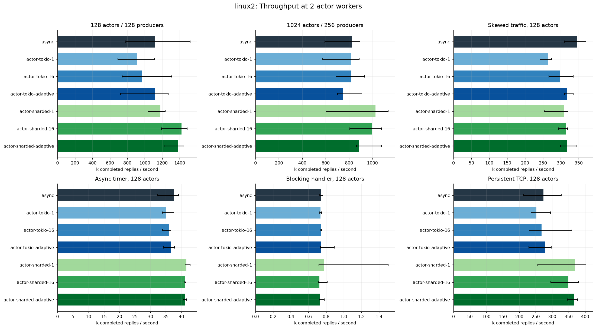
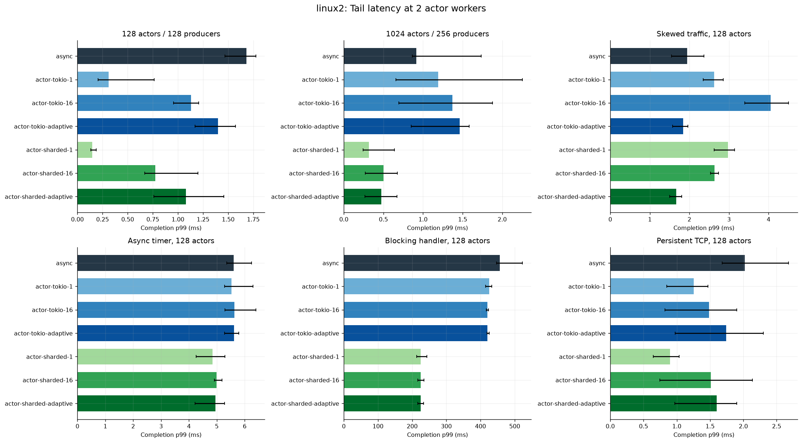
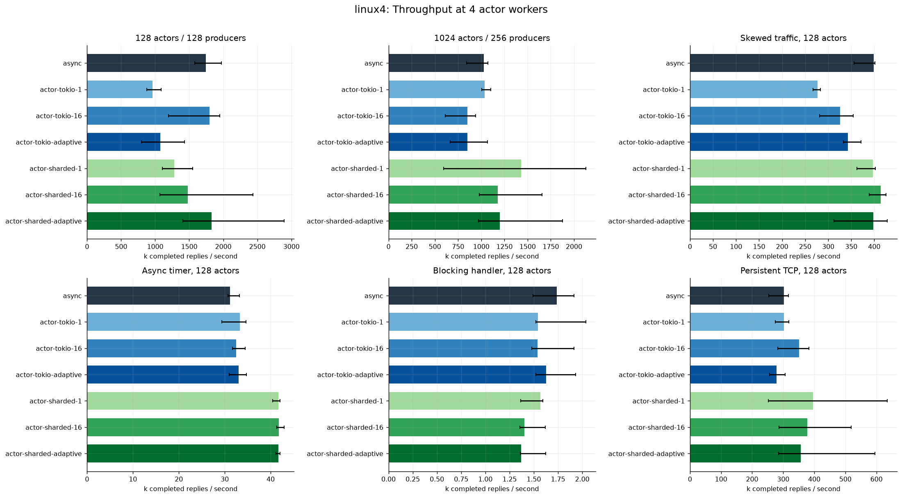
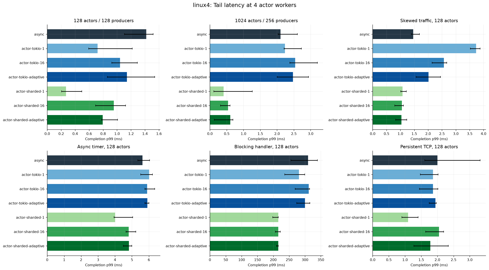
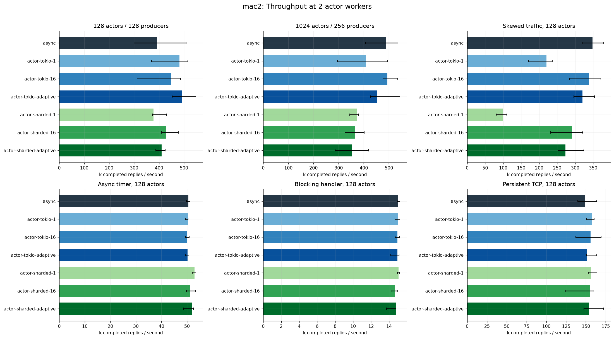
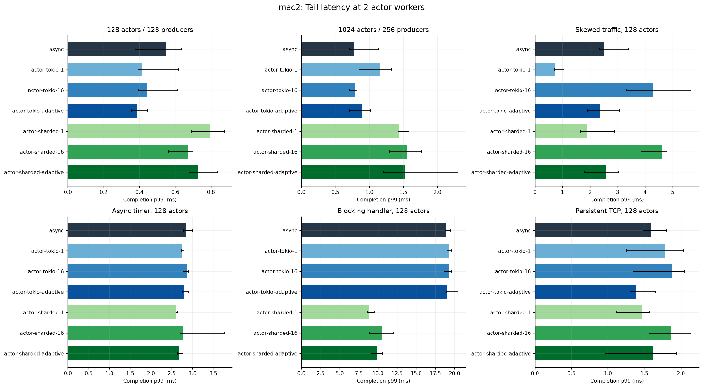
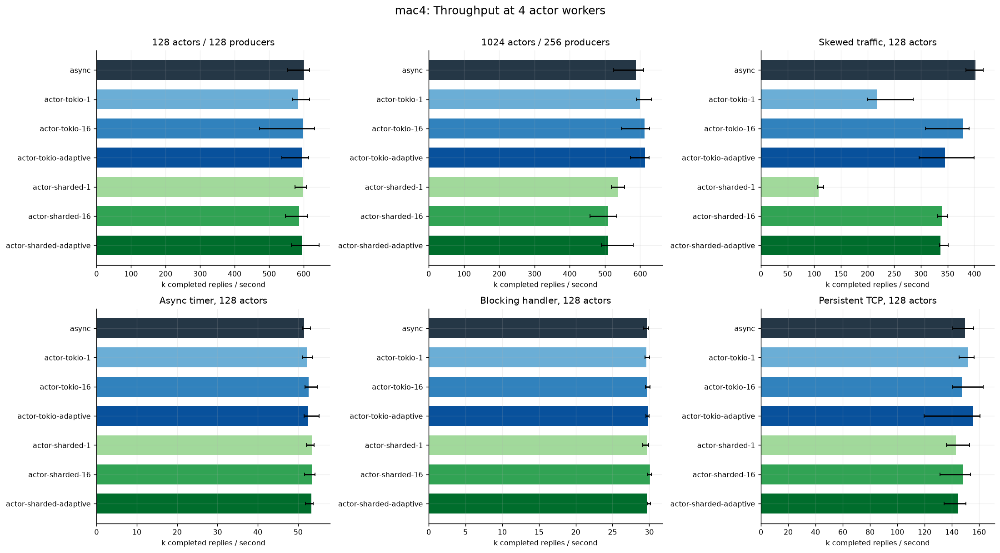
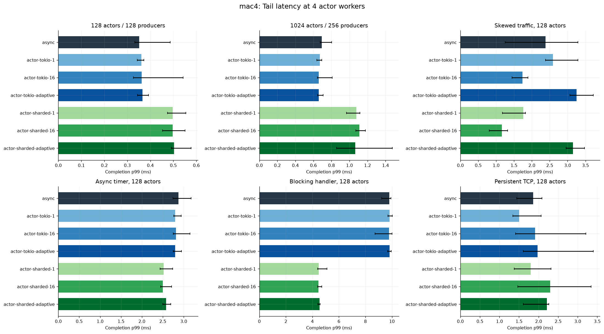

# Spawned: full actor sharding and batching

1,050 measured processes, 1,050 successful; 86,016,070 validated requests. Five independent processes per cell. Existing public actor/protocol interfaces and production defaults are unchanged.

Variant suffixes -1/-16 mean message-turn size, not actor or thread count. All compared paths run actual Spawned actors, boxed envelopes, unbounded mailboxes, replies and lifecycle. This study replaces the previous native-loop semantic mismatch with a matched comparison. It does not erase runtime ownership, placement and compatibility differences.

[Implementation and research questions](../../../docs/research/full-actor-shards.md) · [Validation and known test limitations](../../VALIDATION-FULL-ACTORS.md) · [Raw data and hashes](../../results/full-actors-2026-11-05/manifest.json)

## Findings and recommendation

**Keep Tokio as the default. Retain full-actor sharding as opt-in research for
Linux workloads, with an explicit runtime owner and compatibility contract before
considering a supported backend.** The new matched comparison changes the earlier
native-loop story: gains depend strongly on environment, worker budget and traffic.
Five short, unpinned repetitions are exploratory evidence, not production forecasts.

### Full actor CPU scaling: 1,024 actors / 256 producers

| Environment | Actor workers | Existing Tokio replies/s | Sharded batch-16 replies/s | Tokio completion p99 | Sharded completion p99 |
|---|---:|---:|---:|---:|---:|
| Native macOS | 2 | 488,999 | 365,045 | 0.779 ms | 1.557 ms |
| Native macOS | 4 | 587,212 | 509,723 | 0.693 ms | 1.111 ms |
| Linux VM | 2 | 826,880 | 999,398 | 0.918 ms | 0.503 ms |
| Linux VM | 4 | 1,029,048 | 1,179,428 | 2.106 ms | 0.542 ms |

These are comparisons within each row. macOS runs on the host; Linux runs in an
OrbStack VM/container restricted to four virtual CPUs and 8 GiB. There is no
cross-OS kernel-speed claim. The previous native-loop advantage does not reproduce
in the large macOS full-actor case, while Linux sharding remains promising here.
These experiments do not isolate which envelope, allocation, wakeup, placement or
reactor cost explains the difference; profiling is needed for causal attribution.

### Throughput and overall p99 do not establish fairness

In Linux's four-worker hotspot case, fixed-16 sharding improves overall p99 from
1.465 to 1.053 ms, but **cold-actor p99 worsens from 0.553 to 1.305 ms**. Static
placement can isolate some traffic and concentrate other traffic. Use cold/hot
breakdowns, not only the overall distribution, when deciding a scheduling policy.

Batches are not a universal improvement on existing Tokio. With two macOS workers
and 128 actors, Tokio-adaptive reaches 492k/s versus baseline 392k/s, but their run
ranges overlap (453–548k and 300–509k). With four workers, the same case is roughly
596k versus 602k/s. At 1,024 actors, Linux Tokio-adaptive trails its unmodified Tokio
baseline at both budgets. Fixed batch 16 can improve on forced yield-every-message
without improving on Tokio's existing cooperative policy; always keep `async` as
the reference, not just the artificially frequent-yield control.

The balanced RPC cases usually have at most one outstanding request per actor,
so they often do not sustain a mailbox backlog. Differences between those cells
cannot automatically be credited to batch size. The hotspot case exercises a busy
mailbox; burst and offered-rate sweeps should quantify turn policy further. Also,
`-1` means an explicit one-message turn, not the absence of a batching policy.

### Async waits, networking and blocking work

Persistent TCP on macOS clusters around 150k echoes/s across these designs, with
wide overlapping ranges. Linux with two workers fixed-16 sharding reaches 349k/s versus 274k/s for
Tokio; Linux with four workers reaches 377k versus 302k/s, with mixed latency outcomes (fixed sharding
p99 2.050 ms versus Tokio 2.002 ms at four workers). The common server has one native
thread per socket; this is not a complete optimized application/network stack.

The 1 ms async-timer case also changes by environment and worker count. It measures
runtime/OS timer behavior plus scheduling, not calibrated 1 ms service or CPU work.

The blocking case deliberately sleeps inside an async handler. Its requested
100 µs sleep has Linux with two workers handler p99 around 3.7 ms. Sharding can reduce completion
p99 while also reducing throughput; Linux with four workers fixed-16 is about 1,403/s versus Tokio's
1,736/s, with p99 about216 versus310 ms. This is a scheduling tradeoff under blocking
misuse, not preemption, faster CPU execution, or proof of a better blocking backend.

### Correctness and useful library changes

The experiment reuses actual Spawned lifecycle machinery instead of shipping the
native benchmark loop. Review caught and corrected idle-time turn accounting,
stop during a yield, and last-actor runtime teardown under detached helpers,
blocking children and monitor waiters. The process-owned pool now has explicit
terminal shutdown after actors/helpers complete; documented current-thread and
caller-context limitations remain.

Agy also found a general completion-status bug: a dropped completion sender could
make an async wait return `Kill` while synchronous `exit_reason()` still returned
`None` and `ChildHandle::is_alive()` returned true. The [separate fix](https://github.com/lambdaclass/spawned/pull/180) preserves a
published final reason, treats closed-without-reason as `Kill`, and allows the
already-exited blocking fast path to work without entering another runtime.
Tests cover both tasks and thread completion modes and resource-exhaustion startup.

The performance dataset is pinned to clean revision `9b22346`, before that getter-only
status fix. All successful benchmark cells are of that source/binary; performance
was not remeasured after the status-path fix. The later fix has separate validation.
Do not describe these numbers as measurements of an unrecorded final-branch binary.

### What to do next

1. Land the independently reviewable completion-status fix and document blocking
   pool / dedicated-reactor capacity. Keep the runtime experiment opt-in.
2. Profile the representative macOS loss and Linux gain, then test actor-to-actor
   chains/fan-out with controlled same/cross-shard placement and skew. This decides
   whether locality or a specific wakeup cost justifies a new supported backend.
3. Run fixed-arrival-rate saturation tests with intended-arrival timestamps,
   producer-lag accounting, cold tails and queue/RSS time series. Closed-loop RPC
   does not establish latency targets under overload.
4. Separately evaluate borrowing blocking workers per active handler to address
   persistent blocking actors exhausting the finite pool. That design is proposed,
   not implemented; sequencing, migration/TLS, async work and shutdown need review.

[Research protocol and decision criteria](../../RESEARCH-NEXT.md) describe these
follow-ups. Add another kernel backend, affinity policy or custom work-stealing
executor only after the evidence identifies the bottleneck or missing behavior.

## Reading the figures

Bars show medians; whiskers show observed min/max across fresh processes, not confidence intervals. p99 is the median of run-level handler-completion p99s, not a pooled quantile. Caller-observed latency is retained separately in the CSV. Closed-loop traffic has at most one request per producer; these are not fixed-arrival-rate SLO tests. Compare within a platform and worker budget; Linux is a four-CPU OrbStack VM/container.

## linux2: 2 actor workers

Source `9b223463599ffb18615e0fc7f538924bd3edd8e7` (dirty: `False`), Linux-7.2.12-orbstack-00394-gbecdd6130068-aarch64-with-glibc2.36, rustc 1.93.1 (01f6ddf75 2026-02-11). File limits `[20480, 1048576]`; cgroup `{'/sys/fs/cgroup/cpuset.cpus.effective': '0-3', '/sys/fs/cgroup/cpu.max': 'max 100000', '/sys/fs/cgroup/memory.max': '8589934592', '/sys/fs/cgroup/pids.max': '4096'}`.

Sharded clients have a current-thread observer plus N actor workers; ordinary/batched Tokio uses N actor workers on the caller runtime. Producers and the common thread-per-socket echo server are additional equal controls. Affinity, frequency scaling and unrelated host activity are uncontrolled.

### Per-cell results

| Variant | Case | n | Replies/s | Completion p99 ms | Cold p99 ms | CPU s | Peak RSS MB |
|---|---|---:|---:|---:|---:|---:|---:|
| async | active1024_p256 | 5 | 826,880 | 0.9176 | — | 1.21 | 46.3 |
| actor-tokio-1 | active1024_p256 | 5 | 814,581 | 1.1937 | — | 1.18 | 46.4 |
| actor-tokio-16 | active1024_p256 | 5 | 819,844 | 1.3733 | — | 1.14 | 46.3 |
| actor-tokio-adaptive | active1024_p256 | 5 | 751,525 | 1.4631 | — | 1.19 | 46.4 |
| actor-sharded-1 | active1024_p256 | 5 | 1,027,458 | 0.3165 | — | 0.88 | 47.3 |
| actor-sharded-16 | active1024_p256 | 5 | 999,398 | 0.5033 | — | 0.94 | 47.3 |
| actor-sharded-adaptive | active1024_p256 | 5 | 886,191 | 0.4731 | — | 1.07 | 47.4 |
| async | active128_p128 | 5 | 1,116,222 | 1.6821 | — | 0.30 | 24.4 |
| actor-tokio-1 | active128_p128 | 5 | 913,362 | 0.3119 | — | 0.45 | 24.5 |
| actor-tokio-16 | active128_p128 | 5 | 971,718 | 1.1316 | — | 0.43 | 24.5 |
| actor-tokio-adaptive | active128_p128 | 5 | 1,118,104 | 1.3999 | — | 0.36 | 24.5 |
| actor-sharded-1 | active128_p128 | 5 | 1,179,550 | 0.1493 | — | 0.43 | 24.7 |
| actor-sharded-16 | active128_p128 | 5 | 1,419,684 | 0.7752 | — | 0.27 | 24.7 |
| actor-sharded-adaptive | active128_p128 | 5 | 1,383,345 | 1.0795 | — | 0.26 | 24.7 |
| async | alloc1 | 5 | 47,913 | 0.0353 | — | 0.51 | 5.8 |
| actor-tokio-1 | alloc1 | 5 | 50,095 | 0.0337 | — | 0.49 | 5.7 |
| actor-tokio-16 | alloc1 | 5 | 47,388 | 0.0356 | — | 0.48 | 5.8 |
| actor-tokio-adaptive | alloc1 | 5 | 52,120 | 0.0383 | — | 0.45 | 5.7 |
| actor-sharded-1 | alloc1 | 5 | 56,289 | 0.0240 | — | 0.38 | 5.9 |
| actor-sharded-16 | alloc1 | 5 | 87,404 | 0.0173 | — | 0.24 | 5.9 |
| actor-sharded-adaptive | alloc1 | 5 | 38,704 | 0.0320 | — | 0.47 | 5.9 |
| async | async_wait128 | 5 | 37,481 | 5.6018 | — | 0.11 | 7.1 |
| actor-tokio-1 | async_wait128 | 5 | 35,010 | 5.5261 | — | 0.20 | 7.0 |
| actor-tokio-16 | async_wait128 | 5 | 35,974 | 5.6376 | — | 0.17 | 7.1 |
| actor-tokio-adaptive | async_wait128 | 5 | 36,596 | 5.6164 | — | 0.10 | 7.0 |
| actor-sharded-1 | async_wait128 | 5 | 41,640 | 4.8412 | — | 0.09 | 7.3 |
| actor-sharded-16 | async_wait128 | 5 | 41,228 | 4.9919 | — | 0.10 | 7.2 |
| actor-sharded-adaptive | async_wait128 | 5 | 41,170 | 4.9504 | — | 0.12 | 7.2 |
| async | blocking128 | 5 | 742 | 456.4893 | — | 0.20 | 6.7 |
| actor-tokio-1 | blocking128 | 5 | 737 | 426.0215 | — | 0.20 | 6.7 |
| actor-tokio-16 | blocking128 | 5 | 745 | 419.9478 | — | 0.21 | 6.7 |
| actor-tokio-adaptive | blocking128 | 5 | 742 | 419.9740 | — | 0.21 | 6.7 |
| actor-sharded-1 | blocking128 | 5 | 774 | 224.9132 | — | 0.19 | 6.9 |
| actor-sharded-16 | blocking128 | 5 | 725 | 225.0220 | — | 0.21 | 6.8 |
| actor-sharded-adaptive | blocking128 | 5 | 731 | 224.8102 | — | 0.24 | 6.8 |
| async | hotspot128 | 5 | 344,732 | 1.9419 | 0.6307 | 0.82 | 24.4 |
| actor-tokio-1 | hotspot128 | 5 | 264,271 | 2.6218 | 2.4801 | 1.08 | 24.3 |
| actor-tokio-16 | hotspot128 | 5 | 296,695 | 4.0529 | 0.3249 | 0.98 | 24.5 |
| actor-tokio-adaptive | hotspot128 | 5 | 318,532 | 1.8383 | 0.7615 | 0.92 | 24.4 |
| actor-sharded-1 | hotspot128 | 5 | 310,158 | 2.9767 | 1.1602 | 0.90 | 24.6 |
| actor-sharded-16 | hotspot128 | 5 | 313,640 | 2.6314 | 0.4871 | 0.94 | 24.7 |
| actor-sharded-adaptive | hotspot128 | 5 | 317,903 | 1.6676 | 0.5163 | 0.93 | 24.6 |
| async | idle4 | 5 | — idle probe | 0.1146 | — | 0.00 | 2.8 |
| actor-tokio-1 | idle4 | 5 | — idle probe | 0.0614 | — | 0.00 | 2.7 |
| actor-tokio-16 | idle4 | 5 | — idle probe | 0.1052 | — | 0.00 | 2.9 |
| actor-tokio-adaptive | idle4 | 5 | — idle probe | 0.1093 | — | 0.00 | 2.7 |
| actor-sharded-1 | idle4 | 5 | — idle probe | 0.1008 | — | 0.00 | 2.7 |
| actor-sharded-16 | idle4 | 5 | — idle probe | 0.0614 | — | 0.00 | 2.7 |
| actor-sharded-adaptive | idle4 | 5 | — idle probe | 0.0754 | — | 0.00 | 2.7 |
| async | rpc1 | 5 | 44,917 | 0.0356 | — | 0.53 | 5.8 |
| actor-tokio-1 | rpc1 | 5 | 50,699 | 0.0342 | — | 0.48 | 5.8 |
| actor-tokio-16 | rpc1 | 5 | 57,980 | 0.0235 | — | 0.43 | 5.9 |
| actor-tokio-adaptive | rpc1 | 5 | 54,202 | 0.0260 | — | 0.47 | 5.9 |
| actor-sharded-1 | rpc1 | 5 | 65,573 | 0.0225 | — | 0.30 | 5.8 |
| actor-sharded-16 | rpc1 | 5 | 40,870 | 0.0324 | — | 0.49 | 5.9 |
| actor-sharded-adaptive | rpc1 | 5 | 47,882 | 0.0229 | — | 0.42 | 5.9 |
| async | tcp128 | 5 | 273,797 | 2.0233 | — | 0.37 | 12.1 |
| actor-tokio-1 | tcp128 | 5 | 251,755 | 1.2535 | — | 0.39 | 11.9 |
| actor-tokio-16 | tcp128 | 5 | 267,681 | 1.4829 | — | 0.38 | 12.1 |
| actor-tokio-adaptive | tcp128 | 5 | 278,677 | 1.7427 | — | 0.39 | 12.1 |
| actor-sharded-1 | tcp128 | 5 | 370,150 | 0.8989 | — | 0.33 | 12.2 |
| actor-sharded-16 | tcp128 | 5 | 349,235 | 1.5143 | — | 0.34 | 12.3 |
| actor-sharded-adaptive | tcp128 | 5 | 367,601 | 1.6023 | — | 0.33 | 12.3 |

CPU/RSS include process startup, warmup, native producer/server threads, sample storage, sorting and teardown. They are not isolated actor-core utilization or per-actor heap. Allocation instrumentation is enabled only in alloc1; zero elsewhere means unavailable.

## linux4: 4 actor workers

Source `9b223463599ffb18615e0fc7f538924bd3edd8e7` (dirty: `False`), Linux-7.2.12-orbstack-00394-gbecdd6130068-aarch64-with-glibc2.36, rustc 1.93.1 (01f6ddf75 2026-02-11). File limits `[20480, 1048576]`; cgroup `{'/sys/fs/cgroup/cpuset.cpus.effective': '0-3', '/sys/fs/cgroup/cpu.max': 'max 100000', '/sys/fs/cgroup/memory.max': '8589934592', '/sys/fs/cgroup/pids.max': '4096'}`.

Sharded clients have a current-thread observer plus N actor workers; ordinary/batched Tokio uses N actor workers on the caller runtime. Producers and the common thread-per-socket echo server are additional equal controls. Affinity, frequency scaling and unrelated host activity are uncontrolled.

### Per-cell results

| Variant | Case | n | Replies/s | Completion p99 ms | Cold p99 ms | CPU s | Peak RSS MB |
|---|---|---:|---:|---:|---:|---:|---:|
| async | active1024_p256 | 5 | 1,029,048 | 2.1056 | — | 0.99 | 46.4 |
| actor-tokio-1 | active1024_p256 | 5 | 1,034,889 | 2.2389 | — | 0.98 | 46.4 |
| actor-tokio-16 | active1024_p256 | 5 | 849,859 | 2.5415 | — | 1.21 | 46.4 |
| actor-tokio-adaptive | active1024_p256 | 5 | 851,690 | 2.4760 | — | 1.20 | 46.4 |
| actor-sharded-1 | active1024_p256 | 5 | 1,429,171 | 0.4066 | — | 0.73 | 47.3 |
| actor-sharded-16 | active1024_p256 | 5 | 1,179,428 | 0.5419 | — | 0.83 | 47.4 |
| actor-sharded-adaptive | active1024_p256 | 5 | 1,199,020 | 0.6042 | — | 0.83 | 47.4 |
| async | active128_p128 | 5 | 1,744,436 | 1.4179 | — | 0.24 | 24.6 |
| actor-tokio-1 | active128_p128 | 5 | 961,623 | 0.7220 | — | 0.49 | 24.6 |
| actor-tokio-16 | active128_p128 | 5 | 1,800,475 | 1.0443 | — | 0.30 | 24.5 |
| actor-tokio-adaptive | active128_p128 | 5 | 1,078,394 | 1.1409 | — | 0.37 | 24.5 |
| actor-sharded-1 | active128_p128 | 5 | 1,277,895 | 0.2682 | — | 0.35 | 24.7 |
| actor-sharded-16 | active128_p128 | 5 | 1,476,584 | 0.9534 | — | 0.28 | 24.7 |
| actor-sharded-adaptive | active128_p128 | 5 | 1,826,685 | 0.7961 | — | 0.21 | 24.8 |
| async | async_wait128 | 5 | 31,158 | 5.6245 | — | 0.20 | 7.2 |
| actor-tokio-1 | async_wait128 | 5 | 33,333 | 6.0112 | — | 0.13 | 7.3 |
| actor-tokio-16 | async_wait128 | 5 | 32,449 | 5.8984 | — | 0.22 | 7.2 |
| actor-tokio-adaptive | async_wait128 | 5 | 33,021 | 5.9121 | — | 0.21 | 7.5 |
| actor-sharded-1 | async_wait128 | 5 | 41,683 | 4.0107 | — | 0.13 | 7.3 |
| actor-sharded-16 | async_wait128 | 5 | 41,770 | 4.8113 | — | 0.14 | 7.3 |
| actor-sharded-adaptive | async_wait128 | 5 | 41,650 | 4.8229 | — | 0.14 | 7.3 |
| async | blocking128 | 5 | 1,736 | 310.0335 | — | 0.18 | 6.8 |
| actor-tokio-1 | blocking128 | 5 | 1,544 | 281.0813 | — | 0.19 | 6.7 |
| actor-tokio-16 | blocking128 | 5 | 1,538 | 311.8222 | — | 0.19 | 6.8 |
| actor-tokio-adaptive | blocking128 | 5 | 1,626 | 299.9531 | — | 0.15 | 6.8 |
| actor-sharded-1 | blocking128 | 5 | 1,569 | 215.5200 | — | 0.16 | 7.0 |
| actor-sharded-16 | blocking128 | 5 | 1,403 | 215.9123 | — | 0.20 | 7.0 |
| actor-sharded-adaptive | blocking128 | 5 | 1,369 | 215.6059 | — | 0.19 | 7.1 |
| async | hotspot128 | 5 | 398,580 | 1.4649 | 0.5526 | 0.77 | 24.4 |
| actor-tokio-1 | hotspot128 | 5 | 276,849 | 3.7321 | 2.6682 | 1.03 | 24.5 |
| actor-tokio-16 | hotspot128 | 5 | 326,072 | 2.5678 | 2.1707 | 0.87 | 24.6 |
| actor-tokio-adaptive | hotspot128 | 5 | 343,044 | 2.0203 | 1.7216 | 0.83 | 24.5 |
| actor-sharded-1 | hotspot128 | 5 | 396,582 | 1.0804 | 1.2853 | 0.76 | 24.7 |
| actor-sharded-16 | hotspot128 | 5 | 413,500 | 1.0533 | 1.3055 | 0.74 | 24.7 |
| actor-sharded-adaptive | hotspot128 | 5 | 397,568 | 1.0425 | 1.0943 | 0.78 | 24.7 |
| async | tcp128 | 5 | 301,799 | 2.0021 | — | 0.40 | 12.3 |
| actor-tokio-1 | tcp128 | 5 | 302,864 | 1.8638 | — | 0.40 | 12.3 |
| actor-tokio-16 | tcp128 | 5 | 351,457 | 1.8655 | — | 0.36 | 12.0 |
| actor-tokio-adaptive | tcp128 | 5 | 278,019 | 1.9366 | — | 0.39 | 12.0 |
| actor-sharded-1 | tcp128 | 5 | 395,644 | 1.0927 | — | 0.28 | 12.4 |
| actor-sharded-16 | tcp128 | 5 | 377,086 | 2.0499 | — | 0.26 | 12.4 |
| actor-sharded-adaptive | tcp128 | 5 | 356,217 | 1.7832 | — | 0.31 | 12.4 |

CPU/RSS include process startup, warmup, native producer/server threads, sample storage, sorting and teardown. They are not isolated actor-core utilization or per-actor heap. Allocation instrumentation is enabled only in alloc1; zero elsewhere means unavailable.

## mac2: 2 actor workers

Source `9b223463599ffb18615e0fc7f538924bd3edd8e7` (dirty: `False`), macOS-26.6.2-arm64-arm-64bit-Mach-O, rustc 1.93.0 (254b59607 2026-01-19) (built from a source tarball). File limits `[4096, 9223372036854775807]`; cgroup `{}`.

Sharded clients have a current-thread observer plus N actor workers; ordinary/batched Tokio uses N actor workers on the caller runtime. Producers and the common thread-per-socket echo server are additional equal controls. Affinity, frequency scaling and unrelated host activity are uncontrolled.

### Per-cell results

| Variant | Case | n | Replies/s | Completion p99 ms | Cold p99 ms | CPU s | Peak RSS MB |
|---|---|---:|---:|---:|---:|---:|---:|
| async | active1024_p256 | 5 | 488,999 | 0.7793 | — | 3.26 | 41.9 |
| actor-tokio-1 | active1024_p256 | 5 | 409,497 | 1.1501 | — | 3.90 | 42.7 |
| actor-tokio-16 | active1024_p256 | 5 | 493,812 | 0.7852 | — | 3.16 | 40.4 |
| actor-tokio-adaptive | active1024_p256 | 5 | 452,553 | 0.8922 | — | 3.23 | 39.8 |
| actor-sharded-1 | active1024_p256 | 5 | 373,936 | 1.4317 | — | 4.17 | 42.7 |
| actor-sharded-16 | active1024_p256 | 5 | 365,045 | 1.5568 | — | 4.11 | 42.7 |
| actor-sharded-adaptive | active1024_p256 | 5 | 351,867 | 1.5198 | — | 4.16 | 42.7 |
| async | active128_p128 | 5 | 392,310 | 0.5499 | — | 1.87 | 23.0 |
| actor-tokio-1 | active128_p128 | 5 | 482,216 | 0.4125 | — | 1.64 | 23.2 |
| actor-tokio-16 | active128_p128 | 5 | 446,798 | 0.4410 | — | 1.69 | 23.7 |
| actor-tokio-adaptive | active128_p128 | 5 | 491,612 | 0.3872 | — | 1.57 | 23.1 |
| actor-sharded-1 | active128_p128 | 5 | 377,436 | 0.7965 | — | 2.06 | 23.9 |
| actor-sharded-16 | active128_p128 | 5 | 427,241 | 0.6706 | — | 1.84 | 23.3 |
| actor-sharded-adaptive | active128_p128 | 5 | 409,997 | 0.7297 | — | 1.90 | 23.2 |
| async | alloc1 | 5 | 100,156 | 0.0188 | — | 0.43 | 11.5 |
| actor-tokio-1 | alloc1 | 5 | 122,799 | 0.0152 | — | 0.33 | 11.4 |
| actor-tokio-16 | alloc1 | 5 | 107,467 | 0.0161 | — | 0.36 | 11.4 |
| actor-tokio-adaptive | alloc1 | 5 | 99,346 | 0.0233 | — | 0.35 | 11.4 |
| actor-sharded-1 | alloc1 | 5 | 131,160 | 0.0086 | — | 0.27 | 11.5 |
| actor-sharded-16 | alloc1 | 5 | 144,696 | 0.0089 | — | 0.24 | 11.5 |
| actor-sharded-adaptive | alloc1 | 5 | 141,963 | 0.0095 | — | 0.24 | 11.5 |
| async | async_wait128 | 5 | 50,586 | 2.8560 | — | 0.24 | 11.3 |
| actor-tokio-1 | async_wait128 | 5 | 50,279 | 2.7622 | — | 0.23 | 11.2 |
| actor-tokio-16 | async_wait128 | 5 | 50,162 | 2.8655 | — | 0.25 | 11.3 |
| actor-tokio-adaptive | async_wait128 | 5 | 50,259 | 2.8072 | — | 0.24 | 11.2 |
| actor-sharded-1 | async_wait128 | 5 | 52,944 | 2.6149 | — | 0.20 | 11.4 |
| actor-sharded-16 | async_wait128 | 5 | 51,097 | 2.7710 | — | 0.19 | 11.4 |
| actor-sharded-adaptive | async_wait128 | 5 | 52,074 | 2.6662 | — | 0.21 | 11.4 |
| async | blocking128 | 5 | 15,039 | 18.9676 | — | 0.08 | 10.6 |
| actor-tokio-1 | blocking128 | 5 | 14,997 | 19.2390 | — | 0.09 | 10.6 |
| actor-tokio-16 | blocking128 | 5 | 14,941 | 19.3138 | — | 0.09 | 10.6 |
| actor-tokio-adaptive | blocking128 | 5 | 14,935 | 19.0813 | — | 0.08 | 10.6 |
| actor-sharded-1 | blocking128 | 5 | 15,070 | 8.7886 | — | 0.09 | 10.8 |
| actor-sharded-16 | blocking128 | 5 | 14,668 | 10.5358 | — | 0.09 | 10.8 |
| actor-sharded-adaptive | blocking128 | 5 | 14,754 | 9.8753 | — | 0.10 | 10.8 |
| async | hotspot128 | 5 | 347,920 | 2.5136 | 0.6411 | 1.17 | 23.1 |
| actor-tokio-1 | hotspot128 | 5 | 220,119 | 0.7160 | 0.4945 | 1.44 | 23.0 |
| actor-tokio-16 | hotspot128 | 5 | 339,031 | 4.2869 | 0.2650 | 1.13 | 23.0 |
| actor-tokio-adaptive | hotspot128 | 5 | 320,022 | 2.3680 | 0.4895 | 1.25 | 23.0 |
| actor-sharded-1 | hotspot128 | 5 | 100,460 | 1.8965 | 0.4950 | 1.44 | 23.4 |
| actor-sharded-16 | hotspot128 | 5 | 291,269 | 4.6011 | 0.3386 | 1.20 | 23.2 |
| actor-sharded-adaptive | hotspot128 | 5 | 273,365 | 2.6025 | 0.5087 | 1.44 | 23.2 |
| async | idle4 | 5 | — idle probe | 0.0184 | — | 0.00 | 7.1 |
| actor-tokio-1 | idle4 | 5 | — idle probe | 0.0205 | — | 0.00 | 7.1 |
| actor-tokio-16 | idle4 | 5 | — idle probe | 0.0236 | — | 0.00 | 7.1 |
| actor-tokio-adaptive | idle4 | 5 | — idle probe | 0.0186 | — | 0.00 | 7.1 |
| actor-sharded-1 | idle4 | 5 | — idle probe | 0.0199 | — | 0.00 | 7.2 |
| actor-sharded-16 | idle4 | 5 | — idle probe | 0.0220 | — | 0.00 | 7.2 |
| actor-sharded-adaptive | idle4 | 5 | — idle probe | 0.0220 | — | 0.00 | 7.2 |
| async | rpc1 | 5 | 103,707 | 0.0175 | — | 0.43 | 11.4 |
| actor-tokio-1 | rpc1 | 5 | 104,782 | 0.0170 | — | 0.41 | 11.4 |
| actor-tokio-16 | rpc1 | 5 | 112,262 | 0.0170 | — | 0.37 | 11.4 |
| actor-tokio-adaptive | rpc1 | 5 | 102,541 | 0.0173 | — | 0.43 | 11.4 |
| actor-sharded-1 | rpc1 | 5 | 131,048 | 0.0181 | — | 0.28 | 11.5 |
| actor-sharded-16 | rpc1 | 5 | 119,574 | 0.0103 | — | 0.29 | 11.5 |
| actor-sharded-adaptive | rpc1 | 5 | 147,329 | 0.0154 | — | 0.24 | 11.5 |
| async | tcp128 | 5 | 149,324 | 1.5936 | — | 1.19 | 15.9 |
| actor-tokio-1 | tcp128 | 5 | 157,566 | 1.7865 | — | 1.16 | 15.9 |
| actor-tokio-16 | tcp128 | 5 | 156,025 | 1.8808 | — | 1.15 | 15.8 |
| actor-tokio-adaptive | tcp128 | 5 | 151,764 | 1.3827 | — | 1.17 | 15.8 |
| actor-sharded-1 | tcp128 | 5 | 156,377 | 1.4667 | — | 1.23 | 16.0 |
| actor-sharded-16 | tcp128 | 5 | 154,645 | 1.8630 | — | 1.19 | 16.1 |
| actor-sharded-adaptive | tcp128 | 5 | 153,996 | 1.6200 | — | 1.20 | 16.1 |

CPU/RSS include process startup, warmup, native producer/server threads, sample storage, sorting and teardown. They are not isolated actor-core utilization or per-actor heap. Allocation instrumentation is enabled only in alloc1; zero elsewhere means unavailable.

## mac4: 4 actor workers

Source `9b223463599ffb18615e0fc7f538924bd3edd8e7` (dirty: `False`), macOS-26.6.2-arm64-arm-64bit-Mach-O, rustc 1.93.0 (254b59607 2026-01-19) (built from a source tarball). File limits `[4096, 9223372036854775807]`; cgroup `{}`.

Sharded clients have a current-thread observer plus N actor workers; ordinary/batched Tokio uses N actor workers on the caller runtime. Producers and the common thread-per-socket echo server are additional equal controls. Affinity, frequency scaling and unrelated host activity are uncontrolled.

### Per-cell results

| Variant | Case | n | Replies/s | Completion p99 ms | Cold p99 ms | CPU s | Peak RSS MB |
|---|---|---:|---:|---:|---:|---:|---:|
| async | active1024_p256 | 5 | 587,212 | 0.6931 | — | 4.97 | 41.8 |
| actor-tokio-1 | active1024_p256 | 5 | 598,867 | 0.6717 | — | 4.60 | 41.8 |
| actor-tokio-16 | active1024_p256 | 5 | 612,765 | 0.6582 | — | 4.62 | 39.9 |
| actor-tokio-adaptive | active1024_p256 | 5 | 614,099 | 0.6583 | — | 4.58 | 39.9 |
| actor-sharded-1 | active1024_p256 | 5 | 536,239 | 1.0768 | — | 5.36 | 42.8 |
| actor-sharded-16 | active1024_p256 | 5 | 509,723 | 1.1105 | — | 5.58 | 42.8 |
| actor-sharded-adaptive | active1024_p256 | 5 | 508,880 | 1.0637 | — | 5.37 | 42.8 |
| async | active128_p128 | 5 | 601,642 | 0.3523 | — | 2.30 | 23.2 |
| actor-tokio-1 | active128_p128 | 5 | 584,635 | 0.3613 | — | 2.33 | 23.2 |
| actor-tokio-16 | active128_p128 | 5 | 597,310 | 0.3621 | — | 2.32 | 23.2 |
| actor-tokio-adaptive | active128_p128 | 5 | 596,233 | 0.3665 | — | 2.34 | 23.2 |
| actor-sharded-1 | active128_p128 | 5 | 597,211 | 0.4967 | — | 2.45 | 23.4 |
| actor-sharded-16 | active128_p128 | 5 | 587,562 | 0.4969 | — | 2.38 | 23.3 |
| actor-sharded-adaptive | active128_p128 | 5 | 596,573 | 0.5026 | — | 2.41 | 23.4 |
| async | async_wait128 | 5 | 51,489 | 2.8727 | — | 0.35 | 11.3 |
| actor-tokio-1 | async_wait128 | 5 | 52,268 | 2.7985 | — | 0.33 | 11.4 |
| actor-tokio-16 | async_wait128 | 5 | 52,626 | 2.8148 | — | 0.35 | 11.3 |
| actor-tokio-adaptive | async_wait128 | 5 | 52,514 | 2.7942 | — | 0.31 | 11.3 |
| actor-sharded-1 | async_wait128 | 5 | 53,498 | 2.5170 | — | 0.23 | 11.4 |
| actor-sharded-16 | async_wait128 | 5 | 53,541 | 2.4987 | — | 0.21 | 11.5 |
| actor-sharded-adaptive | async_wait128 | 5 | 53,334 | 2.5791 | — | 0.25 | 11.5 |
| async | blocking128 | 5 | 29,734 | 9.8075 | — | 0.10 | 10.6 |
| actor-tokio-1 | blocking128 | 5 | 29,643 | 9.8241 | — | 0.10 | 10.6 |
| actor-tokio-16 | blocking128 | 5 | 29,752 | 9.7730 | — | 0.09 | 10.6 |
| actor-tokio-adaptive | blocking128 | 5 | 29,884 | 9.8293 | — | 0.10 | 10.7 |
| actor-sharded-1 | blocking128 | 5 | 29,716 | 4.4835 | — | 0.09 | 10.9 |
| actor-sharded-16 | blocking128 | 5 | 30,089 | 4.4509 | — | 0.09 | 10.9 |
| actor-sharded-adaptive | blocking128 | 5 | 29,764 | 4.5431 | — | 0.10 | 10.9 |
| async | hotspot128 | 5 | 402,523 | 2.3846 | 0.3104 | 1.57 | 23.1 |
| actor-tokio-1 | hotspot128 | 5 | 217,673 | 2.5880 | 2.6630 | 1.92 | 23.1 |
| actor-tokio-16 | hotspot128 | 5 | 379,237 | 1.7398 | 1.7653 | 1.57 | 23.1 |
| actor-tokio-adaptive | hotspot128 | 5 | 345,055 | 3.2498 | 0.9366 | 1.61 | 23.1 |
| actor-sharded-1 | hotspot128 | 5 | 107,946 | 1.7605 | 1.0214 | 1.61 | 23.3 |
| actor-sharded-16 | hotspot128 | 5 | 340,339 | 1.1607 | 0.3650 | 1.53 | 23.4 |
| actor-sharded-adaptive | hotspot128 | 5 | 337,119 | 3.1479 | 0.6798 | 1.57 | 23.4 |
| async | tcp128 | 5 | 149,548 | 1.8647 | — | 1.40 | 16.0 |
| actor-tokio-1 | tcp128 | 5 | 151,789 | 1.5068 | — | 1.42 | 16.0 |
| actor-tokio-16 | tcp128 | 5 | 147,553 | 1.9078 | — | 1.41 | 16.0 |
| actor-tokio-adaptive | tcp128 | 5 | 155,451 | 1.9767 | — | 1.36 | 16.0 |
| actor-sharded-1 | tcp128 | 5 | 142,866 | 1.7992 | — | 1.44 | 16.2 |
| actor-sharded-16 | tcp128 | 5 | 147,897 | 2.2995 | — | 1.41 | 16.2 |
| actor-sharded-adaptive | tcp128 | 5 | 144,793 | 2.2113 | — | 1.45 | 16.2 |

CPU/RSS include process startup, warmup, native producer/server threads, sample storage, sorting and teardown. They are not isolated actor-core utilization or per-actor heap. Allocation instrumentation is enabled only in alloc1; zero elsewhere means unavailable.

## Compatibility and interpretation

The sharded backend is Tokio-based and statically places actors; it adds neither work stealing nor CPU affinity. Current-thread runtime restrictions apply, including unsupported block_in_place. The process pool and its explicit terminal shutdown are experimental. External Context helper calls retain their caller-runtime binding. Full actor tests do not make those runtime differences disappear.

The initial actor-count-owned pool was rejected after agy review found premature helper/child runtime teardown. The corrected pool has explicit lifetime, and turn-budget/cancellation regressions accompany it. Keep default Tokio until both workload evidence and lifecycle ownership justify a supported alternative.
