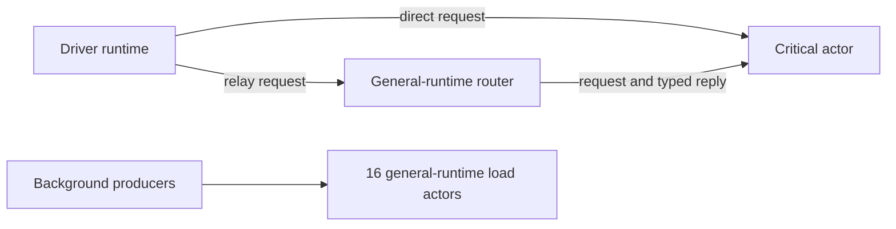

# Actors communicating across runtimes

Actors on separate Tokio runtimes communicate through the same `ActorRef` and
typed request/reply APIs. Keep the runtimes alive, start each actor while entered
into its intended runtime, and stop/await actors before dropping their runtimes.
The [complete executable example](../../../../concurrency/benches/runtime_isolation.rs)
exercises this with ordinary actors; no new public backend API is required.

A split can protect a critical path from other runnable work, but only if the
whole path avoids the overloaded pool. It also reserves capacity that background
work cannot borrow. The controlled benchmark below makes both costs visible.

## Fixed-budget comparison

All layouts use four physical actor cores (CPUs 2–5) and four separate driver
workers on CPUs 10–13, at nice 10 on fede. The shared layout uses one normal Tokio
multi-thread runtime with four workers. The split layout uses one normal Tokio
runtime with one worker on CPU 2 for the critical actor, plus another with three
workers on CPUs 3–5 for general actors. These are parked Tokio runtimes, not the
spinning current-thread shard profile from the earlier study.

There are 18 actors in every process: one critical actor, one router and 16 load
actors. Critical work performs 800 LCG iterations/request. Busy load uses 128
closed-loop producers across 16 actors, each doing 50,000 iterations/request. Idle
load starts those actors without producing background requests.

- **Direct:** the driver requests the critical actor and awaits its typed reply.
- **Relay:** the driver requests a general-runtime router, which requests the
  critical actor, awaits its reply, and then replies upstream. In split mode,
  this crosses runtimes in both directions and leaves general-runtime work on
  the critical path.



The diagram describes the split case. In shared mode, the router, critical actor
and background actors share one four-worker runtime.

## Measured result

[Full table, min/max ranges and graphs](report/REPORT.md) ·
[raw samples](results/raw.csv) · [metadata and frozen schedule](results/metadata.json).

Under busy background load, medians across three fresh processes were:

| Critical path | Shared p99 | Split p99 | Shared background requests/s | Split background requests/s |
|---|---:|---:|---:|---:|
| Direct to critical actor | 19.0 ms | 0.040 ms | 72,997 | 53,181 |
| Via general-runtime router | 21.4 ms | 35.4 ms | 70,594 | 62,297 |

The direct path benefits from isolation in this fixture, at a background-throughput
cost. Splitting only the destination makes the relay path worse here. Do not
isolate an actor and assume every caller's end-to-end latency is protected.

Each full process uses a two-second closed loop with one outstanding critical
request at a time. Changed latency therefore changes achieved critical traffic:
under busy direct load, about 319 critical requests/s shared versus 45,987/s split.
This is not equivalent offered traffic, an open-loop latency guarantee or an
ethrex/ethlambda speedup. Tail sample counts are especially small in the slow
cells; ranges are descriptive and not confidence intervals. Actual elapsed time
includes bounded final in-flight drain. Process CPU includes drivers; background
checks and critical validation are identical within matched configurations.

## Validation and reproduction

Measured source `a3cb5eb15d68f2e21a5d86eb19c84686e747547c` is retained in the
[source bundle](runtime-isolation-source-final.bundle), based on main f56ba3e0.
The benchmark passed release compilation and targeted all-warning-denied Clippy
on fede. Eight 100 ms smoke processes precede 24 full processes (2 layouts ×2 paths
×2 load cases ×3 fresh repetitions), in seeded order. Every process verifies
actual actor affinity, request IDs/computation, handled-message conservation and
18 starts/stops/drops, then joins actor runtimes. All 32 processes passed.
The initial compile-only preflights were corrected before any workload was run.
Agy approved the supplied benchmark for this bounded comparison; its review did
not execute tests. Source/gate/controller logs and exact schedules are retained.

The fixture is Linux-specific and uses taskset/proc CPU observations. The CPU IDs
are for this host; do not apply the small test mask to an entire client process.
From the repository root, build the benchmark:

```sh
cargo bench --locked -p spawned-concurrency --features backend-experiments \
  --bench runtime_isolation --no-run
```

Run the emitted executable with all `SPAWNED_EXPERIMENT_*` and
`TOKIO_WORKER_THREADS` variables unset, for example:

```sh
taskset -c 2,3,4,5 <runtime_isolation-executable> \
  --layout=split --path=relay --load=busy --seconds=2
```

Use `shared`/`split`, `direct`/`relay` and `idle`/`busy` to select a cell. The
[controller](isolation10.py) records source/binary/controller hashes and the full
32-process schedule. [Plot dependencies](../../../../benchmarks/requirements-research.txt)
record the used Python 3.12.3 environment. Rebuild the report on fede with:

```sh
python benchmarks/render_runtime_isolation.py \
  --data research/backend-experiments/2026-11-06-runtime-isolation/results \
  --output research/backend-experiments/2026-11-06-runtime-isolation/report
```

## Application implications

Start with the [ethrex/ethlambda source audit and measurement plan](CLIENT-WORKLOADS.md).
Both clients already isolate important work: ethlambda's chain actor uses
`Backend::Thread`, and ethrex's sequencer block producer uses `Backend::Blocking`.
Their costs also include helpers, storage, cryptography and other thread pools.
An async-backend toggle alone does not change those actors or shorten a running
serial handler. Use a real end-to-end client workload before choosing another
supported configuration.
