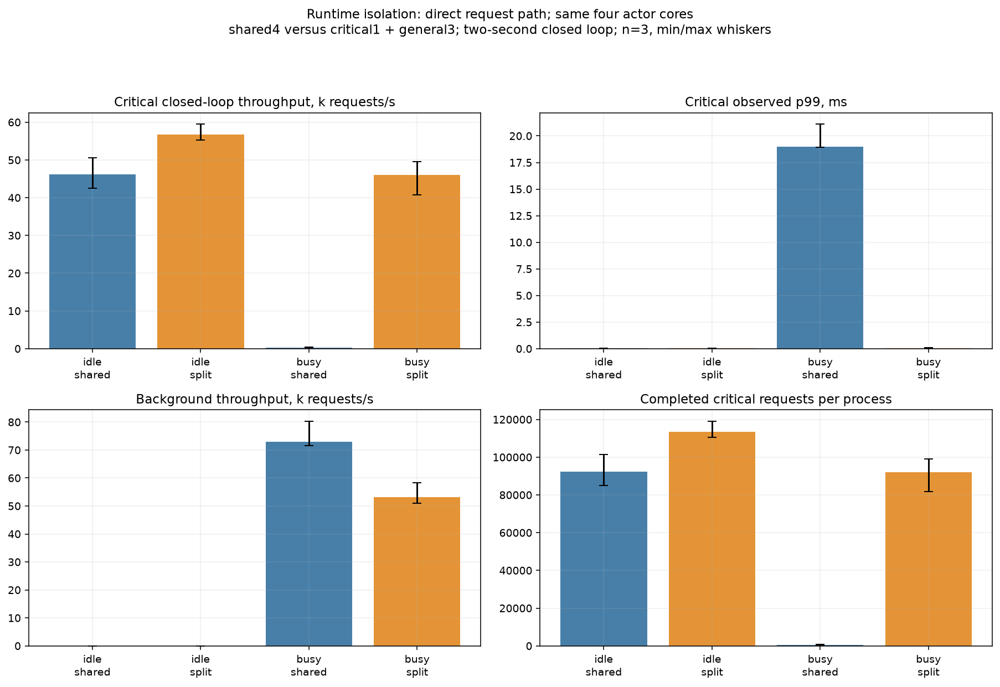
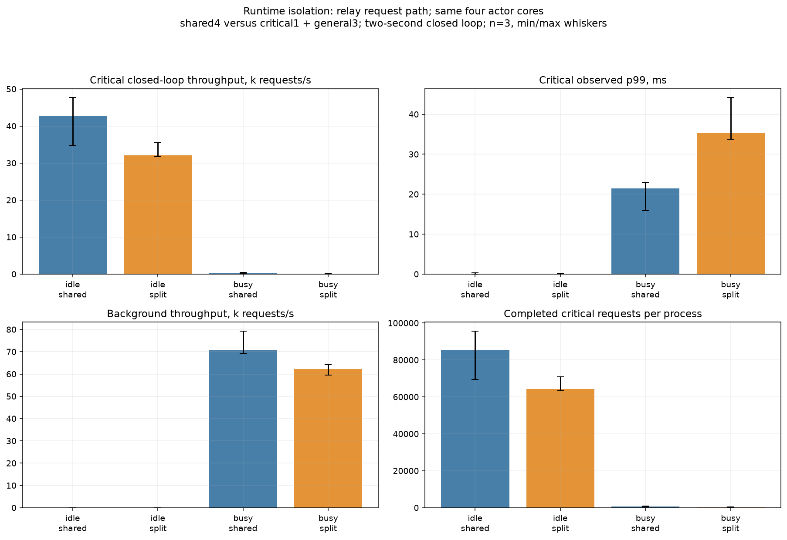

# Shared versus split actor runtimes

Four actor workers/cores in both layouts; four separate driver workers/cores. One closed-loop critical producer. Three fresh two-second processes/cell, with all final in-flight work drained. Different completed request rates are part of the result, not equivalent offered traffic or an open-loop SLO. P99s are short-run sample quantiles; min/max are not confidence intervals.

| Path | Background | Layout | Critical requests/s median | Critical p99 ms median [min–max] | Background requests/s median | Median critical sample count |
|---|---|---|---:|---:|---:|---:|
| direct | busy | shared | 319 | 18.996 [18.956–21.123] | 72,997 | 639 |
| direct | busy | split | 45,987 | 0.040 [0.035–0.072] | 53,181 | 92,119 |
| direct | idle | shared | 46,170 | 0.033 [0.028–0.052] | 0 | 92,402 |
| direct | idle | split | 56,778 | 0.023 [0.021–0.026] | 0 | 113,595 |
| relay | busy | shared | 286 | 21.423 [15.904–22.950] | 70,594 | 573 |
| relay | busy | split | 138 | 35.392 [33.755–44.212] | 62,297 | 276 |
| relay | idle | shared | 42,724 | 0.082 [0.030–0.315] | 0 | 85,452 |
| relay | idle | split | 32,126 | 0.050 [0.036–0.093] | 0 | 64,252 |

Isolating the destination helps the direct path in this synthetic load, at a background-throughput cost. When the request still traverses the busy general-runtime router, splitting the destination alone does not isolate the whole path. This is a normal Tokio shared-versus-partitioned resource comparison, not a Tokio replacement or client benchmark. Full experiment semantics and source audit are in the study README.
