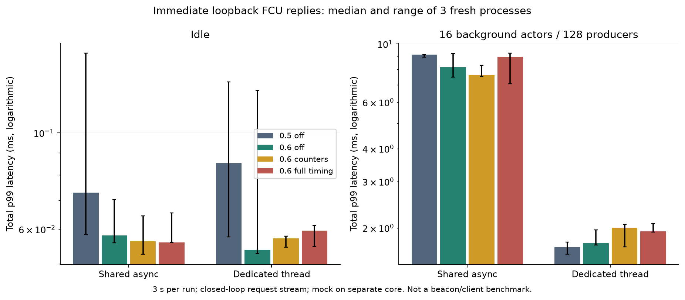
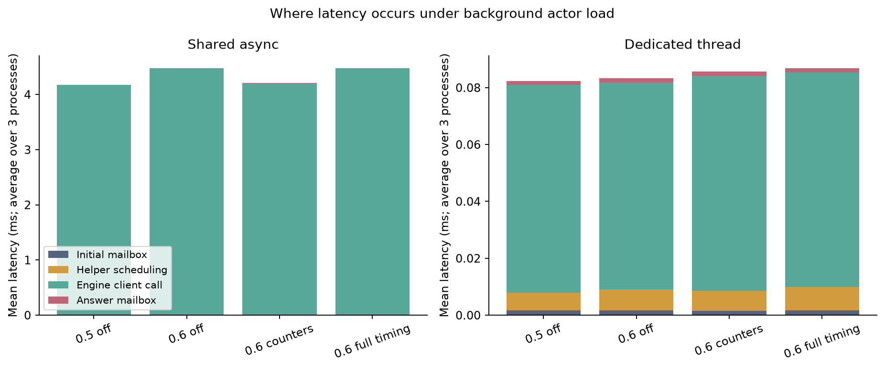
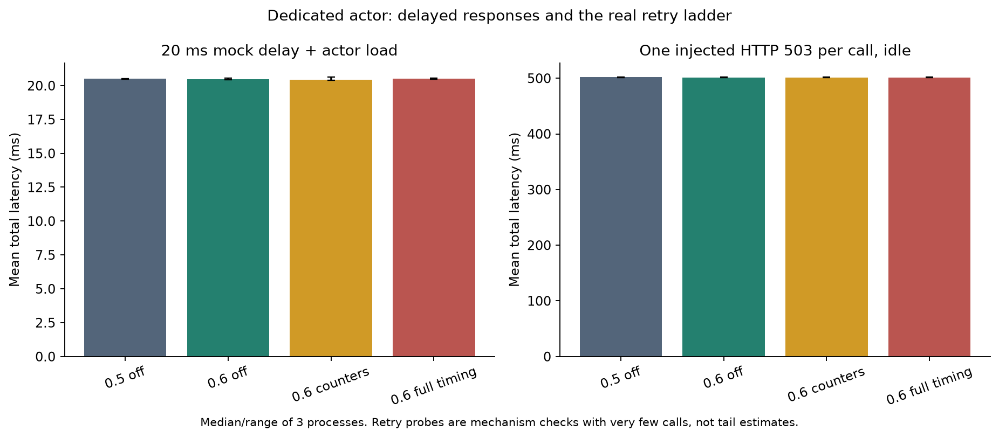

# Engine client / actor isolation probe on fede

This is a local diagnostic using Ethlambda's actual `EngineClient`, JSON-RPC
serialization, JWT generation, reqwest networking, retry ladder, and Spawned
actor dispatch. It is **not a full beacon-node replay**: there is no state
transition, database, P2P custody traffic or real execution client. It cannot by
itself attribute the eth4/eth5 production difference.

## Results

All **84 runs passed**, comprising **1,770,096 measured critical requests**
plus warm-up calls. Maximum sampled combined client/mock RSS was 47.6 MiB,
with 12 threads and 23 descriptors. No production services were contacted.

The main finding is that runtime contention can inflate the **Engine-call
interval**, even with a mock configured to answer immediately. Under busy
shared async execution, median process mean call time was **4.041 ms on 0.5**
and **4.496 ms on metrics-off 0.6**. With dedicated placement it was **0.073 ms
on both**. Mean answer-mailbox time remained below 2 microseconds. This localizes
most of this probe's contention delay inside the awaited client path rather
than after the answer is queued. It supports investigating local I/O/task
progress along with the real EL, not interpreting an EL-request span as pure
server execution time. This probe does not record wire timestamps to split
transport, mock processing and client wakeup within that interval.

| Condition / statistic, milliseconds | 0.5 off | 0.6 off | 0.6 counters | 0.6 full timing |
|---|---:|---:|---:|---:|
| Immediate, dedicated idle: mean | 0.0530 | 0.0489 | 0.0501 | 0.0509 |
| Immediate, shared busy: p99 | 9.103 | 8.163 | 7.639 | 8.948 |
| Immediate, dedicated busy: p99 | 1.692 | 1.754 | 2.006 | 1.942 |
| 20 ms mock delay, dedicated busy: mean | 20.497 | 20.468 | 20.417 | 20.493 |
| One injected 503, dedicated idle: mean | 501.789 | 501.372 | 501.381 | 501.596 |

Each table cell is the median of three process-level statistics, not a pooled
percentile. [All 28 conditions and repeat ranges](report/summary.csv) and
[machine-readable summary](report/summary.json) preserve the remaining results.

There is no large, consistent 0.6-specific slowdown in this probe. Dedicated
metrics-off 0.6 had mean 0.0819 ms and p99 1.754 ms under load, versus 0.0830 ms
and 1.692 ms on 0.5. The full-timing variant reached mean 0.0867 ms and p99
1.942 ms: approximately **6% higher mean and 11% higher p99** than metrics-off
0.6 in this short, fast-path case. Its critical throughput was about 5% lower.
Counters-only was not uniformly faster than full timing. Three repeats, short
runs, variable scheduler tails and closed-loop background traffic do not
establish a precise overhead estimate or a universal ranking. Shared-busy 0.6's
mean was also higher than 0.5's, while its median p99 was lower; the detailed
results should not be reduced to one general speedup/regression claim.

The configured 20 ms delay produced similar ~20.5 ms means across the variants
under load. One injected HTTP 503 produced ~501–502 ms calls on **all versions**,
confirming the real Engine client's first retry backoff can dominate the
measurement independently of the framework version. There are only two scored
calls per retry run; these are mechanism checks. They do not show that any
production outlier retried, and a one-second production request remains
unexplained without actual attempt/response evidence.

The useful next production measurement is a same-node crossover with the
prepared controls, correlated with EL attempt logs and request/response arrival
timings. These results make scheduling and retry behavior testable hypotheses;
they do not establish the cause of eth5's remaining latency difference. No new
release or production deployment was performed.

The [worker-budget follow-ups](one-worker/README.md) separately compare the
unreleased one-worker fix with the published runtime, including concurrent RPCs
and requests spaced by idle gaps. Their results are separate from the 84-run
version comparison above.

## What is exercised

[`engine_actor_probe.rs`](engine_actor_probe.rs) is installed as an example in
the `ethlambda-engine` crate in isolated source worktrees. A driver sends an
actor a request. The actor launches a Tokio helper that performs
`engine_forkchoiceUpdatedV3`, then sends the answer back to that actor. This
follows the helper/reply structure relevant to Ethlambda's payload request
timing, but uses a small FCU request rather than a real block's newPayload.
The helper does not retain a mutable borrow of the actor during the RPC.

Four conditions use three compiled binaries:

| Condition | Spawned | Framework metrics |
|---|---|---|
| `baseline05` | published 0.5.0 | absent |
| `control06` | published 0.6.0 | compiled out |
| `counters06` | published 0.6.0 | enabled, timing sample every 0 |
| `metrics06` | published 0.6.0 | enabled, timing every message |

Both versions use the original networking dependency edges and Rust 1.97.1,
with the repository's fat-LTO release profile and target flags. The Engine
client source is identical across the builds. This separates the framework's
collection overhead from the additional exporter and networking changes in
the deployed eth5 build; it does not benchmark that RPC exporter.
Spawned main's unreleased dedicated-runtime fix is **not** included.

The actor uses either the ambient three-worker async runtime or
`tasks::Backend::Thread`. `TOKIO_WORKER_THREADS=3` makes the published dedicated
backend's private worker pool explicit. These dedicated runs therefore use a
root thread plus three async workers, rather than main's newer one-worker pool.
Idle cases contain only the critical actor. Busy cases add **16 async actors
and 128 closed-loop producers**, each background handler performing 50,000
black-boxed integer steps. Background work shares the ambient runtime.

The mock runs on core 5, and all client threads inherit affinity to cores 2–4;
both run at nice 10. No compilation overlaps scored runs. The mock binds only
`127.0.0.1` on an ephemeral port and uses HTTP keepalive with TCP_NODELAY. No
real JWT secret, chain data or production service is used.

## Scenarios and measurement

There are **84 fresh-process runs**, three repeats of each condition:

- Immediate reply: async/dedicated placement, idle/busy; 3 seconds per run.
- 20 ms mock reply delay: dedicated placement, idle/busy; 3 seconds per run.
- One HTTP 503 followed by success for **each call**: dedicated, idle; 1 second
  per run. This deliberately exercises the actual 500 ms first retry backoff.

The order is shuffled with seed `20261108`. Each run starts fresh client and
mock processes. Eight, three or one initial requests respectively warm the
request path before sampling. A 300 ms startup pause precedes those requests;
this is a short local probe warm-up, not the production canary's 30-minute gate.

Five monotonic-clock intervals are recorded per request:

1. Driver send → first actor handler entry.
2. Handler entry → helper starts, including dispatch/launch work.
3. Helper starts → EngineClient returns, including request construction,
   serialization, transport, mock delay, retry sleeps and client wakeups.
4. Answer ready → answer handler entry, including enqueue/dispatch work.
5. Driver send → answer handler entry, equal to the sum of the four stages.

The driver waits for each answer before sending the next request. Throughput
is therefore **closed-loop** and changes with latency; offered load is not held
constant. Stage percentiles do not add. Reports preserve individual samples,
per-process means and empirical nearest-rank percentiles. Summary p99 values
are medians of three process-level p99s, with their ranges plotted. In the
20 ms case, roughly 150 observations per process make tails imprecise; the
retry runs have very few calls and demonstrate a mechanism, not a tail estimate.

Each run checks exact unique call/attempt counts, the number of injected
failures, successful parsing of every final reply, conservation of the four
timing stages, enabled metrics condition and successful shutdown. Metrics builds
also check zero active actors/handlers/requests/mailbox entries and enqueue/drop
accounting at completion. The controller samples combined client/mock resource
use and enforces 1 GiB RSS, 96 threads, 1,024 descriptors and 35 seconds per run.

## Reproduction

The scripts retain the paths used on fede. They expect the previously prepared
Ethlambda source clones, Rust toolchain and native build dependencies described
in the [control build notes](../controls/README.md).

1. Copy `engine_actor_probe.rs` and `mock_engine.py` into
   `/tmp/spawned-pr-security-review/` on fede.
2. Source `/tmp/spawned-fede-research-25dGGmPA/env.sh` and run `build.py`.
   It creates separate probe worktrees, permits only the example's new engine
   dev-dependency in Cargo.lock, and builds baseline, metrics-off and metrics-on
   examples sequentially. The full client binaries remain untouched.
3. Run `run.py` only after all builds finish. It refuses to replace its existing
   results directory; use a fresh output path when rerunning.
4. Run `analyze.py <results-directory> <report-directory>` with the research
   plotting environment pinned in `benchmarks/requirements-research.txt`.

Full source, build commands/hashes, machine details, run plan, per-run audits,
raw samples and plots accompany the report. Production diagnosis still needs
the same-node canary or a real workload replay with matching data, identity and
EL configuration; no production deployment or release is part of this probe.

Evidence is in [evidence](evidence/), including [build hashes](evidence/builds.json),
[the run plan](evidence/results/plan.json) and the [completion marker](evidence/results/COMPLETE).
Raw `stdout.json.gz` files are losslessly compressed, with the original
uncompressed hashes in [this index](evidence/uncompressed-stdout-sha256.json).
For example, `gzip -dc evidence/results/000-*/stdout.json.gz` reads the first
process's timing samples and summary.
