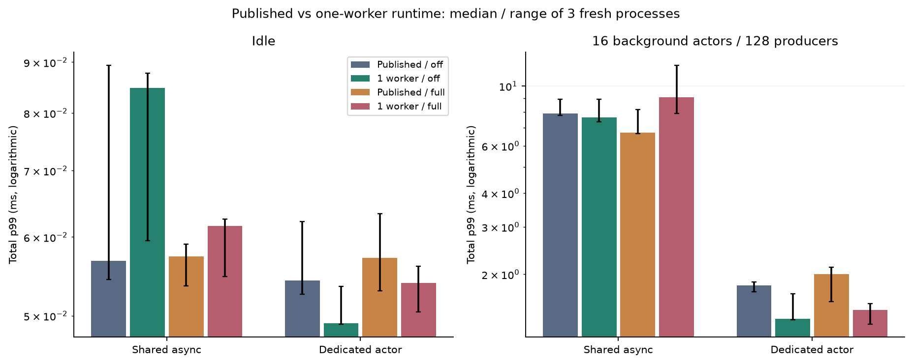
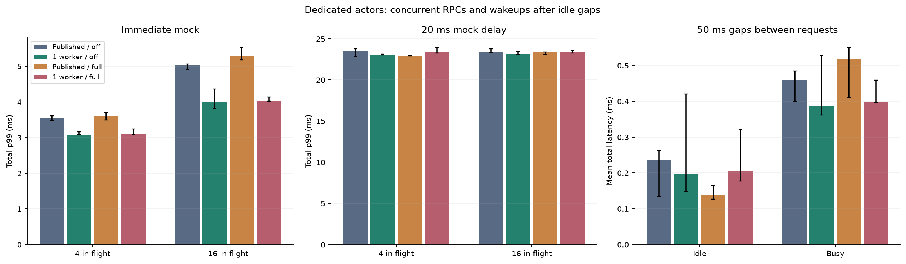
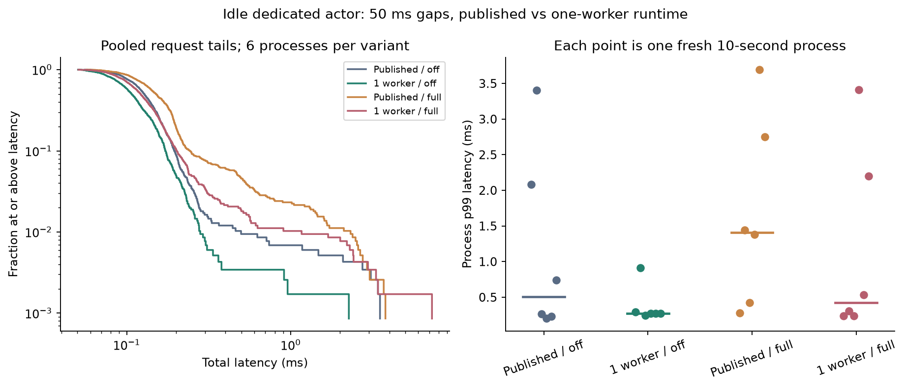

# Worker-budget follow-ups

These studies compare **published Spawned 0.6.0** with the same runtime source
plus the reviewed one-worker fix. They do not change a production node or
constitute a 0.6.1 release. All runtime source files except `src/threads/mod.rs`
are checked against the published crate. The EngineClient source, actor/helper
protocol, networking edges, Rust 1.97.1 and release settings are held constant.
The [runtime patch](runtime.patch) is the only library implementation change.

## Completed worker / concurrency results

All **156 functional/resource-gated runs passed**, comprising **2,835,757 scored
critical requests**. These are additional to the original version-comparison
campaign. Every final RPC parsed successfully, expected call counts matched,
metrics accounting closed and timing stages reconstructed total latency.

| Dedicated actor, milliseconds | Published / off | One worker / off | Published / full | One worker / full |
|---|---:|---:|---:|---:|
| Immediate, busy, 1 in flight: p99 | 1.815 | 1.367 | 2.002 | 1.475 |
| Immediate, busy, 4 in flight: p99 | 3.556 | 3.081 | 3.602 | 3.110 |
| Immediate, busy, 16 in flight: p99 | 5.039 | 4.012 | 5.305 | 4.017 |
| 20 ms reply, busy, 16 in flight: mean | 20.497 | 20.505 | 20.482 | 20.491 |

Cells are medians of three independent process statistics. The worker fix
improved the busy immediate-reply tails at 1, 4 and 16 in flight in this setup.
Metrics-off critical completion rate rose from about **10,661 to 13,984/s** at
4 in flight and **12,924 to 14,682/s** at 16. These are closed-loop completion
rates, not equal offered-load or full-node throughput comparisons.

At 16 in flight with a 20 ms mock response, all variants completed roughly
**775–777 calls/s** with similar mean latency. The smaller helper pool retained
concurrent I/O progress in that workload. The configured dedicated worker budget
fell from three to one; sampled total process/thread peaks also include the
driver, ambient workers and Python connection threads, so they are not a direct
count of only the dedicated pool.

The short sparse runs were less conclusive. Each idle process supplied only 58
requests. The full-timing published variant's process p99s were 0.192–0.308 ms,
versus 2.687–7.073 ms with one worker; metrics-off variants also had millisecond
outliers. One 7.073 ms request split into 3.051 ms before handler entry and
3.981 ms in the awaited client call. Another outlier spent 2.500 ms waiting for
the helper to start. These cannot all be characterized as slow mock execution
or waiting for the actor's final reply handler. They prompted a separate longer
sparse comparison, not a claim that a latency SLO passed.

[All 52 conditions and repeat ranges](../followup-report/summary.csv),
[JSON summary](../followup-report/summary.json) summarize the result. The raw
worker evidence (`one-worker/evidence/`) and concurrent evidence
(`concurrent/evidence/`) were removed from the tree; recover them from git
history at commit `5273a5fa`.

## Longer sparse follow-up

All **24 longer runs passed**, adding **4,660 scored calls**, for **180 runs and
2,840,417 scored critical calls** across these follow-ups. Six fresh processes
per variant ran for ten seconds each, with one producer and 50 ms gaps.

| Pooled idle-gap requests | Published / off | One worker / off | Published / full | One worker / full |
|---|---:|---:|---:|---:|
| Requests | 1,165 | 1,166 | 1,163 | 1,166 |
| Mean total, ms | 0.150 | 0.119 | 0.209 | 0.161 |
| Empirical p99 total, ms | 0.461 | 0.277 | 2.110 | 0.903 |
| Requests at least 1 ms | 7 | 1 | 26 | 11 |
| Maximum, ms | 3.505 | 2.263 | 3.783 | 7.273 |

These percentiles pool requests from six processes, unlike the preceding
tables' medians of per-process statistics. The longer sample **does not confirm
the short sparse test's apparent full-timing worker regression**: the fixed
variant's pooled mean and p99 were lower in both metrics conditions. Yet its
full-timing variant still had the largest individual outlier, 7.273 ms, and
process-level tails varied substantially. This is not an idle-wakeup SLO or
evidence that rare delays have been eliminated. The sample is insufficient to
identify kernel scheduling, transport, CPU power state or runtime wakeup policy
as the cause of those tails.

For slow calls, different stages dominated: full-timing fixed had eight of its
eleven at-least-1-ms calls dominated by the awaited Engine call, plus one each
in initial actor dispatch, helper scheduling and final answer dispatch. This
reinforces that a request interval is not pure mock/server processing time.

[The longer sparse summary](../sparse-report/summary.json) includes pooled
statistics, each process's mean/p99 and dominant stages for slow calls.
The raw evidence (`concurrent/longer-sparse/evidence/`, all samples and the
six-repeat run plan) is recoverable from git history at commit `5273a5fa`. The same four concurrent-probe artifacts were reused;
no library or probe implementation changed for this follow-up.

The combined result supports a bounded-worker canary, with particularly useful
busy-workload improvements. It does not establish why the production 0.6 node
had slower EL spans or replace a same-node upgrade/revert experiment.

## Conditions

| Label | Dedicated runtime | Framework metrics |
|---|---|---|
| `control06` | published, `TOKIO_WORKER_THREADS=3` | compiled out |
| `fixed06` | explicit one helper worker | compiled out |
| `metrics06` | published, `TOKIO_WORKER_THREADS=3` | every message timed |
| `fixedmetrics06` | explicit one helper worker | every message timed |

The actor root remains on its dedicated thread in both dedicated variants.
The ambient runtime has three workers in every condition. Client processes
inherit cores 2–4; the loopback mock uses core 5. Background load is 16 async
actors and 128 producers. Scoring runs at nice 10, sequentially, after builds
finish. This is runtime separation on a common CPU set, not per-actor core
pinning or a full Ethereum replay. The published runtime is tested with three
workers, not with an unconstrained machine-sized pool.

## Campaigns

The **one-worker campaign** reuses the original single-request probe and scores
84 fresh-process runs: immediate responses on shared/dedicated runtimes under
idle/busy load; 20 ms replies on dedicated runtimes under idle/busy load; and one
injected HTTP 503 per logical call on an idle dedicated runtime. There are three
repeats per condition. The original old-runtime artifacts are re-scored in the
same randomized campaign as the fixed artifacts. Shared async placement does
not exercise this dedicated-runtime fix, and serves as a noise/control case.

The **concurrent/sparse campaign** uses the same Engine/actor message path with
the [concurrent driver](../concurrent/engine_actor_probe.rs):

- 4 and 16 closed-loop producers issue RPCs through **one dedicated actor**,
  with immediate or 20 ms mock replies, under the background actor load.
- One producer waits 50 ms between completed calls, under idle and busy load,
  to exercise the actor and helper's wakeup after idle periods. This is
  fixed-delay spacing, not an absolute-rate arrival schedule. Timing starts
  after the driver wakes, so it does not measure lateness of that driver's timer.

These six cases, four runtime/metrics conditions and three repeats make **72
additional fresh-process runs**. Concurrency counts producers, each with at most
one outstanding call. The actor starts a helper and remains available for the
next message; it does not await RPC completion inside its first handler.

The same exact RPC count, injected-failure, successful reply parsing, stage
conservation, metrics accounting and sampled resource gates apply as in the
[original probe](../README.md). Samples and independent process ranges must be
retained; three-second runs do not establish a universal scheduler ranking.
Sparse runs have few samples, and retry runs only two scored calls per process.

## Reproduction and preflight

Use [build.py](build.py) and [run.py](run.py) for the worker-only comparison,
then [concurrent/build.py](../concurrent/build.py) and
[concurrent/run.py](../concurrent/run.py) for the added workload shapes. These
wrappers reference the archived parent builders/controller installed on fede;
they refuse to replace scored result directories. A complete one-worker run
must finish before building the concurrent campaign, and all concurrent builds
must finish before scoring it. Run [analyze_followups.py](../analyze_followups.py)
after both campaigns complete.

An initial concurrent build preflight stopped before compilation/scoring because
the source guard selected the first `spawned-rt` entry in Cargo.lock. The
workspace retains both 0.5 and 0.6 packages. The corrected guard explicitly
checks **0.6.0** and verifies that every other package/edge remains unchanged.
This was a harness validation error, not a framework or scored-run failure; its
log is preserved with the concurrent evidence.

For the sparse follow-up, [run_sparse.py](../concurrent/run_sparse.py) reuses the
same four compiled artifacts and executes six fresh 10-second idle processes
per variant with 50 ms gaps: **24 more runs**. They are a separate sample rather
than pooled into the 156-run table above. An initial controller-generation error
stopped before any sparse run started; its unscored preflight log is preserved.

The same-node eth5 canary still requires its deployment location and service/EL
configuration. The existing [runtime correctness review](../../../../../docs/reviews/dedicated-runtime.md)
and CI passed independently; no production root cause or rollout is inferred
from these local workloads.
