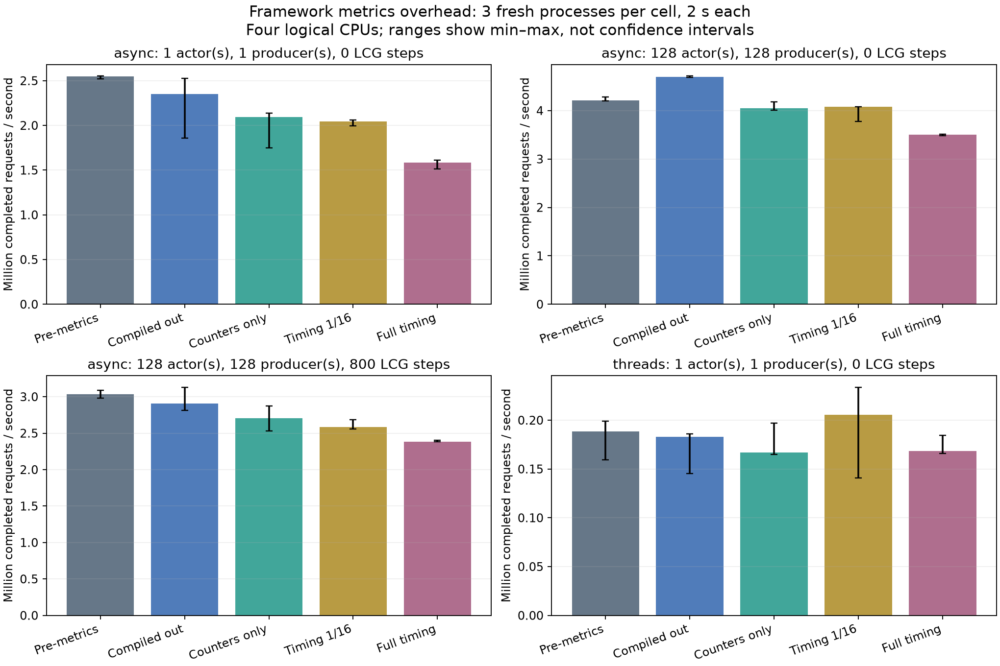
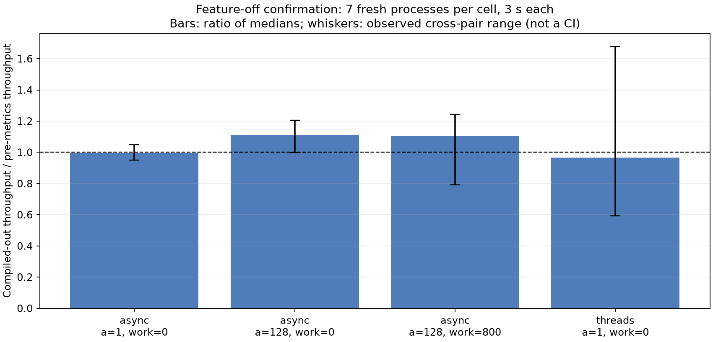

# Framework metrics: behavior, overhead and reproduction

Measured 2026-11-06 on fede: AMD Ryzen 9 9950X3D, 32 logical CPUs; each process
restricted to logical CPUs 2,3,4,5. Rust 1.93.0, ordinary `--release`, empty
RUSTFLAGS, four build jobs. The host is shared; other users' jobs were not stopped.
Effective benchmark nice was **19**, not the outer driver's recorded 10; see
[data errata](data/ERRATA.md). No exporter runs during the timed loop.

The initial study has 60 fresh processes: four cases × five configurations ×
three repeats, two seconds each. A clean feature-off confirmation has 56 fresh
processes: four cases × two configurations × seven repeats, three seconds each.
Order is shuffled with fixed seeds. Another 56-process confirmation overlapped
our release compilation and is archived **excluded**, not used in any summary.

The driver uses closed-loop high-level typed request/reply. Async runs use four
Tokio workers; native synchronous actors use OS threads. Each producer addresses
one actor. Work is zero or 800 dependent LCG steps. Actor startup/warmup and
shutdown are outside throughput timing; final gauge/conservation checks run after
shutdown. This is a small framework-overhead experiment, not a client workload,
fixed-arrival SLO, queue-backlog, latency-quantile or memory-allocation benchmark.

## Initial throughput

Median completed requests/second (millions); ranges are in [SUMMARY.csv](SUMMARY.csv).

| Case | Pre-metrics | Compiled out | Counters only | Timing 1/16 | Full timing |
|---|---:|---:|---:|---:|---:|
| Async, 1 actor/producer, no work | 2.550 | 2.352 | 2.092 | 2.047 | 1.584 |
| Async, 128 actors/producers, no work | 4.212 | 4.694 | 4.049 | 4.075 | 3.500 |
| Async, 128 actors/producers, 800 steps | 3.037 | 2.909 | 2.704 | 2.587 | 2.386 |
| Native threads, 1 actor/producer, no work | 0.189 | 0.183 | 0.167 | 0.206 | 0.168 |



Full timing lowers throughput by approximately 18–33% versus the new compiled-out
build in these async cases. Sampling reduces clock/histogram work, but counters,
shared atomic contention and envelope metadata still have a cost. Counts-only is
not guaranteed to outperform sampling in three noisy repeats. Native results are
particularly variable; the apparent sampled win is not evidence that collecting
metrics accelerates native actors. Choose a sampling rate using application
measurements, not a universal overhead estimate from this table.

## Feature-off confirmation

| Case | Pre-metrics req/s | Compiled-out req/s | Ratio of medians |
|---|---:|---:|---:|
| Async, 1 actor/producer, no work | 2,468,360 | 2,459,104 | 0.996 |
| Async, 128 actors/producers, no work | 4,089,243 | 4,549,370 | 1.113 |
| Async, 128 actors/producers, 800 steps | 2,956,730 | 3,265,668 | 1.104 |
| Native threads, 1 actor/producer, no work | 167,024 | 161,237 | 0.965 |



The single-actor async control is essentially unchanged in the confirmation.
Many-actor runs are faster for the new default source, but this comparison includes
the enqueue-helper/code-generation change as well as the disabled instrumentation.
It does not isolate a cause or justify a general speedup claim. Native min–max
ranges are broad. There is no consistent slowdown across these cases, and this
short shared-host study cannot establish equivalence or a client regression bound.

The task ActorRef remains 72 bytes with metrics compiled out (same as baseline),
and is 80 bytes with collection enabled in these builds. Enabled metrics add one
shared atomic depth allocation per actor and inline per-envelope observations;
there is no additional per-message metrics heap allocation, global actor registry
or label map. This is source/layout evidence, not a measured total-RSS guarantee.

## Source and reproduction

Baseline is `bfa1bafa91c0b1ec5256fb5938dc4f2c772c48b6`. Only the identical driver and
its bench manifest entry were added to the baseline worktree. Measured source is
`de68ec9f`; [bench-source.bundle](bench-source.bundle) preserves its review history.
The release's runtime implementation matches that source; later changes add
version metadata, documentation, tests and CI. Compare source before attributing
results to a particular optimization.

From a Spawned clone containing the baseline:

```sh
git fetch research/framework-metrics/2026-11-06/bench-source.bundle refs/archive/metrics-bench
git worktree add --detach /tmp/spawned-metrics-source FETCH_HEAD
python3 research/framework-metrics/2026-11-06/run.py \
  --source /tmp/spawned-metrics-source --out /tmp/spawned-metrics-run \
  --cpus 2,3,4,5 --nice 19 --seconds 2 --replicates 3
# Run without concurrent builds/tests on the selected CPU mask.
python3 research/framework-metrics/2026-11-06/confirm.py \
  --out /tmp/spawned-metrics-run --cpus 2,3,4,5 --nice 19
```

Select CPUs appropriate for the machine. Scripts create an isolated baseline
worktree under the output directory, build frozen executables, then run fresh
processes serially. Run from a shell with the intended compiler/linker dependencies.
The initial actual runner is preserved as [run-original.py](run-original.py);
the reusable runner adds path/priority arguments and correct effective-nice
metadata. Process commands, build artifacts, compiler/hardware metadata, raw CSV,
stdout/stderr and excluded-run notes are in [data](data/). The confirmation uses
the frozen original executables; binaries themselves are not committed.

To rebuild tables and plots, install [requirements.txt](requirements.txt), place
new raw/confirmation CSV in a copy of this folder's `data`, and run `report.py`.
SVG IDs/date metadata are fixed. Observed min–max ranges and cross-pair ratios
are not confidence intervals; no hypothesis test is claimed.

## Validation and review

The release tag has byte-identical crate sources/manifests to gated source
`2d74a168`, which passed the workspace suite both with all features and
with default features, plus Clippy for both configurations. There are 149 passing
all-feature library tests, the public macro tests, three isolated metrics
integration processes and a metrics documentation test. Tests cover depth,
queue/handler timing, direct and protocol-generated requests in both modes,
reply/drop/timeout outcomes, rejected/discarded messages, panic, runtime abort
before/during handling, clock-free and sampled collection, and quiescent accounting.

The leaf crates packaged successfully; the concurrency package file list includes
its metrics source and tests. Final registry packaging/verification happens in
dependency order during the existing release workflow. Execution logs and the
focused independent Agy review are in [evidence](evidence/). The static review
found no blockers, did not execute tests, and lists boundaries checked separately
by the maintainer. A prior broad attempt produced only preambles and is not an
approval. Review and tests are not a proof of every schedule.

See [metrics usage and limits](../../../docs/METRICS.md) for exported definitions,
sampling bias and raw receiver limitations. Oldest-message age, active-monitor
counts, causal tracing and an instrumented client workload remain separate work.
