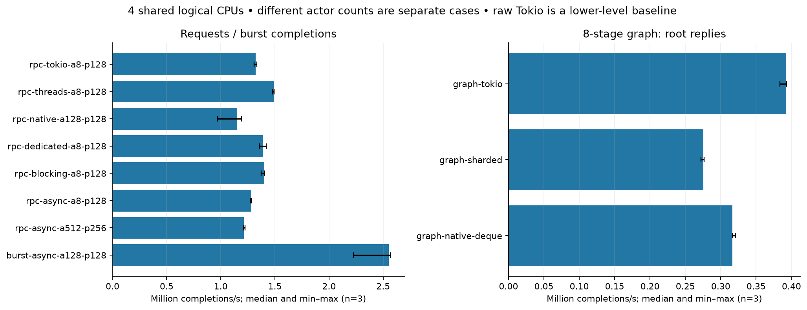
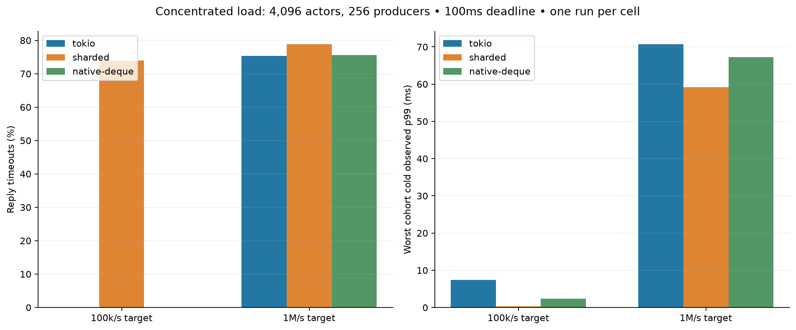
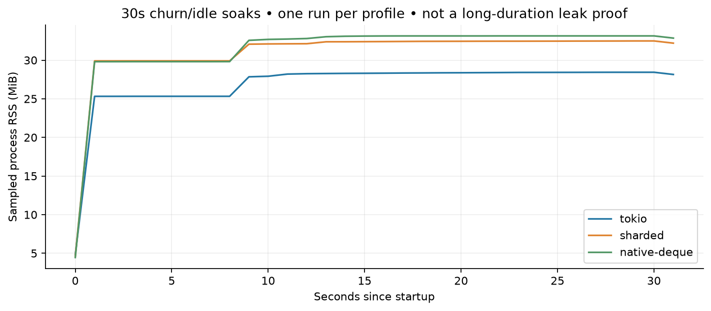

# Failure coverage, larger-producer workloads and capability examples

Measured on fede-256gb, 2026-11-06. This campaign adds reliability evidence and
application examples; it does not add production backends or change actor APIs.
The [capability guide](../../../../examples/capabilities/README.md) demonstrates what
works today. The [roadmap](../../../../ROADMAP.md) and
[ranked backlog](../../../../ROADMAP.md#ranked-backlog) describe future work.

## What we learned

- All nine controlled failure windows passed on four execution modes. Independent
  request histories and finite handler-progress replays found no new production
  library failure in this campaign. Passing these bounded checks is not a proof
  of race freedom or a complete deterministic runtime simulation.
- Caller timeout/drop does not cancel or roll back an actor's effect. This is
  deliberately exercised, including the effect-before-reply failure window.
- A real benchmark-driver defect surfaced with 256 producers: descriptor
  exhaustion caused a worker to panic before a barrier, leaving other scoped
  threads waiting forever. Startup now aborts the rendezvous on participant
  failure, closes epoch waiters on unwinding and stops the sampler. The outer
  process watchdog remains necessary: subprocess setup itself has no timeout.
- Collector runtimes need timers, not I/O reactors. Removing unused I/O drivers
  lets the full offered-load generator fit the normal 1,024-descriptor limit.
  This is a research-harness correction, not a production backend optimization.
- Backend tradeoffs remain workload-dependent. Tokio led root throughput in this
  cross-shard graph. At moderate concentrated load, static sharding protected cold
  cohorts but timed out many hot requests; the lower cold tail is not a universal
  win. These profiles should remain experiments pending a client workload.

## Correctness and failure coverage

| Check | Campaign | Result |
|---|---|---|
| Semantic failure windows | 9 windows × 4 modes | All reached and passed; see [coverage](raw/stress/failure-coverage.txt) |
| Independent request histories | 128 cases/mode, 512 total + checker negative controls | Passed |
| Finite progress model | 125 reachable states; 500 witness replays on real backends | Passed |
| Seeded progress scripts | 256 seeds × 4 modes, audited normalized digests | Passed; controls handler gates, not arbitrary scheduling |
| Unique payload stress | 128 producers × 256 owned 1KiB payloads × drain/discard × 4 modes | 262,144 payloads; delivery/drop assertions passed |
| Generated scenarios and churn | 256 generated inputs; 100 churn rounds | Passed |
| Loom | Actual CancellationToken and experimental ready gate | Passed within configured models |
| Abrupt process failure | Owned child abort and kill after effect | Passed in workspace tests; no cleanup/rollback/durability promise |
| Startup failure regression | Invalid worker affinity and child-only low FD limit | Expected nonzero exit promptly; no watchdog intervention |
| Workspace / Clippy | Default and all features; all targets | Passed |
| Capability examples | Five finite programs with assertions | Passed; final source recorded in example evidence |

Four modes mean Tokio async, Tokio blocking pool, tasks Backend::Thread and native
synchronous threads. The finite model has three actors, two messages per actor,
cooperative completion of an in-flight handler and discard of queued work on
normal stop. It does not simulate all timer, monitor, link or scheduler events.
Timeout/closed-reply operations are unknown effects in the independent history
oracle; only proven enqueue rejection permits no effect. The oracle has explicit
operation/state bounds and treats exhaustion as failure/inconclusive.

## Measurement conditions

Ryzen 9 9950X3D host, 32 logical CPUs; this campaign and its watchdog share logical
CPUs **2–5**, effective nice **10**, empty `RUSTFLAGS`, Rust **1.93.0**, four actor
workers where applicable. See [hardware/compiler metadata](raw/bench/metadata.json).
Clippy used the available Rust/Clippy **1.98.1** pair, recorded per command; tests
and measured binaries used 1.93.0. This was a shared host, without exclusive
physical-core/SMT/NUMA control or system-wide perf counter claims.

Each baseline has 65,536 messages, 512 warmups, a shared 64-byte Arc payload and
800 synthetic LCG iterations. Independent correctness stress uses unique payloads;
baseline payload bytes are not 65,536 separately allocated 64-byte vectors.
Baseline cases are shuffled across three fresh processes; graph profiles have
three fresh processes in fixed profile order. Ranges below are observed min/max,
not confidence intervals. No old/new library version A/B comparison was run.
`tokio` in the baseline table is a lower-level handwritten mailbox loop, not a
Spawned public backend with matching lifecycle features.

Graphs use 4,096 actors, 256 logical producers multiplexed over four async caller
threads, cross placement, eight-stage chains and 65,536 roots (524,288 handler
invocations). Reported graph throughput counts root replies, not handler turns.

Offered load uses 4,096 actors, 256 OS producer threads and 256 collectors, all
sharing CPUs 2–5 with the actor workers. The default 768-thread watchdog ceiling
allows the generator; it is not a 768-core actor runtime. Every fifth request is
cold; the other 80% target four hot actors with 50,000 synthetic iterations versus
800 for cold work. Concentrated placement puts hot actors on one static shard;
Tokio can schedule separate hot actors across workers. The two target rates are
100k/s and 1M/s, but generator lag means achieved arrival rates can differ. The
100ms deadline is measured from intended arrival. Late work is fenced/drained,
not cancelled. One run per profile/rate cannot establish a stable capacity limit.
Cold observed p99 includes timer/observer delays, avoiding a survivors-only
latency claim; the plotted worst cohort is max(shard-0, other cold cohort), not
max individual actor p99. Full fields include per-actor worst cold tail and losses.

## Results

| Baseline case | Completions/s, median [min–max] | Completion p99 ms, median |
|---|---:|---:|
| burst-async-a128-p128 | 2,552,109 [2,223,490–2,567,736] | 12.914 |
| rpc-async-a512-p256 | 1,212,744 [1,208,451–1,224,068] | 0.525 |
| rpc-async-a8-p128 | 1,283,660 [1,273,752–1,285,574] | 1.031 |
| rpc-blocking-a8-p128 | 1,400,217 [1,373,317–1,401,137] | 0.510 |
| rpc-dedicated-a8-p128 | 1,386,677 [1,356,872–1,418,835] | 0.532 |
| rpc-native-a128-p128 | 1,152,613 [969,460–1,190,766] | 0.134 |
| rpc-threads-a8-p128 | 1,487,653 [1,477,055–1,491,232] | 0.148 |
| rpc-tokio-a8-p128 | 1,323,434 [1,307,345–1,332,274] | 0.918 |

| Graph profile | Root replies/s, median [min–max] | Observed p99 ms, median |
|---|---:|---:|
| graph-native-deque | 316,534 [316,430–320,830] | 4.288 |
| graph-sharded | 275,609 [271,882–276,603] | 1.826 |
| graph-tokio | 392,454 [383,375–392,967] | 3.762 |

| Offered-load case | Reply timeouts | Worst cold cohort observed p99 ms |
|---|---:|---:|
| offered-native-deque-100000 | 0 / 65536 | 2.340 |
| offered-native-deque-1000000 | 49521 / 65536 | 67.218 |
| offered-sharded-100000 | 48482 / 65536 | 0.332 |
| offered-sharded-1000000 | 51643 / 65536 | 59.227 |
| offered-tokio-100000 | 0 / 65536 | 7.435 |
| offered-tokio-1000000 | 49381 / 65536 | 70.682 |





The sharded 100k/s case times out 48,482 hot requests while protecting cold traffic;
read its cold tail together with its loss count. At 1M/s every profile loses most
hot replies to the deadline. Timeout is an observation outcome, not proof that
work did not execute. This supports explicit admission/placement policies rather
than an unconditional backend switch.



Each profile ran a 30-second soak with 4,096 idle actors and batches of 256 churn
actors. Started/stopped/dropped counts agree after completion. Sampled RSS and
short runs cannot prove absence of long-term leaks; allocator retention differs.
The [raw soak CSV](figures/soak.csv) records final counts, elapsed time and sampled
resource peaks. SVG versions accompany every figure.

## Reproduce and inspect

From the repository root on Linux, choose an available CPU mask:

```sh
python3 benchmarks/run_reliability.py --source . --out /tmp/spawned-reliability --cpus 2,3,4,5 --phase all --seconds 30 --replicates 3
python3 benchmarks/report_reliability.py --input /tmp/spawned-reliability --out /tmp/spawned-reliability-report
```

Plotting requires matplotlib. The measured environment used matplotlib 3.11.2 and
NumPy 2.5.4. `--phase tests`, `stress`, `startup` or `bench` can run separate parts.
Use `--clippy-rustc`/`--clippy-rustdoc` only when the installed Clippy pair differs.
Run [examples](../../../../examples/capabilities/README.md) with the listed Cargo
commands; CI also executes them. Resource budgets are adjustable and recorded.
Builds allow 2GiB sampled aggregate RSS; runtime stress defaults to 512MiB, 768
threads and 2,048 descriptors, with phase-specific time limits. Sampling can miss
brief peaks and can double count shared pages across processes.

- [Completed benchmark commands/resources](raw/bench/runs.json) and raw CSV logs.
  Source: `a4d375a7`; [source bundle](evidence/benchmark-source.bundle) retains
  that revision and test/driver history relative to an existing Spawned clone.
- [Completed final checks](evidence/checks/runs.json), including per-command
  compiler overrides, and [startup regressions](evidence/startup/runs.json).
  Source: `e73ed359`; [validation bundle](evidence/validation-source.bundle).
- [Examples evidence](evidence/examples): final source/build commands are recorded
  alongside stdout. Examples were strengthened after the main workspace checks.
- [Independent Agy reliability review](evidence/agy-reliability-review.json): no
  blockers on supplied tests/runner. This review preceded the startup-driver fix;
  it is not approval of later code or a claim the reviewer executed tests.
- [Report generator](../../../../benchmarks/report_reliability.py) validates expected
  completed case counts and emits tables/CSV/JSON/PNG/SVG. `SHA256SUMS` covers the
  archived study files; source revision and immutable data distinguish reruns.

## Excluded preflights

None of these runs contribute performance points above:

1. [Compilation-budget preflight](raw/excluded/compile-budget): the watchdog
   applied a 512MiB executable budget while Cargo was compiling stress tests.
   Compilation crossed it; build and execution budgets are now separate.
2. [Startup hang](raw/excluded/startup-hang): FD exhaustion before the old barrier
   stranded the offered-load process; the watchdog killed only its owned group.
3. [Fail-fast startup](raw/excluded/startup-fast-failure): the repaired rendezvous
   exited in roughly 0.24s after actual EMFILE, but unused collector I/O reactors
   still exceeded the FD limit. Removing those unused reactors made the subsequent
   full matrix complete. The failure is retained as fault-path evidence.

These distinctions prevent a resource/tooling failure from being reported as an
actor correctness bug or an incomplete campaign from looking like a benchmark win.
