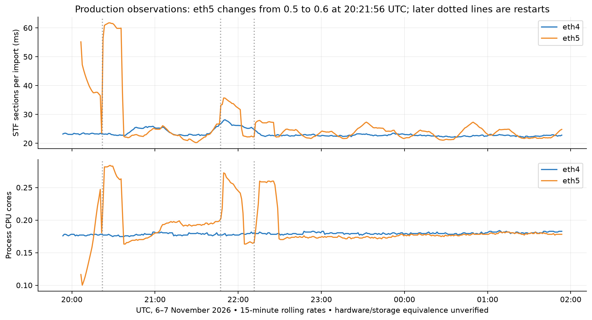
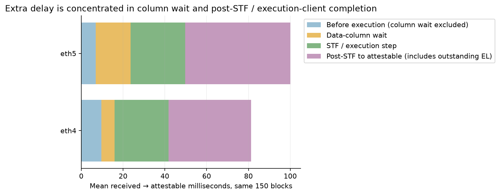
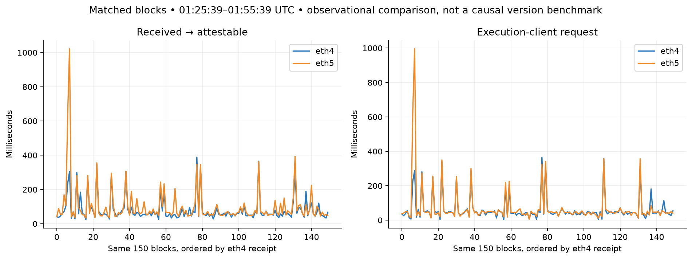

# Ethlambda eth4 / eth5: startup effects and a matched-block comparison

Read-only production observations, 6–7 November 2026 UTC. This is **not a
controlled Spawned version benchmark** or evidence of a causal scheduler change.
Data came from the public [A/B dashboard](https://metrics.ethlambda.xyz/d/ethlambda-ab/ethlambda-a-b)
through its existing Prometheus and ClickHouse query APIs. No node, runtime,
datasource or dashboard configuration was changed.

## Findings

The large early regressions cannot all be attributed to Spawned 0.6:

- eth4 ran build `4117c5a`, with Spawned 0.5.0, continuously from
  **2026-11-05 21:55:19 UTC**.
- eth5's first observed process started **20:05:22** on November 6, running build
  `f96f949` with Spawned **0.5.0**. Elevated startup timings already appear
  before the 0.6 deployment. The largest early peak follows that deployment;
  it must not be described as entirely an old-version spike. Fifteen-minute
  rolling rates straddle both processes and their startup periods.
- eth5 switched to build `5259dee` / Spawned 0.6.0 at **20:21:56**, then restarted
  at **21:47:11** and **22:11:32**. At the original linked window's end,
  22:16:53, it had only 5m21s uptime; eth4 had 24h21m34s.
- The six-hour view mixes a different old build, multiple startups, cache/peer
  warm-up and steady operation. Fifteen-minute rolling histograms also retain
  earlier slow events after the event itself has passed.

These timestamps are derived from historical `lean_node_start_time_seconds` and
`lean_node_info`; [archived start data](data/starts.json) and
[version data](data/versions.json) preserve the exact queries and responses.
The original user link covered 16:16:53–22:16:53 UTC; later screenshots covered
approximately 19:53–01:53 UTC. They are different windows.



The recent window is healthier, but a residual end-to-end difference remains.
We matched **the same 150 block roots** received by both nodes between
**2026-11-07 01:25:39 and 01:55:39 UTC**, using the dashboard's per-block event
reconstruction. Both returned 150 rows with no unmatched roots. This removes
block-content differences, but not network arrival, node storage/cache state,
execution-client behavior or machine differences.

| Same 150 blocks: mean elapsed time | eth4 | eth5 | eth5 − eth4 |
|---|---:|---:|---:|
| Received → attestable | 81.28 ms | 99.97 ms | +18.69 ms |
| Before execution, excluding column wait | 9.58 ms | 6.87 ms | −2.71 ms |
| Data-column wait | 6.36 ms | 16.74 ms | +10.38 ms |
| STF / execution step | 25.84 ms | 26.18 ms | +0.34 ms |
| Post-STF → attestable | 39.49 ms | 50.18 ms | +10.69 ms |
| Execution-client request, overlapping other work | 61.80 ms | 71.06 ms | +9.26 ms |
| Actual `get_head` computation | 0.237 ms | 0.231 ms | −0.006 ms |

The first four component rows after total reconstruct the total. The execution-
client request overlaps the other phases: **do not add it again**. The field
called `head_ms` in the dashboard SQL is post-STF until attestable, not pure
fork-choice CPU time. Outstanding EL completion and applying the answer can be
part of it. The actual `get_head_ms` is a separate measurement.



For the largest eth5 outlier (slot **15,599,234**), received-to-attestable was
**1,021.65 ms**, and its execution-client request lasted **995.87 ms**. Eth4's
same block took 304.94 ms with a 287.93 ms EL request. The next eth5 outlier also
tracks a slower EL answer (642.72 ms total, 634.62 ms EL). This points to an
execution-client path worth investigating; it does not identify the cause of
that path's latency or exonerate instrumentation/scheduling without an experiment.



Empirical nearest-rank p99 over the 150 matched blocks was **365.15 vs 642.72 ms**
for total, and **358.76 vs 634.62 ms** for EL request time. With 150 observations,
p99 is determined by very few blocks. These empirical percentiles differ from
Prometheus's bucket-interpolated, rolling p99; they should not be interchanged.
The [paired summary](data/paired-summary.json) includes sample counts, means,
medians, p99, maxima and paired mean/median differences.

## Other useful observations

At 01:55:39 UTC, using a trailing 30-minute `increase`:

| Dashboard import-phase mean per event | eth4 | eth5 |
|---|---:|---:|
| `total` | 43.32 ms | 51.44 ms |
| `stf` | 25.90 ms | 26.25 ms |
| `fcu` | 1.32 ms | 12.66 ms |
| `queue` | 8.86 µs | 9.92 µs |
| `columns_wait` | 21.16 ms | 32.61 ms |

These rows have different event populations and overlapping phases; they are not
an additive block breakdown. For example, the estimated FCU event counts were
195.25 vs 227.80 while total imported-block counts were 149.49 on both. Fractional
counts come from Prometheus extrapolation. Use matched block events for additive
per-block reasoning, not a sum of this dashboard table.

Every observed queue event in this warm window fit the first **1 ms** histogram
bucket. Flat p50=500 µs and p99=990 µs are linear interpolation within that bucket,
not measurements establishing those exact percentiles. The much smaller mean
comes from `_sum / _count`. Bucket bounds limit what the chart can resolve.
See [raw queue buckets](data/queue-buckets.json).

The sampled 01:25–01:53 window showed similar beacon process CPU (~0.181 vs 0.179
cores) and thread counts (~157 each), and lower eth5 RSS (~2.58 GiB vs ~2.84 GiB).
The database-size gauge differed substantially (~1.84 vs ~12.11 GiB), consistent
with different retained data/history. These are observations, not proof of equal
hardware, disk/cache conditions, EL configuration or host-wide CPU availability.
Beacon process CPU excludes the execution client and other host processes.

## Follow-up: separate answer arrival from actor application

The per-block rows also permit `attestable - el_verdict`: equivalently
`total_ms - before_ms - columns_wait_ms - el_ms`, since the SQL's execution-start
anchor is `el_sent` on these 150 blocks. Mean answer-to-attestable was **3.53 ms**
on eth4 and **5.30 ms** on eth5. The worst eth5 total-latency block applied its
answer only **0.087 ms** after the request task recorded that answer; its large
995.87 ms request interval therefore did not occur waiting in the actor's reply
mailbox. That localizes the large outlier without identifying the cause of the
request interval.

The [request span begins before the helper task is spawned](https://github.com/lambdaclass/ethlambda/blob/5259dee25b81cc5275a4b0f441f24361d4f4b940/crates/blockchain/src/beacon_new_payload.rs#L369),
and [the answer timestamp precedes the actor message](https://github.com/lambdaclass/ethlambda/blob/5259dee25b81cc5275a4b0f441f24361d4f4b940/crates/blockchain/src/beacon_new_payload.rs#L530).
It includes task scheduling, request construction, network/server work and client
wakeups. It is not a pure EL-server CPU measurement. The separate
[`timed_new_payload` wrapper](https://github.com/lambdaclass/ethlambda/blob/5259dee25b81cc5275a4b0f441f24361d4f4b940/crates/blockchain/src/beacon_engine.rs#L238)
starts inside that task, around awaiting the client call. Its trailing 30-minute
sum/count gives approximately **62.25 vs 71.63 ms** (149.49 extrapolated events
on each node), consistent with a gap inside the wrapped call. Those counter-based
means are not the exact matched 150-block sample and cannot establish a precise
helper-scheduling difference.

Similarly, column wait ends when the actor observes that its required columns
are present, not at an independently measured network receipt of the last byte.
FCU timing surrounds the awaited request and verdict application. To distinguish
network/server/disk delay from client scheduling, add or consult transport/server
spans with correlated block/request IDs. No such EL-server evidence was obtained
in this study, and no causal latency fix is claimed.

## What differs between builds

[Compare `4117c5a` to `5259dee`](https://github.com/lambdaclass/ethlambda/compare/4117c5aef5ca3b916c3d871cea042805b57a4e88...5259dee25b81cc5275a4b0f441f24361d4f4b940):
three commits ahead. The branch updates Spawned, enables its metrics feature,
appends the framework collector to the RPC metrics endpoint, updates the lockfile
and fixes unrelated preset-dependent tests. There is no identified new mainnet
state-transition algorithm in this source diff. The historical `f96f949` process
is a third build and must not be silently treated as the 0.6 build.

The [eth5 metrics documentation](https://github.com/lambdaclass/ethlambda/blob/5259dee25b81cc5275a4b0f441f24361d4f4b940/docs/metrics.md#actor-runtime-spawned)
explicitly leaves `timing_sample_every=1`. Thus the upgrade also enables full
framework timing. Prior [microbenchmarks](../../framework-metrics/2026-11-06/README.md)
showed measurable timing overhead, so a version-only attribution needs a metrics-
off/counters-only/full comparison. The current data does not establish that this
is responsible for the residual production gap.

The per-actor machine-sized Tokio runtime exists in
[Spawned 0.5](https://github.com/lambdaclass/spawned/blob/v0.5.0/rt/src/threads/mod.rs#L29)
and 0.6. Fixing its resource model is worthwhile, but it was not introduced by the
upgrade and this dashboard has not measured the new fix.

## Next discriminating checks

1. Keep deployment/restart annotations and compare only a named, warmed interval
   with matching versions, peer count and block roots. Do not mix `now-6h`
   screenshots with the original absolute window.
2. Investigate the slow EL blocks: newPayload timing, execution-client identity,
   host load, disk/cache and `forkchoiceUpdated` latency. Compare data-column
   arrival/completeness for the same roots. This requires additional node/EL
   evidence; the dashboard alone does not establish those configurations.
3. Run Spawned 0.6 with metrics off versus full timing on an otherwise identical
   workload/configuration, then a matched 0.5 baseline. Swap node roles or replay
   the same trace to reduce host and startup bias. Keep valid response/missing-
   verdict counts and event populations alongside latency.

No production changes were made as part of this observation. Hardware/EL parity,
exact causal attribution and a controlled client replay remain open.

## Reproduce

`metadata.json` fixes the node labels and UTC windows. The JSON under `data/`
contains each PromQL expression and its API parameters; the ClickHouse request
contains the dashboard-derived bounded SELECTs. Query using anonymous read-only
access to the dashboard's datasource proxies and `/api/ds/query`. Do not treat the
post-STF field as CPU time, add overlapping intervals or aggregate percentiles
from rolling windows as a single whole-window percentile.

```sh
python3 research/client-observations/2026-11-06-ethlambda-ab/plot.py
```

Plotting requires matplotlib. PNG and SVG figures are retained together with raw
responses. Internal instance/host/container labels were removed before archiving;
no credentials or datasource configuration are included. `SHA256SUMS` covers the
archived files. This report does not claim a controlled backend or release test.
